# Data Analysis: Meaning, Importance, and the Complete Data Analysis Life Cycle

Data analysis is one of the most important foundations of **Data Science, Machine Learning, Artificial Intelligence, and Business Intelligence**. Before building a machine learning model or an AI application, we often need to understand the data, identify patterns, discover problems, and extract useful information from it.

The central purpose of data analysis is simple:

> **To convert raw data into meaningful information that helps people understand situations, solve problems, and make better decisions.**

We will learn this from the basics, using practical examples, diagrams, flowcharts, and Python-oriented explanations.

## 1. What is Data Analysis?

**Data Analysis** is the systematic process of collecting, cleaning, transforming, exploring, and interpreting data to discover useful information, identify patterns, draw conclusions, and support decision-making.

Let's understand the definition through its important parts:

| Activity | Meaning |
|---|---|
| Collecting data | Gathering data from different sources |
| Cleaning data | Finding and correcting errors, duplicates, missing values, and inconsistencies |
| Transforming data | Converting data into a suitable format for analysis |
| Exploring data | Studying data to understand its structure, distribution, and patterns |
| Interpreting data | Understanding what the results actually mean |
| Drawing conclusions | Reaching evidence-based findings |
| Decision-making | Using findings to choose an appropriate action |

### A simple example

Imagine that you own an online shopping store. You have collected information about 10,000 customer orders.

Your raw data might look like this:

| Order ID | Product | City | Amount | Rating |
|---|---|---|---:|---:|
| 101 | Laptop | Delhi | ₹55,000 | 5 |
| 102 | Mobile | Ludhiana | ₹20,000 | 4 |
| 103 | Headphones | Delhi | ₹2,000 | 3 |
| 104 | Laptop | Mumbai | ₹60,000 | 5 |
| 105 | Mobile | Ludhiana | ₹22,000 | 4 |

At first, this is just a collection of records. By analysing it, you might discover:

- Laptops generate the highest revenue.
- Delhi has a large number of orders.
- Mobile phones receive consistently good ratings.
- Certain products sell better in particular cities.

These findings can help the business decide which products to promote, where to invest in marketing, and how to improve customer satisfaction.

**The basic idea**

| Raw data | Useful insights |
|---|---|
| 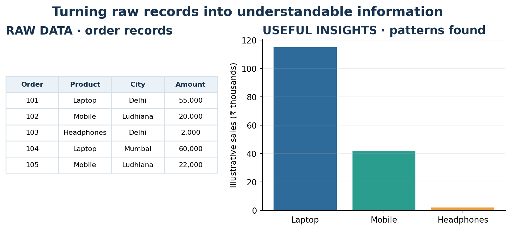 |  |
| **Unprocessed records** | **Patterns and findings** |

## 2. What is the Difference Between Data, Information, and Insights?

These three terms are related, but they are not the same.

**1. Data:** Raw facts and figures without necessarily having a meaningful context.

Example: `450, 520, 610, 700, 820`

**2. Information:** Data that has been organised or processed so that it has meaning.

Example: Monthly sales were ₹450, ₹520, ₹610, ₹700, and ₹820 thousand.

**3. Insight:** A meaningful interpretation of information that helps explain what is happening and may guide an action.

Example: Sales have increased every month, suggesting that the current marketing strategy may be working.

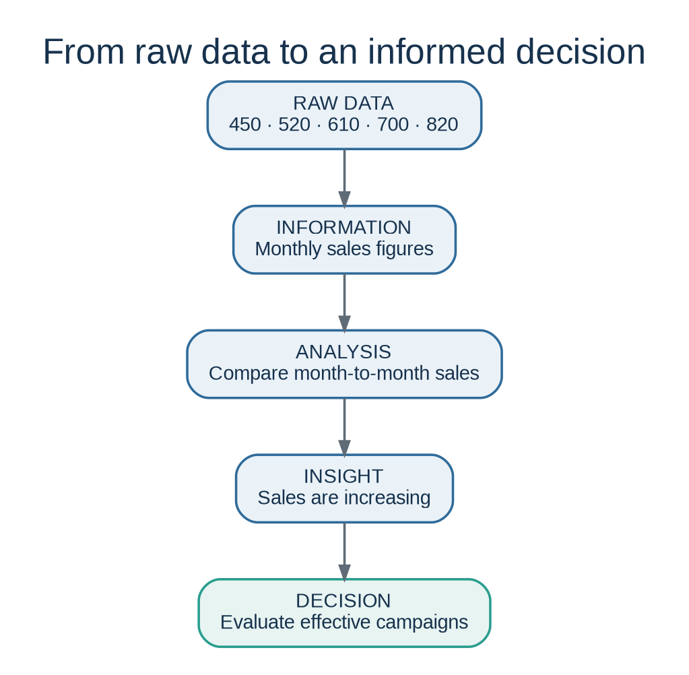

**Remember:** Data is what we have; information is what it means; insight is what we learn from it; and a decision is what we choose to do with that learning.

## 3. Why Is Data Analysis Important?

Today, almost every industry generates a huge amount of data. However, collecting data alone does not create value. We need to analyse it to understand what is happening and what should happen next.

Let's understand its importance.

### 3.1 Better Decision-Making

Businesses, governments, hospitals, educational institutions, and individuals make decisions every day.

Without data analysis, decisions may depend on assumptions, guesses, or personal opinions.

With data analysis, decisions can be supported by evidence.

**Example:**

A college wants to introduce a new course.

Instead of randomly selecting a course, it analyses:

- Students' interests.
- Current industry requirements.
- Job opportunities.
- Previous placement records.
- Student feedback.

The college can use these findings to make a better decision.

### 3.2 Identifying Patterns and Trends

Data analysis helps identify patterns that might not be visible by simply looking at raw records.

**Example:**

An online shopping platform analyses sales over 12 months and discovers that sales increase significantly during festival seasons.

The company can use this information to:

- Increase inventory before festivals.
- Prepare marketing campaigns.
- Offer relevant discounts.
- Improve delivery capacity.

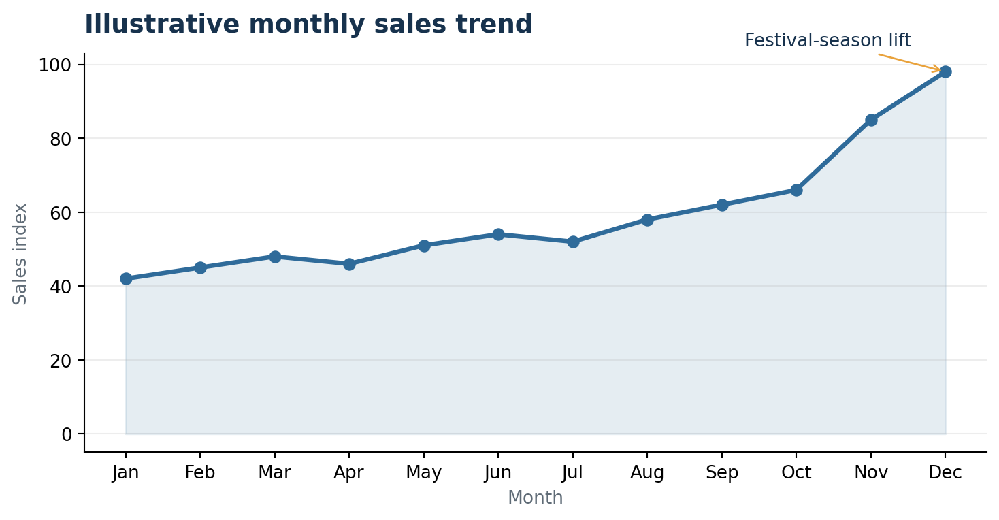

### 3.3 Understanding Customer Behaviour

Businesses need to understand their customers to provide better products and services.

Data analysis helps answer questions such as:

- Which products do customers purchase most frequently?
- Which age groups purchase particular products?
- Why do customers stop using a service?
- Which marketing campaigns generate more customers?
- What makes customers return?

**Example:** Netflix can analyse viewing behaviour to understand which movies and shows different users prefer. Such information can contribute to personalised recommendations.

### 3.4 Improving Business Performance

Data analysis helps organisations measure their performance and identify areas that need improvement.

For example, an e-commerce company can analyse:

| Business Metric | What it tells us |
|---|---|
| Total revenue | How much money the business generates |
| Conversion rate | How many visitors become customers |
| Customer retention | How many customers continue using the service |
| Average order value | Average amount spent per order |
| Customer acquisition cost | Cost of acquiring a customer |
| Return rate | How frequently products are returned |

By analysing these metrics, a company can discover problems and improve its performance.

### 3.5 Detecting Problems and Anomalies

Data analysis can identify unusual activities, errors, and unexpected changes.

Examples:

- A bank detects an unusually large transaction.
- A hospital identifies an unexpected increase in patient admissions.
- A manufacturing company detects an unusual increase in defective products.
- A website experiences a sudden decrease in traffic.

These unusual observations are often called **anomalies or outliers**, depending on the context.

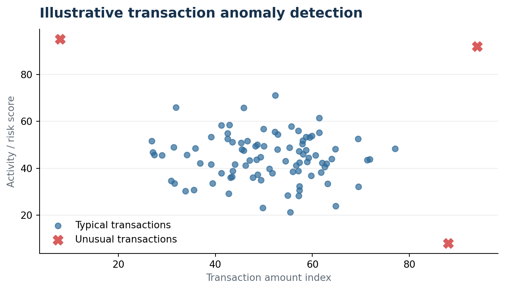

### 3.6 Forecasting and Predicting Future Outcomes

Historical data can help us estimate future possibilities.

For example:

- Predicting next month's sales.
- Estimating future electricity demand.
- Forecasting product demand.
- Predicting customer churn.
- Estimating future inventory requirements.

This is where data analysis becomes closely connected with statistics and Machine Learning.

### 3.7 Reducing Costs and Saving Time

Organisations can analyse operational data to identify unnecessary expenses and inefficient processes.

For example, a delivery company might analyse delivery routes and discover that some routes consistently require more fuel and time.

It can use those findings to improve route planning.

### 3.8 Supporting Artificial Intelligence and Machine Learning

This is particularly important for an AI Engineer.

Machine Learning algorithms learn patterns from data. However, poor-quality data, irrelevant features, and incorrect assumptions can produce unreliable models.

Data analysis helps us:

- Understand available datasets.
- Identify missing and incorrect values.
- Discover relationships between features.
- Understand distributions.
- Detect outliers.
- Identify useful features.
- Evaluate model predictions.
- Understand model performance.

**Example: House Price Prediction**

Suppose we want to develop an ML model that predicts house prices.

We might collect these features:

| Feature | Example |
|---|---:|
| Area | 1,500 sq. ft. |
| Bedrooms | 3 |
| Bathrooms | 2 |
| Location score | 8 |
| Age of property | 5 years |
| House price | ₹75 lakh |

Before training the model, we should analyse whether area, location, number of bedrooms, and other features have meaningful relationships with house prices.

Therefore, data analysis is an important part of the Machine Learning development process.

### Summary: Importance of Data Analysis

| Area | Importance |
|---|---|
| Decision-making | Supports evidence-based decisions |
| Business | Improves performance and profitability |
| Customers | Helps understand customer preferences |
| Research | Helps discover patterns and relationships |
| Healthcare | Helps study health trends and outcomes |
| Finance | Helps assess risks and identify unusual transactions |
| Marketing | Helps evaluate campaigns |
| AI/ML | Helps prepare, understand, and evaluate datasets |
| Forecasting | Helps estimate future outcomes |

---

## 4. What Is the Data Analysis Life Cycle?

The **Data Analysis Life Cycle** is a systematic sequence of stages that an analyst follows to convert a business problem or research question into meaningful insights and actionable decisions.

It describes the complete journey of data, from understanding the initial problem to evaluating the results and improving future decisions.

One important thing to understand:

**Data analysis is not a one-time, straight-line process. It is an iterative cycle.**

Sometimes, during analysis, we discover that the collected data is insufficient. We may need to collect additional data, clean the dataset again, or change our analytical approach.

### 4.1 Complete Data Analysis Life Cycle

We will follow a detailed 10-stage practical framework.

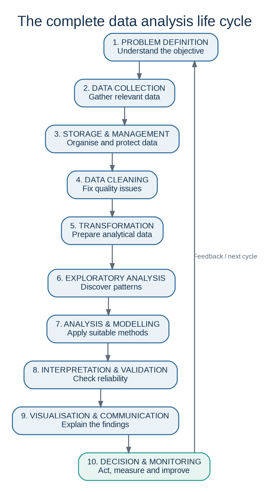

The exact number and naming of stages vary between organisations and educational frameworks. This 10-stage version separates important technical activities that are sometimes combined into fewer stages. [Source references: turn170363search17, turn170363search1, turn170363search0]

Let's understand every stage in detail.

## Stage 1. Problem Definition and Understanding

This is the starting point of every data analysis project.

Before collecting or analysing any data, we must understand **what problem we are trying to solve and why we need the analysis.**

An analyst should never start collecting random data without knowing the purpose of the project.

### 1.1 What happens in this stage?

The analyst performs the following activities:

**A. Understand the problem**

Identify the actual problem that needs to be solved.

Example:

An online shopping company notices that its monthly revenue is decreasing.

The initial problem is:

"Why are our sales decreasing?"

**B. Identify the business objectives**

Determine what the organisation wants to achieve.

For example:

- Identify the reason behind declining sales.
- Find products with decreasing demand.
- Understand customer purchasing behaviour.
- Improve the conversion rate.
- Increase monthly revenue.

**C. Identify stakeholders**

Stakeholders are people or groups who are interested in the analysis or affected by its results.

Examples:

| Stakeholder | Requirement |
|---|---|
| Business owner | Understand revenue decline |
| Marketing team | Understand campaign performance |
| Sales team | Identify poorly performing products |
| Product team | Find problems in the shopping experience |
| Data analyst | Analyse the available data |

**D. Define analytical questions**

Convert the general problem into specific questions that can be answered using data.

For example:

1. Which months experienced a sales decline?
2. Which products have declining sales?
3. Which geographical locations generate the least revenue?
4. Are customers abandoning their shopping carts?
5. Has the conversion rate decreased?
6. Is the decline associated with a particular device or payment method?

**E. Define KPIs (Key Performance Indicators)**

KPIs are measurable values used to evaluate performance against an objective.

Some important business KPIs include:

| KPI | Meaning |
|---|---|
| Total Revenue | Total money generated through sales |
| Conversion Rate | Percentage of visitors who complete a purchase |
| Customer Retention Rate | Percentage of customers who continue purchasing |
| Average Order Value | Average amount spent per order |
| Customer Acquisition Cost | Cost of acquiring a customer |
| Return Rate | Percentage of orders or products returned |

### 1.2 Example

Suppose an online shopping company has the following objective:

**Business problem**

Monthly revenue has decreased by 20%.

**Objective**

Identify the reasons behind the revenue decline and recommend improvements.

**Analytical questions**

- Are website visitors decreasing?
- Are fewer visitors completing purchases?
- Are customers abandoning carts?
- Are particular products responsible for the decline?

**Expected outcome**

A report identifying the main contributing factors and suggesting appropriate actions.

### 1.3 Output of this stage

At the end of this stage, we should have:

- A clearly defined problem.
- Business objectives.
- Specific analytical questions.
- Identified stakeholders.
- Required KPIs.
- Project scope and expected deliverables.

**Important:** A well-defined problem makes the remaining analysis more focused, efficient, and meaningful.

---

## Stage 2. Data Collection

After understanding the problem, the next step is to collect relevant data.

**Data Collection** is the process of gathering raw data from different sources to answer the questions defined in the previous stage.

Data can come from databases, spreadsheets, websites, applications, APIs, surveys, sensors, and many other sources.

### 2.1 Types of Data Sources

Data sources can be divided into two major categories.

**A. Internal Data Sources**

Internal data is generated or maintained within an organisation.

Examples:

- Customer databases.
- Sales records.
- Employee information.
- Company financial records.
- Website traffic logs.
- Inventory management systems.
- Customer support records.

**B. External Data Sources**

External data comes from outside an organisation.

Examples:

- Government datasets.
- Public research databases.
- Social media platforms.
- Market research reports.
- Weather APIs.
- Competitor information.
- Public websites.

**Data source classification**

| Internal Sources | External Sources |
|---|---|
| Company databases | Public datasets |
| Sales records | APIs |
| CRM systems | Surveys |
| Website logs | Government portals |
| Financial records | Research reports |

### 2.2 Common Methods of Collecting Data

**1. Manual Data Collection**

Data is collected manually through forms, questionnaires, observations, and interviews.

Example: A college distributes a Google Form to collect student feedback.

**2. Database Extraction**

Data is retrieved from databases using SQL queries.

Example:

```sql
SELECT *
FROM orders;
```

This query retrieves all records from the `orders` table.

**3. API Data Collection**

An API (Application Programming Interface) allows one application to communicate with another application and retrieve data.

For example, a weather application can retrieve weather information through a weather API.

**4. Web Scraping**

Web scraping is the process of extracting information from web pages using programming tools.

Python libraries commonly used include:

- BeautifulSoup
- Scrapy

Web scraping must follow applicable website terms, access restrictions, and privacy requirements.

**5. File-Based Collection**

Data can be collected from different file formats:

| Format | Description |
|---|---|
| CSV | Comma-Separated Values |
| XLSX | Microsoft Excel workbook |
| JSON | JavaScript Object Notation |
| TXT | Plain text file |
| XML | Extensible Markup Language |
| Parquet | Column-oriented data storage format |

### 2.3 Understand Different Forms of Data

During collection, we also need to understand the kind of data we are collecting.

| Data type | Meaning | Example |
|---|---|---|
| Structured | Organised in a fixed schema or tabular format | SQL tables |
| Semi-structured | Has some organisation but does not follow a fixed tabular structure | JSON, XML |
| Unstructured | Does not have a predefined tabular structure | Images, videos, audio, free-form text |

For example, an e-commerce organisation may collect:

- Customer details from a database.
- Customer reviews from its application.
- Product images from its product catalogue.
- Transaction information from its payment system.

All these different data sources may contribute to the same analysis.

### 2.4 Primary and Secondary Data

Another way to classify data is by how it is obtained.

**Primary Data:** Data collected directly for a particular study.

Examples: Surveys, interviews, experiments, and observations conducted by the researcher.

**Secondary Data:** Data that has already been collected by another individual or organisation and is reused for the current analysis.

Examples: Government reports, published research datasets, and existing company records.

### 2.5 Important Things to Check During Data Collection

Before accepting a dataset, consider:

1. Is the data relevant to the problem?
2. Is the source trustworthy?
3. Is the data sufficiently recent?
4. Does the dataset cover the required population?
5. Are there any collection biases?
6. Do we have permission to access and use it?
7. Are the collected records sufficient for the analysis?

For example, suppose we want to understand the shopping behaviour of customers across India. Collecting information from only 20 customers in one city may not provide a representative picture.

### 2.6 Output of This Stage

At the end of data collection, we should have:

- Raw datasets.
- Information about data sources.
- Data collection documentation.
- Details about the variables collected.
- Permission and access information.
- An initial understanding of data availability.

**Practical example**

Suppose you have collected three files:

`customers.csv`

`orders.csv`

`products.csv`

These files contain customer information, order details, and product information.

They will later be combined to answer questions such as which customer groups purchase which products.

---

## Stage 3. Data Storage and Management

Once data is collected, it must be stored and organised properly.

**Data Storage and Management** refers to the process of storing, organising, maintaining, protecting, and managing data so that it can be accessed and used when required.

Imagine collecting millions of records from different sources without organising them. Finding the necessary information would become difficult.

This stage helps solve that problem.

### 3.1 Common Data Storage Systems

**A. Files**

Suitable for small datasets and beginner-level projects.

Examples:

- CSV
- Excel
- JSON
- Parquet

**B. Relational Databases**

Relational databases store data in tables containing rows and columns.

Examples:

- MySQL
- PostgreSQL
- SQLite
- Microsoft SQL Server

A simplified database structure:

**CUSTOMER TABLE**

| Customer ID | Name | City |
|---:|---|---|
| 1 | Rahul | Delhi |
| 2 | Aman | Ludhiana |
| 3 | Priya | Mumbai |

**ORDER TABLE**

| Order ID | Customer ID | Amount |
|---:|---:|---:|
| 101 | 1 | 5000 |
| 102 | 2 | 3000 |
| 103 | 1 | 2000 |

*Customer ID in the ORDER table connects each order to its customer.*

**C. Data Warehouses**

A data warehouse is designed to store integrated, structured data from multiple sources for reporting and analytical queries.

Examples:

- Google BigQuery
- Amazon Redshift
- Snowflake

**D. Data Lakes**

A data lake is designed to store large volumes of data in different formats, including structured, semi-structured, and unstructured data.

Examples include:

- Amazon S3-based data lakes.
- Azure Data Lake Storage.

### 3.2 What Does Data Management Include?

It includes:

- Organising datasets.
- Maintaining data consistency.
- Managing access permissions.
- Creating backups.
- Maintaining documentation and metadata.
- Protecting sensitive information.
- Tracking data changes and versions.

### 3.3 Important Concept: Metadata

Metadata means **data about data**.

For example, suppose we have a dataset named `customers.csv`.

Its metadata might include:

| Metadata | Value |
|---|---|
| Dataset name | customers.csv |
| Number of rows | 10,000 |
| Number of columns | 6 |
| Creation date | 15 November 2026 |
| Data source | Customer registration system |
| Format | CSV |
| Owner | Customer Analytics Team |

Metadata helps us understand the origin, structure, and meaning of a dataset.

### 3.4 Output of This Stage

We should have:

- Properly stored datasets.
- An organised storage structure.
- Access controls.
- Dataset documentation.
- Backup and recovery arrangements.

**Note:** In small projects, storage and management can be combined with collection or preparation. In larger projects, this stage deserves separate attention.

---

## Stage 4. Data Cleaning

This is one of the most important stages of the entire data analysis life cycle.

**Data Cleaning** is the process of detecting, correcting, handling, or removing inaccurate, incomplete, duplicated, inconsistent, and irrelevant data.

Real-world datasets are rarely perfect.

They may contain:

- Missing values.
- Duplicate records.
- Incorrect data types.
- Inconsistent formats.
- Invalid values.
- Spelling mistakes.
- Unusual observations.

Let's understand each problem.

### 4.1 Missing Values

Missing values occur when some information is not available in a dataset.

Example:

| Name | Age | City | Salary |
|---|---:|---|---:|
| Rahul | 22 | Delhi | 30000 |
| Aman | 24 | Ludhiana | 35000 |
| Priya | — | Mumbai | 40000 |
| Simran | 23 | — | 32000 |

Here, age is missing for Priya, and city is missing for Simran.

**How do we handle missing values?**

Method 1: Remove affected records.

If a record is incomplete and cannot be reliably used, we may remove it, provided doing so does not introduce bias or discard important information.

Method 2: Replace with mean.

For numerical data, we can sometimes replace missing values with the mean.

Example:

Values:

`20, 30, 40, 50, Missing`

Mean:

\[
\text{Mean}=\frac{20+30+40+50}{4}=35
\]

We can replace the missing value with 35 when mean imputation is appropriate.

Method 3: Replace with median.

For skewed numerical data or data with extreme values, median imputation may be more suitable.

Method 4: Replace with mode.

For categorical data, we may replace missing values with the most frequently occurring category.

Method 5: Advanced imputation.

In more complex datasets, we may use statistical methods or ML-based approaches to estimate missing values.

**Important:** We should never automatically replace every missing value with zero. Zero may represent a genuine measurement rather than an absent value.

### 4.2 Duplicate Records

Duplicate records occur when the same observation appears more than once.

Example:

| Customer ID | Name | City |
|---:|---|---|
| 101 | Rahul | Delhi |
| 102 | Aman | Mumbai |
| 101 | Rahul | Delhi |
| 103 | Priya | Ludhiana |

Here, the record for customer 101 appears twice.

If this is an accidental duplicate, it should be handled appropriately to avoid incorrect calculations.

### 4.3 Incorrect Data Types

Sometimes values are stored in an inappropriate data type.

Example:

| Name | Age |
|---|---|
| Rahul | "22" |
| Aman | "25" |
| Priya | "21" |

Age is stored as a string rather than an integer.

This can create problems when performing mathematical operations.

For example, string addition can behave differently from numerical addition.

```python
# Incorrect data type
age = "22"

# Convert into integer
age = int(age)

print(age + 5)
```

Output:

```text
27
```

### 4.4 Inconsistent Data

Sometimes the same information is represented in different ways.

Example:

| City |
|---|
| Delhi |
| delhi |
| DELHI |
| New Delhi |

The first three clearly refer to the same spelling of the city, while New Delhi may or may not need to be grouped with Delhi depending on the analysis.

Other examples:

- `Male`, `male`, `M`.
- `INR`, `Rs`, `₹`.
- `01-11-2026`, `2026/11/01`.

We need standardisation rules based on the dataset's meaning.

### 4.5 Outliers

An outlier is an observation that is unusually far from the other observations in a dataset.

Example:

`20,000, 22,000, 21,000, 23,000, 25,000, 5,00,000`

Here, ₹5,00,000 is much higher than the other values.

Possible reasons:

- Data entry mistake.
- Measurement error.
- Genuine exceptional observation.
- Fraudulent activity.
- A different population or customer segment.

Outliers should be investigated before removing them. They can contain important business information.

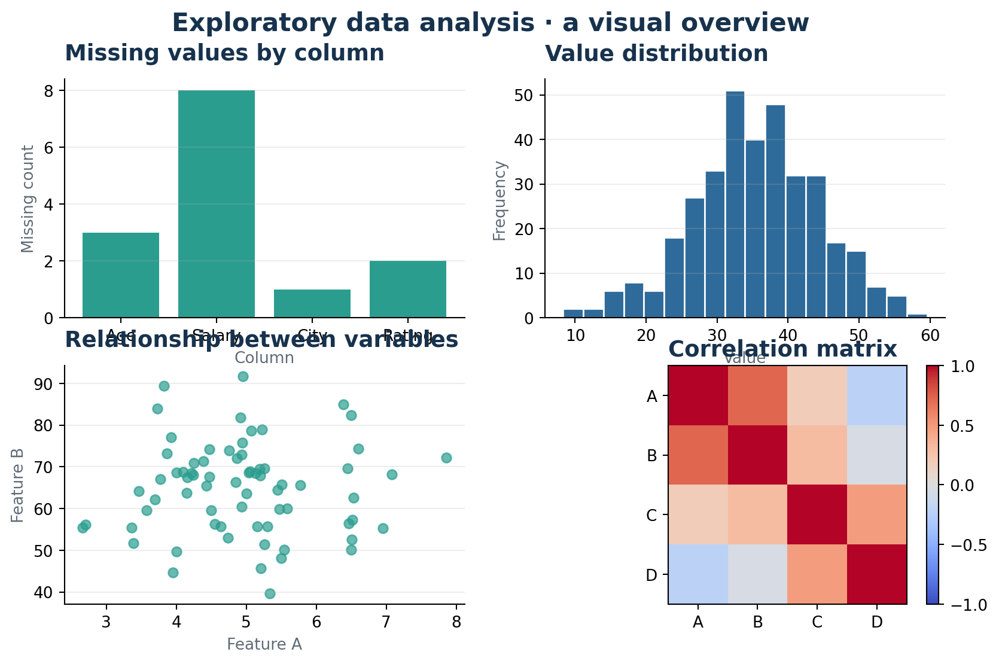

### 4.6 Irrelevant Data

Sometimes datasets contain information that is not required for the current analysis.

For example, suppose we want to identify factors affecting product sales.

A dataset may contain:

- Customer name.
- Product ID.
- Selling price.
- Quantity.
- Sales date.
- Customer favourite colour.

Customer favourite colour may be irrelevant to the current question and can be excluded, depending on the analytical objective.

However, columns should not be removed merely because they seem unnecessary at first glance.

### 4.7 Data Quality Characteristics

Good-quality data should ideally satisfy the following conditions:

| Characteristic | Meaning |
|---|---|
| Accuracy | Values correctly represent reality |
| Completeness | Required information is present |
| Consistency | Values follow compatible rules |
| Validity | Values satisfy defined constraints |
| Uniqueness | Unwanted duplicate records are absent |
| Timeliness | Data is sufficiently up to date |

### 4.8 Data Cleaning Using Python

A small example using Pandas:

```python
import pandas as pd

# Create a sample dataset
data = {
    "Name": ["Rahul", "Aman", "Priya", "Rahul"],
    "Age": [22, 24, None, 22],
    "City": ["Delhi", "Ludhiana", "Mumbai", "Delhi"]
}

df = pd.DataFrame(data)

# Check missing values
print(df.isnull().sum())

# Remove duplicate rows
df = df.drop_duplicates()

# Fill missing age with median
df["Age"] = df["Age"].fillna(df["Age"].median())

# Check the cleaned dataset
print(df)
```

This is only a simple demonstration. In real projects, the correct cleaning strategy depends on the meaning of each column and the reason behind the data-quality problem.

### 4.9 Output of This Stage

At the end, we should have a dataset that is:

- More accurate.
- More consistent.
- Properly formatted.
- Free from unintended duplicates.
- Appropriately handled for missing values and outliers.
- Ready for further analysis.

---

## Stage 5. Data Transformation and Preparation

Data cleaning fixes data-quality problems. Data transformation prepares the data in a suitable structure and format for analysis.

These activities are closely connected, but they are not identical.

**Data Transformation** is the process of converting data from one format, structure, or representation into another format that is more suitable for a particular analytical task.

### 5.1 Filtering Data

Filtering means selecting only the records that satisfy particular conditions.

Example:

Suppose we have 10,000 customer records, but our analysis requires only customers from Punjab.

We can filter those records.

```python
punjab_customers = df[df["State"] == "Punjab"]
```

### 5.2 Selecting Relevant Columns

We may have 30 columns in a dataset, but our analysis might require only five.

```python
selected_data = df[
    ["Customer_ID", "City", "Product", "Amount", "Date"]
]
```

### 5.3 Changing Data Formats

Example: Converting a date stored as text into a proper date format.

```python
df["Date"] = pd.to_datetime(df["Date"])
```

This allows us to perform date-based operations such as grouping records by month or year.

### 5.4 Standardisation of Values

Suppose product prices are available in different currency units.

Some records are in INR and others in USD.

Before comparing prices, we must convert them to a common currency using an appropriate exchange rate for the analysis.

Similarly, distances might be recorded in kilometres and miles. We should standardise them to one common unit.

### 5.5 Aggregation

Aggregation means combining multiple records to calculate summary values.

Example:

Suppose we have:

| City | Sales |
|---|---:|
| Delhi | 1000 |
| Mumbai | 2000 |
| Delhi | 1500 |
| Mumbai | 2500 |

We can aggregate sales by city:

| City | Total Sales |
|---|---:|
| Delhi | 2500 |
| Mumbai | 4500 |

Using Python:

```python
city_sales = df.groupby("City")["Sales"].sum()
```

### 5.6 Creating New Features

Sometimes, existing columns can be used to create new, more informative columns.

Suppose we have:

| Product Price | Quantity |
|---:|---:|
| 500 | 3 |
| 1000 | 2 |
| 200 | 5 |

We can create a new column called `Total Amount`.

\[
\text{Total Amount}=\text{Product Price}\times\text{Quantity}
\]

```python
df["Total_Amount"] = df["Product_Price"] * df["Quantity"]
```

This process is also called feature creation or feature engineering.

### 5.7 Combining Multiple Datasets

Suppose we have:

**customers.csv**

| Customer ID | Name |
|---:|---|
| 101 | Rahul |
| 102 | Aman |

**orders.csv**

| Order ID | Customer ID | Amount |
|---:|---:|---:|
| 1 | 101 | 5000 |
| 2 | 102 | 3000 |

We can combine these datasets using their common `Customer ID`.

The resulting dataset:

| Order ID | Customer ID | Name | Amount |
|---:|---:|---|---:|
| 1 | 101 | Rahul | 5000 |
| 2 | 102 | Aman | 3000 |

Python:

```python
combined_df = pd.merge(
    customers,
    orders,
    on="Customer_ID",
    how="inner"
)
```

### 5.8 Scaling and Encoding

These techniques are especially relevant when preparing data for Machine Learning.

**Scaling:** Converting numerical features to comparable scales.

For example, house area might range from 500 to 5,000 while the number of bedrooms ranges from 1 to 6.

A scaling method such as Min-Max scaling can convert values into a range such as 0 to 1.

\[
X_{\text{scaled}}=\frac{X-X_{\min}}{X_{\max}-X_{\min}}
\]

**Encoding:** Converting categorical data into a numerical representation.

Example:

| City | Encoded representation |
|---|---:|
| Delhi | 0 |
| Mumbai | 1 |
| Ludhiana | 2 |

This is an example of label encoding. For nominal categories, one-hot encoding may be more appropriate because integer labels can accidentally suggest an ordering that does not exist.

### 5.9 Difference Between Data Cleaning and Data Transformation

| Data Cleaning | Data Transformation |
|---|---|
| Fixes data-quality problems | Changes data representation or structure |
| Handles missing values | Creates new features |
| Removes unintended duplicates | Aggregates records |
| Corrects inconsistent values | Converts formats |
| Investigates invalid records | Combines datasets |

### 5.10 Output of This Stage

We should have a prepared dataset that is:

- Organised.
- Consistently formatted.
- Properly structured.
- Relevant to the problem.
- Ready for exploration and analysis.

---

## Stage 6. Exploratory Data Analysis (EDA)

This is one of the most important concepts for anyone learning Data Science or Machine Learning.

**Exploratory Data Analysis (EDA)** is the process of examining, summarising, and visualising a dataset to understand its characteristics, distributions, patterns, relationships, and unusual observations before conducting deeper analysis or building predictive models.

In simple language:

> EDA is how we get to know our dataset before deciding what to do with it.

### 6.1 Why Do We Perform EDA?

Suppose you receive a dataset containing 100,000 records.

You cannot simply start building an ML model without understanding:

- How many rows and columns exist?
- What each column represents.
- Which columns contain missing values?
- What is the average value?
- Are values distributed evenly?
- Are there any outliers?
- Are two or more columns related?
- Are there any unexpected patterns?

EDA helps answer these questions.

### 6.2 Main Activities in EDA

**A. Understand Dataset Structure**

First, inspect the size and structure of the dataset.

Important things to check:

- Number of rows.
- Number of columns.
- Column names.
- Data types.
- Missing values.
- Duplicate records.

Example using Pandas:

```python
import pandas as pd

df = pd.read_csv("sales.csv")

# First five rows
print(df.head())

# Dataset dimensions
print(df.shape)

# Column names
print(df.columns)

# Data types and non-null counts
print(df.info())

# Statistical summary
print(df.describe())
```

**B. Descriptive Statistics**

Descriptive statistics summarise the important properties of numerical data.

The main statistical measures include:

| Measure | Meaning |
|---|---|
| Mean | Arithmetic average |
| Median | Middle value after sorting |
| Mode | Most frequently occurring value |
| Minimum | Smallest value |
| Maximum | Largest value |
| Range | Difference between maximum and minimum |
| Variance | Measure of spread around the mean |
| Standard Deviation | Measure of how spread out values are |
| Quartiles | Values dividing observations into four parts |

For example:

Consider the following monthly sales values:

`10, 20, 30, 40, 50`

Mean:

\[
\frac{10+20+30+40+50}{5}=30
\]

Median:

\[
30
\]

Range:

\[
50-10=40
\]

These statistics give us an initial understanding of the dataset.

### 6.3 Types of Exploratory Data Analysis

EDA can be divided into three important categories based on the number of variables examined.

#### A. Univariate Analysis

Univariate means analysing one variable at a time.

Example:

Suppose a student dataset contains:

| Student | Marks |
|---|---:|
| Rahul | 80 |
| Aman | 75 |
| Priya | 90 |
| Simran | 65 |
| Karan | 85 |

We want to understand the distribution of student marks.

Questions:

- What is the average mark?
- What is the highest mark?
- What is the lowest mark?
- How frequently do particular marks occur?

Common visualisations:

- Histogram.
- Box plot.
- Bar chart (for categorical frequencies).

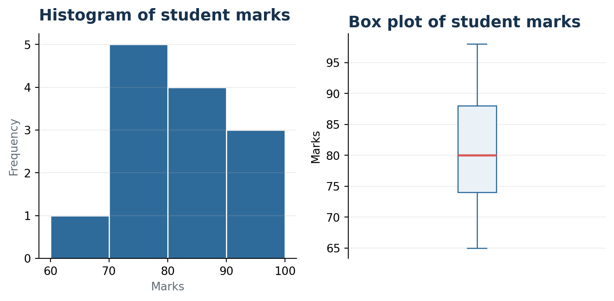

#### B. Bivariate Analysis

Bivariate means analysing two variables together to understand their relationship.

Example:

We want to understand the relationship between study hours and examination marks.

| Study Hours | Marks |
|---:|---:|
| 1 | 40 |
| 2 | 50 |
| 3 | 60 |
| 4 | 70 |
| 5 | 85 |

Questions:

- Do marks increase as study hours increase?
- Is there a relationship between the two variables?
- How strong is their relationship?

Common visualisations:

- Scatter plot.
- Line chart.
- Grouped bar chart.
- Correlation analysis.

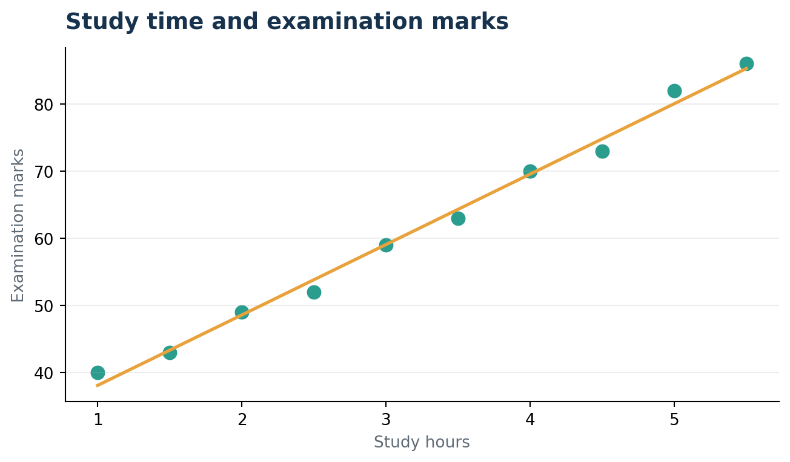

#### C. Multivariate Analysis

Multivariate analysis examines three or more variables simultaneously.

Example:

We want to understand how house prices relate to:

- House area.
- Number of bedrooms.
- Location.
- Property age.
- Distance from the city centre.

Common visualisations:

- Correlation heatmap.
- Pair plot.
- Bubble chart.
- Multivariable charts.

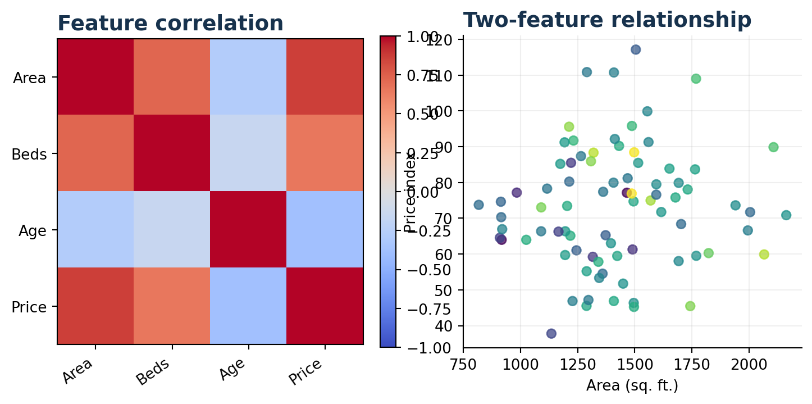

### 6.4 Important EDA Techniques

| Technique | Purpose |
|---|---|
| Distribution analysis | Understand how values are distributed |
| Missing-value analysis | Identify incomplete columns |
| Outlier detection | Identify unusual observations |
| Correlation analysis | Measure relationships between numerical variables |
| Group analysis | Compare different categories |
| Trend analysis | Identify patterns over time |
| Frequency analysis | Understand how often values occur |

**Important:** Correlation does not automatically mean causation.

For example, ice cream sales and swimming activity might both increase during summer. That does not prove ice cream sales cause swimming activity.

### 6.5 EDA Visualisation Summary

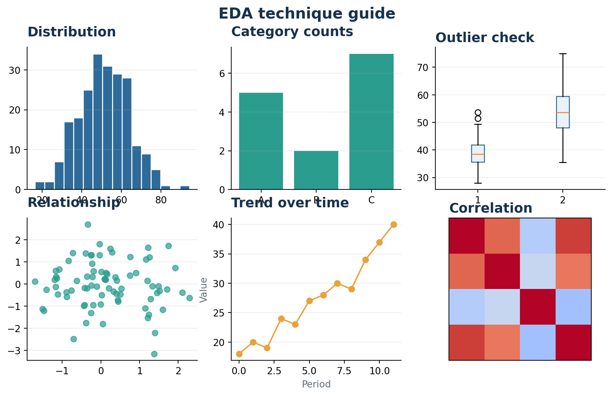

### 6.6 Output of EDA

After EDA, we should understand:

- The structure of our dataset.
- The distribution of each important variable.
- Important trends and patterns.
- Relationships between variables.
- Potential outliers.
- Data-quality issues that still need attention.
- Which variables may be useful for further analysis.

**Important distinction:** EDA is exploratory. It helps us discover what might be happening. Confirmatory or hypothesis-driven analysis can then test particular explanations more rigorously.

---

## Stage 7. Data Analysis and Modelling

Now we reach the central analytical stage.

After understanding the data, we apply appropriate mathematical, statistical, logical, or computational techniques to answer the original questions.

**Data Analysis** involves examining data using suitable methods to extract meaningful patterns, compare observations, test hypotheses, and solve problems.

### 7.1 Four Important Types of Data Analysis

A widely used way to classify analytical work is through four categories.

**1. Descriptive**

**What happened?**

Descriptive analysis summarises historical data to understand past events.

Example: Total sales last month were ₹10 lakh.

Common methods: Mean, median, totals, frequency distributions, percentage calculations.

**2. Diagnostic**

**Why did it happen?**

Diagnostic analysis investigates possible reasons behind a particular outcome.

Example: Sales decreased because fewer visitors completed purchases.

Common methods: Drill-down analysis, comparisons, segmentation, correlation, root-cause investigation.

**3. Predictive**

**What might happen next?**

Predictive analysis uses historical data and statistical or Machine Learning models to estimate future or unknown outcomes.

Example: Predicting next month's sales.

Common methods: Regression, time-series forecasting, classification, Machine Learning.

**4. Prescriptive**

**What should we do?**

Prescriptive analysis evaluates possible actions and helps recommend suitable decisions.

Example: Recommending inventory levels and discount strategies based on forecast demand.

Common methods: Optimisation, simulation, decision analysis and scenario modelling.

### 7.2 Visual Representation

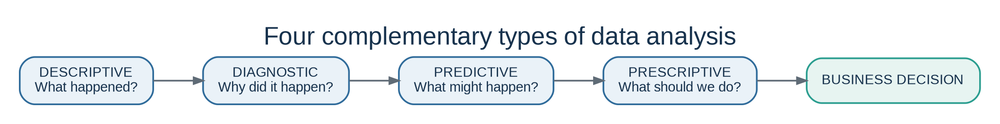

These four categories are complementary. They are not mandatory sequential steps for every data analysis project.

### 7.3 Common Analytical Techniques

**1. Statistical Analysis**

Uses statistical methods to understand data.

Examples:

- Mean and median.
- Variance and standard deviation.
- Probability.
- Hypothesis testing.
- Confidence intervals.

**2. Correlation Analysis**

Identifies the strength and direction of relationships between numerical variables.

Example:

We want to understand whether advertising expenditure and revenue tend to move together.

**3. Regression Analysis**

Regression helps model relationships between variables and can be used to predict numerical outcomes.

Example:

Predicting house prices using area, location, and number of rooms.

**4. Classification**

Classification assigns observations to predefined categories.

Example:

Classifying emails as spam or not spam.

**5. Clustering**

Clustering groups similar observations without requiring predefined category labels.

Example:

Grouping customers based on purchasing behaviour.

**6. Time-Series Analysis**

Studies data recorded over time.

Example:

Monthly sales, daily temperature, or hourly website traffic.

### 7.4 Difference Between Analysis and Modelling

Data analysis does not always require Machine Learning.

For example, calculating total revenue, identifying the best-selling product, and comparing sales between two cities are all valid forms of data analysis.

Modelling becomes relevant when we need to represent relationships, test hypotheses, estimate unknown values, classify observations, or predict outcomes.

### 7.5 Output of This Stage

At the end, we should have:

- Calculated metrics.
- Identified patterns and relationships.
- Statistical findings.
- Model results when modelling is required.
- Answers to the original analytical questions.
- Potential recommendations.

---

## Stage 8. Interpretation and Validation

Obtaining numerical results is not enough.

We must understand what those results mean and whether they are reliable.

**Interpretation** means explaining the meaning and significance of analytical results in the context of the original problem.

**Validation** means checking whether the analytical process and its results are sufficiently reliable for the intended purpose.

### 8.1 Interpretation

Suppose our analysis produces the following result:

| Month | Revenue |
|---|---:|
| August | ₹10 lakh |
| September | ₹9 lakh |
| October | ₹7 lakh |

A basic observation is that revenue has decreased.

But interpretation requires asking:

- Why is revenue decreasing?
- Is the decline associated with fewer orders?
- Is the average order value decreasing?
- Is one product category responsible?
- Is the trend seasonal?
- Is the decrease associated with a change in website traffic?

We should connect the numerical findings to the actual business problem.

### 8.2 Validation

Consider the following checks:

**A. Data Validation**

- Is the dataset correct?
- Are important values missing?
- Are calculations accurate?
- Have we used the correct data sources?

**B. Method Validation**

- Is the selected analytical method appropriate?
- Are the assumptions reasonable?
- Are there any sampling biases?
- Are the results affected by unusual observations?

**C. Statistical Validation**

Depending on the analysis, we may use:

- Hypothesis testing.
- Confidence intervals.
- Statistical significance.
- Sensitivity analysis.

**D. Model Validation**

When Machine Learning models are used, evaluation may include:

| Task | Common metrics |
|---|---|
| Regression | MAE, MSE, RMSE, R² |
| Classification | Accuracy, Precision, Recall, F1-score |
| Clustering | Silhouette score, Davies–Bouldin index |

We should select metrics that match the actual problem rather than blindly using one metric.

For example, accuracy alone may be misleading for a fraud detection model if fraudulent transactions are very rare.

### 8.3 A Very Important Concept: Correlation vs Causation

Suppose our analysis finds:

"Customers who receive discounts tend to purchase more products."

Does this prove that discounts cause customers to purchase more?

Not necessarily.

Perhaps customers who already purchase frequently receive more discounts.

Or perhaps discounts are offered during seasonal sales when demand is naturally higher.

We need suitable experimental or causal analysis methods to establish causation.

### 8.4 What If Validation Fails?

We may need to move backward in the cycle.

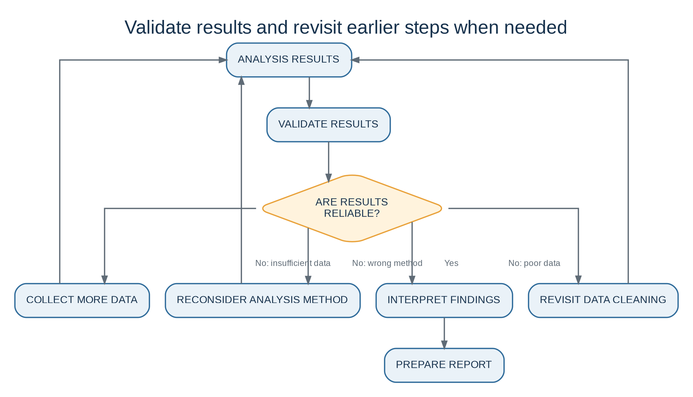

### 8.5 Output of This Stage

- Validated findings.
- Clear interpretation.
- Documented assumptions.
- Known limitations.
- Confidence in the results, appropriate to the available evidence.

---

## Stage 9. Data Visualization and Communication

After completing analysis and validation, the next step is to communicate the findings.

A result is useful only when people can understand it and use it.

**Data Visualization** is the graphical representation of data using charts, graphs, plots, and dashboards to communicate information clearly.

**Data Communication** is the process of explaining analytical results, insights, limitations, and recommendations to the intended audience.

### 9.1 Why Is Data Visualization Important?

Imagine that you have analysed 100,000 sales records and discovered several important trends.

You could provide someone with thousands of rows of data, but it would be difficult for them to understand the findings quickly.

Instead, you could create visualisations that highlight:

- Monthly revenue trends.
- Best-selling products.
- Sales by geographical region.
- Customer purchasing patterns.
- Growth and decline percentages.

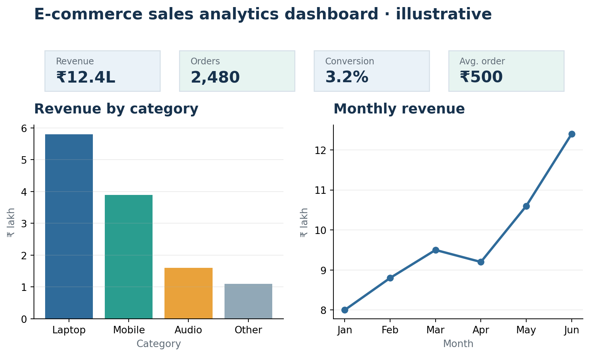

### 9.2 Common Types of Data Visualizations

**1. Bar Chart**

Used to compare values across categories.

Example: Comparing revenue generated by different products.

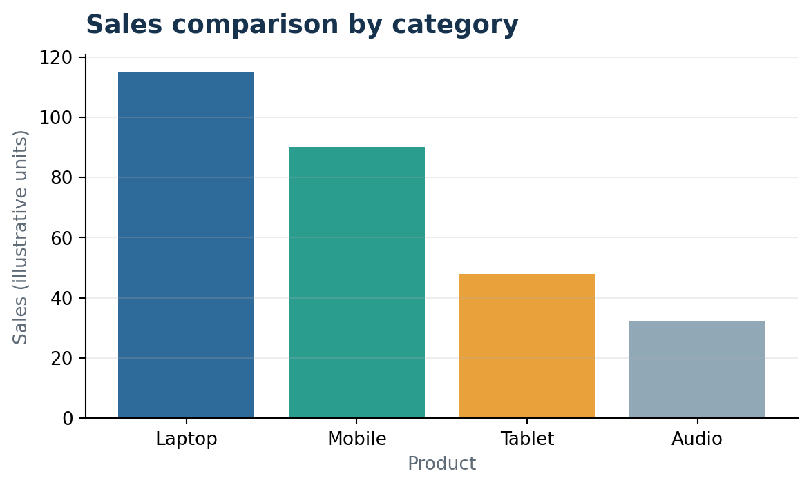

**2. Line Chart**

Used to identify changes and trends over time.

Example: Monthly revenue from January to December.

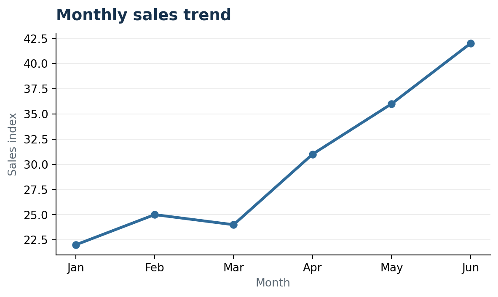

**3. Pie Chart**

Used to show proportions or composition of a whole.

Example: Market share of different products.

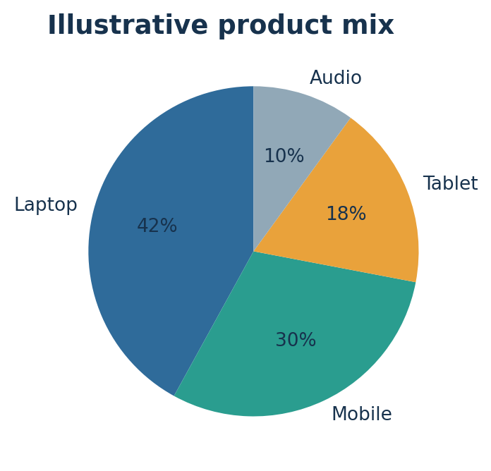

**4. Histogram**

Used to understand the distribution of numerical values.

Example: Distribution of customer ages.

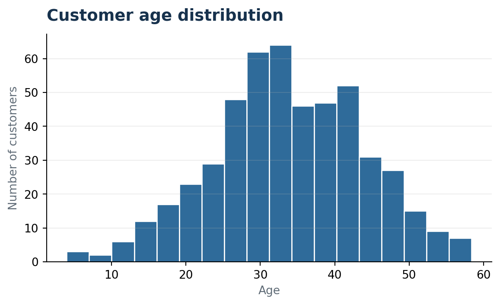

**5. Scatter Plot**

Used to explore relationships between two numerical variables.

Example: Advertising expenditure and sales revenue.

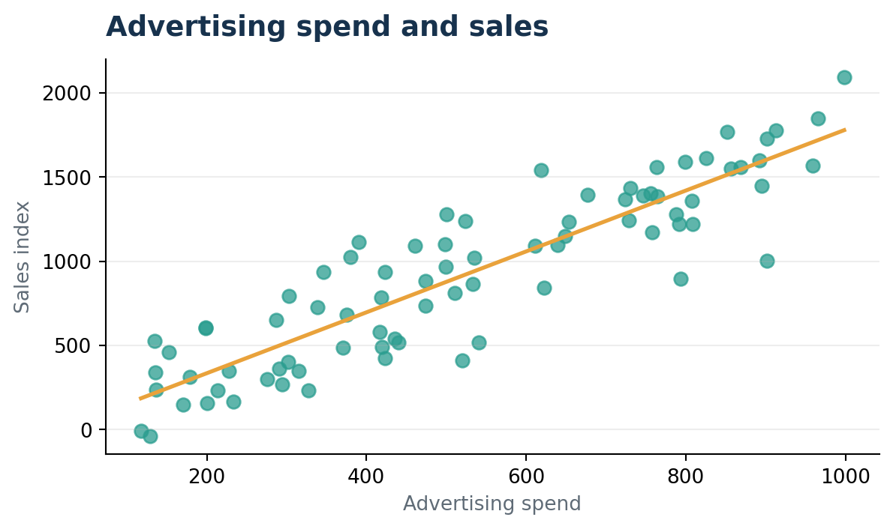

**6. Box Plot**

Used to visualise distributions, quartiles, and potential outliers.

Example: Comparing salary distributions across departments.

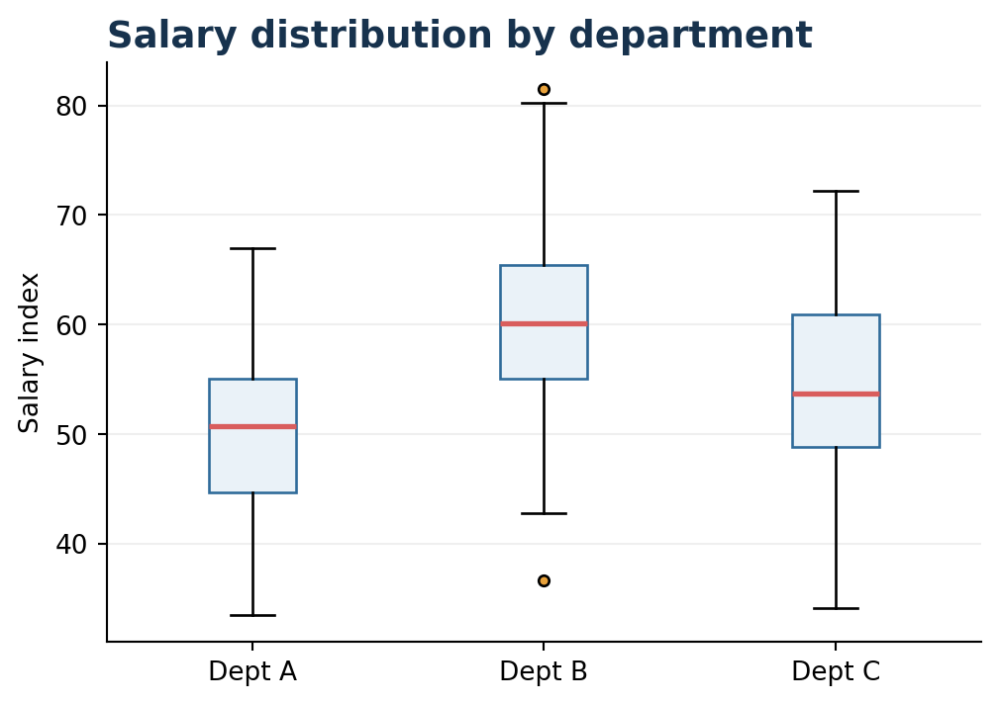

**7. Heatmap**

Uses colour intensity to represent values in a matrix.

Example: Correlations between numerical variables.

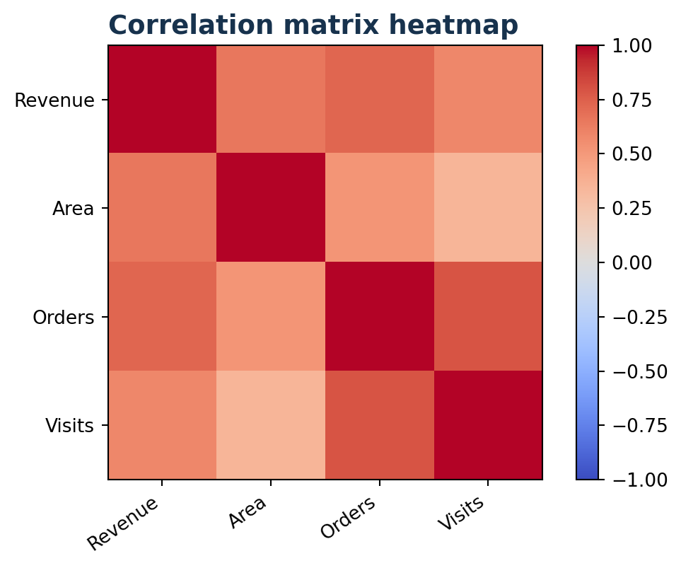

### 9.3 Which Chart Should We Use?

| Requirement | Suitable chart |
|---|---|
| Compare categories | Bar chart |
| Show trends over time | Line chart |
| Show proportions | Pie chart or stacked bar |
| Understand a distribution | Histogram |
| Study two numerical variables | Scatter plot |
| Detect potential outliers | Box plot |
| Compare correlations | Heatmap |

### 9.4 Common Data Visualization Tools

| Tool | Purpose |
|---|---|
| Matplotlib | Creating plots using Python |
| Seaborn | Statistical data visualisation in Python |
| Plotly | Interactive charts and dashboards |
| Power BI | Business intelligence and dashboards |
| Tableau | Business intelligence and visual reporting |
| Excel | Basic data visualisation and reporting |

### 9.5 Data Storytelling

Data storytelling means presenting analytical findings in a meaningful narrative rather than simply showing charts and numerical values.

A useful data story generally contains:

1. **Context:** What problem are we investigating?
2. **Finding:** What did the analysis reveal?
3. **Evidence:** Which data or visualisation supports the finding?
4. **Meaning:** Why is the finding important?
5. **Recommendation:** What action should be considered?

**Context**

The company has experienced a decline in monthly sales.

**Finding**

Mobile-device purchases have decreased considerably.

**Evidence**

A comparison of conversion rates reveals a much higher checkout abandonment rate on mobile devices.

**Meaning**

The mobile purchasing experience may be contributing to revenue decline.

**Recommendation**

Investigate the mobile checkout process and test improvements.

### 9.6 Output of This Stage

- Charts and visualisations.
- Dashboards.
- Analytical reports.
- Presentation slides.
- Key findings.
- Recommendations for stakeholders.

---

## Stage 10. Decision-Making, Implementation, and Monitoring

This is where analytical findings are converted into practical actions.

The main purpose of data analysis is not simply to create charts or reports. It is to help people make better decisions.

### 10.1 Decision-Making

Suppose our analysis identifies that mobile users are abandoning their shopping carts more frequently.

Possible decisions include:

- Improving mobile website performance.
- Simplifying the checkout process.
- Offering more payment options.
- Fixing technical errors.
- Improving the user interface.

Decisions should be based on the strength of the available evidence, the costs involved, and the expected benefits.

### 10.2 Implementation

Once an appropriate decision has been made, the organisation implements it.

Example:

The development team simplifies the mobile checkout process and fixes identified errors.

### 10.3 Monitoring

After implementation, we need to monitor whether the changes have produced the desired outcome.

For example, we may track:

- Mobile conversion rate.
- Cart abandonment rate.
- Total revenue.
- Number of completed orders.
- Customer satisfaction.

### 10.4 Measuring Success

Suppose:

| Before improvement | After improvement |
|---|---|
| **2.0%** | **3.0%** |
| Mobile conversion rate | Mobile conversion rate |

The conversion rate increased by 1 percentage point, equivalent to a 50% relative increase.

However, we should not automatically conclude that the change caused the improvement. We should also consider seasonality, marketing changes, traffic composition, and other possible influences. A controlled experiment, such as an A/B test, can provide stronger evidence.

### 10.5 Feedback and Continuous Improvement

The analysis cycle does not stop after implementation.

We continuously monitor results, evaluate whether objectives have been achieved, and identify new problems.

For example:

- Did the changes improve conversion?
- Did revenue increase?
- Did customer satisfaction improve?
- Did the solution introduce any new problems?
- Is further analysis necessary?

The answers can lead to another round of problem definition and analysis.

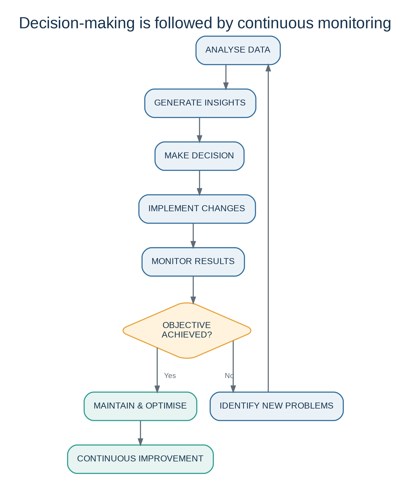

### 10.6 Output of This Stage

- Business decisions.
- Implemented improvements.
- Measured outcomes.
- Monitoring reports.
- New questions for future analysis.

---

# 5. Complete Practical Example: Applying the Entire Data Analysis Life Cycle

Now let's combine all the stages into one practical project.

This is important because understanding each stage independently is different from understanding how all the stages work together.

## Project: Analysing Sales Performance of an E-Commerce Company

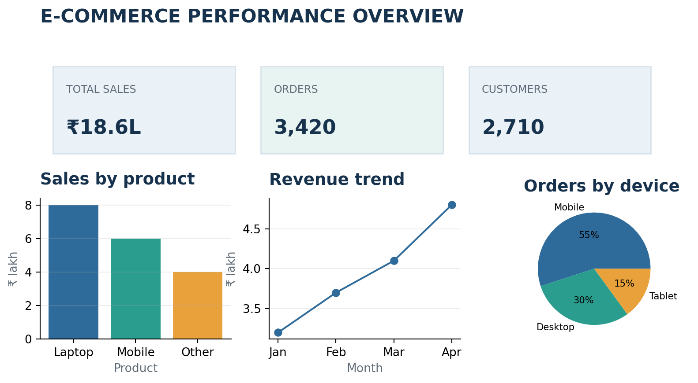

### Problem Statement

An e-commerce company has noticed that its monthly revenue has decreased.

The management wants to understand:

1. Why is revenue decreasing?
2. Which products are performing poorly?
3. Which customer segments are purchasing less?
4. Are customers abandoning their shopping carts?
5. What improvements can increase revenue?

Let's solve this problem using all 10 stages.

### Stage-by-stage implementation

| Stage | What we do in this project |
|---|---|
| 1. Problem Definition | Define the objective of investigating declining revenue |
| 2. Data Collection | Collect order, product, customer, payment and website traffic data |
| 3. Storage and Management | Store datasets in a database or structured files |
| 4. Data Cleaning | Handle missing values, duplicate orders and incorrect records |
| 5. Transformation | Calculate revenue, aggregate monthly sales and combine datasets |
| 6. EDA | Explore sales distributions, trends, customer behaviour and product performance |
| 7. Analysis | Investigate reasons for declining sales using statistical methods |
| 8. Validation | Verify calculations, assumptions and analytical findings |
| 9. Visualization | Build dashboards and reports |
| 10. Decision and Monitoring | Implement improvements and monitor their results |

### Step 1: Collect Sample Data

Suppose the company has collected the following simplified order data.

| Order ID | Product | City | Device | Amount | Status |
|---:|---|---|---|---:|---|
| 101 | Laptop | Delhi | Mobile | 55000 | Completed |
| 102 | Mobile | Ludhiana | Desktop | 20000 | Completed |
| 103 | Headphones | Delhi | Mobile | 2000 | Cancelled |
| 104 | Laptop | Mumbai | Desktop | 60000 | Completed |
| 105 | Mobile | Ludhiana | Mobile | 22000 | Completed |

This is our raw dataset.

### Step 2: Clean and Prepare the Data

We perform the following activities:

- Remove accidental duplicate records.
- Investigate missing values.
- Correct invalid values.
- Handle cancelled and refunded orders according to the company's revenue definition.
- Convert the amount column into a numerical format.
- Standardise city and device names.

### Step 3: Explore the Data

We investigate:

- Total revenue.
- Revenue by product.
- Revenue by city.
- Number of completed orders.
- Revenue by device.
- Monthly revenue trends.

### Step 4: Analyse the Data

Suppose our analysis discovers the following hypothetical findings:

| Finding | Observation |
|---|---|
| Product performance | Laptop revenue is declining |
| Device performance | Mobile conversion is decreasing |
| Geography | Two cities have experienced lower sales |
| Customer behaviour | Mobile cart abandonment has increased |

We now have potential explanations that need to be investigated and validated.

### Step 5: Interpret and Validate

We check whether the decline in mobile conversion is supported by reliable website session and transaction data.

We also compare the results over consistent periods and investigate other factors, such as changes in traffic and marketing campaigns.

### Step 6: Visualize Results

We create a dashboard containing:

- Monthly revenue.
- Product-wise revenue.
- City-wise revenue.
- Conversion rates.
- Cart abandonment.
- Device-wise performance.

### Step 7: Take Action

The management may decide to:

- Improve the mobile checkout experience.
- Investigate low-performing products.
- Improve marketing campaigns.
- Optimise product availability.

### Step 8: Monitor Results

After implementing improvements, we compare the relevant KPIs against their previous values.

We then determine whether the changes have achieved their intended objectives.

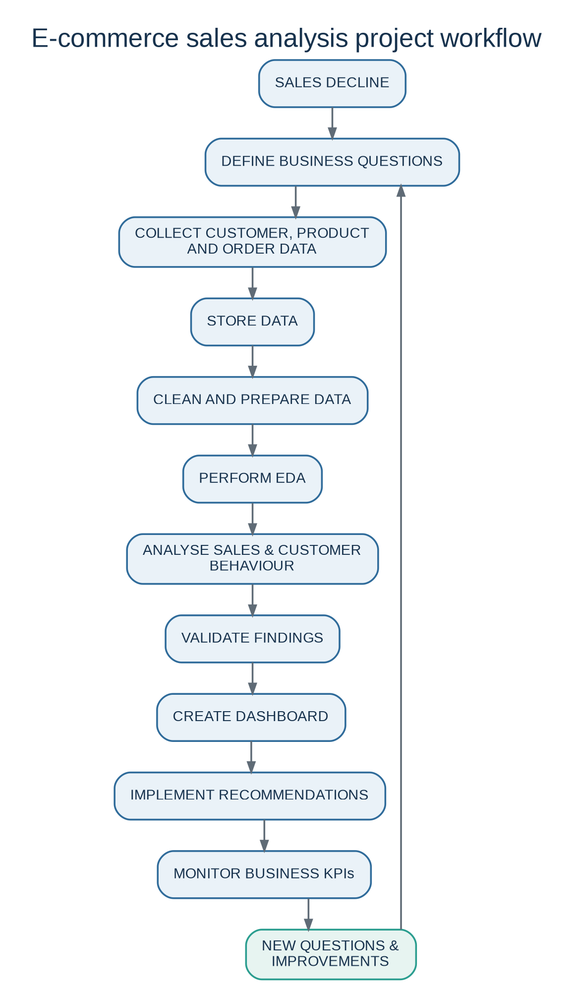

This is how a real data analysis project moves from a business problem to useful decisions.

---

# 6. Tools and Technologies Used in Data Analysis

As someone learning Python for Data Science and AI Engineering, you should understand which tools are used at each stage.

Different tools solve different problems.

| Tool / Technology | Main purpose |
|---|---|
| Microsoft Excel | Basic data handling and analysis |
| Google Sheets | Spreadsheet-based analysis and collaboration |
| SQL | Extracting and querying database records |
| Python | Data processing, analysis and automation |
| NumPy | Numerical computing |
| Pandas | Data manipulation and analysis |
| Matplotlib | Creating visualisations |
| Seaborn | Statistical visualisation |
| Plotly | Interactive visualisations |
| Power BI | Business intelligence and dashboards |
| Tableau | Interactive reporting and dashboards |
| Jupyter Notebook | Interactive Python analysis |
| Scikit-learn | Machine Learning and predictive modelling |
| PostgreSQL / MySQL | Relational data storage |
| BigQuery / Snowflake | Large-scale analytical data storage |

## Which tool is used at which stage?

### Data analysis technology map

| Stage | Tools |
|---|---|
| Problem Definition | Business knowledge, documentation, Excel |
| Data Collection | SQL, APIs, Python, CSV, web sources |
| Storage | MySQL, PostgreSQL, cloud storage |
| Cleaning | Python, Pandas, Excel, SQL |
| Transformation | Pandas, NumPy, SQL |
| EDA | Pandas, NumPy, Matplotlib, Seaborn |
| Analysis | Python, statistics, SQL, Scikit-learn |
| Validation | Statistical methods, Python, Scikit-learn |
| Visualization | Matplotlib, Seaborn, Power BI, Tableau |
| Monitoring | Power BI, SQL, Python, dashboards |

**Important:** You don't need every tool to perform data analysis. The tools depend on the size of the dataset, the problem, the organisation, and the type of analysis.

For many beginner Python projects, you can perform a complete analysis using Jupyter Notebook, Pandas, NumPy, Matplotlib, and Seaborn.

---

# 7. Relationship Between Data Analysis, Data Science, AI and Machine Learning

These terms are closely related, but they have different meanings.

**Data Analysis**

Examines existing data to understand patterns, investigate questions, and support decisions.

Example: Finding which products generate the highest revenue.

**Data Science**

A broader field that combines statistics, programming, mathematics, domain knowledge, data analysis, experimentation and Machine Learning to solve data-driven problems.

Example: Developing a system that predicts customer behaviour.

**Machine Learning**

A field of AI in which algorithms learn patterns from data to make predictions, classifications, recommendations or other outputs.

Example: Predicting whether a customer will purchase a product.

**Artificial Intelligence**

A broader field focused on creating systems capable of performing tasks associated with intelligent behaviour, such as reasoning, perception, language understanding and decision-making.

Example: An AI assistant that understands and responds to user questions.

### How are they connected?

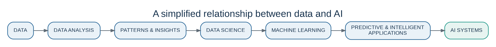

This is a simplified conceptual relationship, not a strict hierarchy. Data Science can include Machine Learning, and AI can use Machine Learning, but neither requires every project to follow this exact sequence.

## 7.1 Why Data Analysis Is Essential for an AI Engineer

Suppose you want to build a house price prediction application.

Your work does not begin directly with writing a Machine Learning algorithm.

You first need to:

1. Understand the problem.
2. Collect a relevant housing dataset.
3. Understand its columns and data types.
4. Identify missing values.
5. Detect incorrect values and outliers.
6. Explore relationships between variables.
7. Create useful features.
8. Prepare training and testing datasets.
9. Train and evaluate an appropriate model.
10. Monitor the model's performance.


Data analysis helps us understand the data on which our AI and Machine Learning applications depend.

One additional ML-specific precaution is to avoid data leakage. For example, transformations such as imputation and scaling should generally be fitted using training data and then applied to validation or test data, rather than learning from the entire dataset.

---

# 8. Common Mistakes During Data Analysis

Even experienced analysts can make mistakes. Understanding them is important.

| Mistake | Why it is problematic |
|---|---|
| Starting without a clear objective | The analysis may not solve the intended problem |
| Collecting irrelevant data | Wastes time and can introduce noise |
| Ignoring missing values | May produce incorrect calculations |
| Removing every outlier | May eliminate important observations |
| Ignoring data types | Can cause incorrect operations |
| Choosing inappropriate charts | Can misrepresent the findings |
| Assuming correlation means causation | Can lead to incorrect conclusions |
| Ignoring data bias | Results may not represent the intended population |
| Not validating results | Errors can remain undetected |
| Ignoring privacy | May expose sensitive information |
| Not communicating findings | Stakeholders may not understand the value |
| Not monitoring outcomes | We may not know whether the solution worked |

**Best practice:** Always document your assumptions, data-cleaning decisions, analytical methods, and limitations.

---

# 9. Complete Revision: Data Analysis Life Cycle

Use this table to revise the entire topic.

| No. | Stage | Main question | Expected output |
|---:|---|---|---|
| 1 | Problem Definition | What do we want to solve? | Problem statement and objectives |
| 2 | Data Collection | Where will we get the data? | Raw datasets |
| 3 | Storage and Management | How will we organise the data? | Managed datasets |
| 4 | Data Cleaning | Is the data reliable and consistent? | Clean dataset |
| 5 | Transformation | How should the data be structured? | Prepared dataset |
| 6 | EDA | What does the data reveal? | Patterns and observations |
| 7 | Analysis and Modelling | What methods can answer our questions? | Analytical results |
| 8 | Interpretation and Validation | Are the findings meaningful and reliable? | Validated findings |
| 9 | Visualization and Communication | How do we explain the findings? | Reports and dashboards |
| 10 | Decision and Monitoring | What should we do, and did it work? | Actions and measured outcomes |

## 10. Final Conceptual Diagram

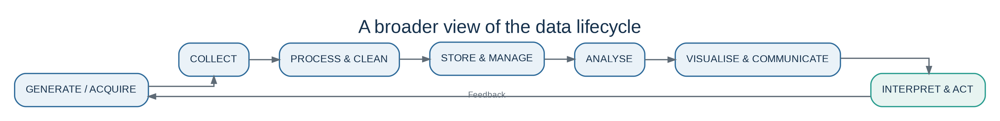

---

## 11. Important Points to Remember

1. Data analysis converts raw data into meaningful information and insights.
2. Its primary purpose is to support better decisions and solve problems.
3. Data collection is not the same as data analysis.
4. Data cleaning is essential because real-world datasets frequently contain quality issues.
5. Data transformation prepares information for analytical tasks.
6. EDA helps us understand the structure, distributions, relationships, and patterns in a dataset.
7. Descriptive, diagnostic, predictive, and prescriptive analysis answer four different types of questions.
8. Data visualization helps communicate findings effectively.
9. Validation ensures that conclusions are supported by reliable evidence.
10. Data analysis is an iterative process, not a one-way sequence.
11. Data analysis is a fundamental skill for Data Scientists and AI Engineers.

## 12. Recommended Learning Sequence

For your Python and AI Engineering journey, the following is a useful practical sequence for learning how to perform data analysis:

### Your practical data analysis learning path

1. **Data Analysis Fundamentals**

   Understand data, information, insights, the analysis lifecycle and analytical questions.

2. **Python for Data Analysis**

   Learn NumPy and Pandas for numerical operations and data manipulation.

3. **Data Cleaning and Preparation**

   Work with missing values, duplicates, inconsistent data and transformations.

4. **Exploratory Data Analysis**

   Learn descriptive statistics, distributions, outliers and relationships.

5. **Data Visualization**

   Learn Matplotlib, Seaborn and Plotly.

6. **Statistics for Data Analysis**

   Learn probability, distributions, correlation, hypothesis testing and statistical inference.

7. **SQL for Data Analysis**

   Learn to retrieve, filter, aggregate and combine database records.

8. **Practical Projects**

   Analyse real-world datasets and publish complete projects on GitHub.

**Final takeaway:** Data analysis is not just about calculating averages, writing Python code, or creating charts. It is about asking the right questions, working with reliable data, discovering meaningful patterns, interpreting evidence, and using the findings to make better decisions.

That is the foundation on which professional Data Science and AI Engineering work is built.
