# n8n Complete Learning Notes – Single-File Edition
> This file combines every topic and project guide. The ZIP also contains each note as a separate Markdown file.

## Contents

- [Topic 1: Introduction to n8n](#topic-1-introduction-to-n8n)
- [Topic 2: Types of Workflows](#topic-2-types-of-workflows)
- [Topic 3: Data Flow in n8n](#topic-3-data-flow-in-n8n)
- [Topic 4: Basics of n8n](#topic-4-basics-of-n8n)
- [Topic 5: Installing n8n](#topic-5-installing-n8n)
- [Topic 6: Working with Core Nodes](#topic-6-working-with-core-nodes)
- [Topic 7: Expressions and Data Manipulation](#topic-7-expressions-and-data-manipulation)
- [Topic 8: APIs and HTTP Requests](#topic-8-apis-and-http-requests)
- [Topic 9: Working with External Applications](#topic-9-working-with-external-applications)
- [Topic 10: Introduction to AI in n8n](#topic-10-introduction-to-ai-in-n8n)
- [Topic 11: AI Nodes and AI Chains](#topic-11-ai-nodes-and-ai-chains)
- [Topic 12: AI Agents](#topic-12-ai-agents)
- [Topic 13: Memory and Context Management](#topic-13-memory-and-context-management)
- [Topic 14: Embeddings and Vector Databases](#topic-14-embeddings-and-vector-databases)
- [Topic 15: Retrieval-Augmented Generation (RAG)](#topic-15-retrieval-augmented-generation-rag)
- [Topic 16: Advanced AI Agent Systems](#topic-16-advanced-ai-agent-systems)
- [Topic 17: Error Handling and Debugging](#topic-17-error-handling-and-debugging)
- [Topic 18: Security and Credentials](#topic-18-security-and-credentials)
- [Topic 19: Deployment and Production](#topic-19-deployment-and-production)
- [Project 1 – AI Email Assistant](#project-1--ai-email-assistant)
- [Project 2 – AI Telegram Chatbot](#project-2--ai-telegram-chatbot)
- [Project 3 – AI Document Processing System](#project-3--ai-document-processing-system)
- [Project 4 – RAG-Based Knowledge Assistant](#project-4--rag-based-knowledge-assistant)
- [Project 5 – AI Lead Management System](#project-5--ai-lead-management-system)
- [Project 6 – AI Research Assistant](#project-6--ai-research-assistant)
- [Final Capstone – AI-Powered Personal Assistant and Automation Platform](#final-capstone--ai-powered-personal-assistant-and-automation-platform)

---


# Topic 1: Introduction to n8n

> **Stage:** Stage 1 – Foundations  
> **Learning level:** Beginner → practical → professional  
> **Purpose:** Build a correct mental model of workflows, automation, n8n, and its role in AI-enabled systems.

## Learning outcomes

By the end of this topic, you should be able to:

- Define a workflow and distinguish a workflow from automation.
- Explain why businesses automate repetitive and rule-based work.
- Describe n8n as a fair-code workflow automation and orchestration platform.
- Explain nodes, triggers, actions, connections, credentials, executions, and outputs.
- Recognize n8n capabilities: integrations, APIs, data transformation, custom code, AI, and deployment options.
- Separate the responsibility of an automation platform from the responsibility of an AI model.

## Visual reference


*Image source: [Nuvi – Comparing no-code AI agent builders](https://www.nuvi.dev/blog/ai-agent-platforms-compared). Interface details can change between n8n versions.*

## Detailed notes

### 1.1 Workflow: the process before the tool

A **workflow** is an ordered set of connected activities that takes an input or event and moves it toward an intended outcome. A workflow can be performed by a person, software, or a combination of both.

Example: a student submits a registration form. Someone checks the fields, records the student in a spreadsheet, assigns a department, and sends a confirmation. The sequence is the workflow even if every step is manual.

A useful way to describe any workflow is:

- **Trigger / starting condition:** What causes work to begin?
- **Input:** What information is available?
- **Processing:** What transformations or decisions are required?
- **Actions:** Which systems must be changed or contacted?
- **Output:** What result should exist when the process finishes?
- **Exceptions:** What happens when information is missing or a service fails?

### 1.2 Workflow versus automation

A workflow describes *how work is organized*. Automation describes *which steps technology executes with reduced manual intervention*. A workflow can be manual; an automated workflow executes some or all of its steps automatically.

For instance, manually checking an invoice and entering it into accounting software is a workflow. Automatically reading a mailbox, extracting invoice fields, validating them, and creating a draft accounting record is an automated version of that workflow.

### 1.3 Why automation is needed

- **Repetition:** the same steps are performed many times.
- **Time:** staff spend time copying, routing, and formatting information.
- **Consistency:** a well-tested process applies the same rules each time.
- **Scale:** higher volumes can be handled without a linear increase in manual effort, within infrastructure and provider limits.
- **Integration:** separate apps can exchange data without users repeatedly moving it by hand.
- **Traceability:** executions and logs can show what happened and where a failure occurred.

Automation does not guarantee correctness. A flawed rule can repeat a mistake very efficiently. High-impact decisions still need controls, review, and an escalation path.

### 1.4 What is n8n?

**n8n (pronounced “n-eight-n”)** is a fair-code workflow automation platform. It lets builders connect applications and APIs, move and transform data, and orchestrate operations using a visual editor with the option to add code. It can be used as a hosted cloud service or self-hosted by users who can operate the infrastructure.

It is not itself an LLM, a database, or a replacement for Python. It coordinates systems and steps. A connected AI model may classify a message; n8n can then route the classification, write a record, and notify a person.

### 1.5 Core building blocks

- **Workflow:** the complete automation definition.
- **Node:** one building block. A node may start a workflow, retrieve or send data, or process data.
- **Trigger node:** begins execution when its configured event or schedule occurs, or when a user starts it manually.
- **Action / processing node:** performs an operation after the workflow starts, such as filtering records or sending a message.
- **Connection:** defines the path from one node to another and passes output data forward.
- **Credentials:** authentication material used to connect to external services. Keep it private and grant only the permissions needed.
- **Execution:** one run of a workflow. Execution records help with inspection and debugging.
- **Canvas:** the visual workspace where a workflow is assembled and configured.

### 1.6 What n8n offers

- A visual workflow builder and a library of built-in integrations.
- HTTP requests and webhooks for services that expose APIs.
- Data mapping, expressions, transformation nodes, and custom code.
- Control flow such as conditions, branches, loops, waits, and sub-workflows.
- AI integrations with language models, agents, tools, memory, and retrieval components.
- Execution history, error workflows, and testing/debugging facilities.
- Cloud and self-hosted deployment options.

### 1.7 One connected example

A student submits a question. A form or webhook trigger starts the workflow. n8n validates the fields, sends the question to an AI model for a suggested category, checks the model output, routes it to the correct department, stores the record, and sends an acknowledgement. The **model** provides language understanding; **n8n** coordinates the process; the **database** persists records; and APIs connect the services.

### 1.8 Automation versus AI-powered automation

Traditional automation follows explicit rules: “if payment status is successful, create a receipt.” AI-powered automation uses a model for a task that involves ambiguous or unstructured information, such as classifying a complaint or extracting fields from a document. The workflow should still validate AI output and use human approval when the consequence of an incorrect action is significant.

## How the pieces fit together

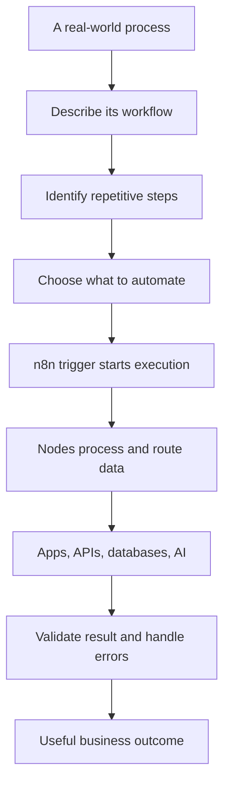

## Connection to AI engineering

In AI engineering, n8n is an **orchestration layer**. The model interprets text, generates a draft, extracts information, or selects a tool; n8n controls the sequence, credentials, routing, persistence, notifications, and approvals. Do not give an AI agent unrestricted authority simply because it can be connected to a tool.

## Guided practice

Build a paper design before opening n8n: **New student registration → validate email and required fields → write to a sheet/database → send confirmation**. Add an invalid-data branch and a service-failure branch. Label every input and output. Then identify one step where an LLM might genuinely add value (for example, categorizing a free-text request) and explain why ordinary rules would be insufficient.

## Best practices

- Name nodes and workflows after their purpose, not after the order in which you created them.
- Test normal, empty, malformed, duplicate, and failure inputs—not only the happy path.
- Keep credentials out of code, screenshots, exported examples, and public repositories.
- Make data contracts explicit: document what each step expects and returns.
- Add observability and recovery before treating a workflow as production-ready.

## Quick revision

- Define a workflow and distinguish a workflow from automation.
- Explain why businesses automate repetitive and rule-based work.
- Describe n8n as a fair-code workflow automation and orchestration platform.
- Explain nodes, triggers, actions, connections, credentials, executions, and outputs.
- Recognize n8n capabilities: integrations, APIs, data transformation, custom code, AI, and deployment options.
- Separate the responsibility of an automation platform from the responsibility of an AI model.

## Knowledge check

1. Explain the central idea of **Introduction to n8n** in your own words.
2. Draw the workflow or architecture without looking at the notes.
3. Describe one failure case and how you would detect and recover from it.
4. Explain where Python, an API, a database, or an AI model would fit into this topic.

## Official and further reading

- [CampusX n8n notes repository](https://github.com/campusx-official/n8n-notes) – foundational chapter structure.
- [n8n Docs: Understand workflows](https://docs.n8n.io/workflows/).
- [n8n Docs: Work with nodes](https://docs.n8n.io/build/understand-workflows/workflow-components/work-with-nodes/).
- [n8n Academy](https://n8n.io/education/) – current hands-on learning paths.

---

[Back to the master index](../README.md)


---


# Topic 2: Types of Workflows

> **Stage:** Stage 1 – Foundations  
> **Learning level:** Beginner → practical → professional  
> **Purpose:** Recognize common workflow patterns and choose a structure that matches the business process.

## Learning outcomes

By the end of this topic, you should be able to:

- Explain linear, conditional, parallel, looping, and combined workflow patterns.
- Distinguish manual, event-driven, scheduled, and webhook-triggered starts.
- Understand the difference between a conceptual workflow pattern and a specific n8n trigger/node.
- Choose a pattern using the process requirements, data volume, and error behavior.
- Design branches, joins, loops, and human approval points.

## Visual reference


*Image source: [Medium – The Complete n8n Social Media Pipeline](https://medium.com/write-a-catalyst/the-complete-n8n-social-media-pipeline-from-zero-to-autopilot-3cfd60ea308d). This is an example, not a required workflow pattern.*

## Detailed notes

### 2.1 A note about “types”

Workflow types can be classified in more than one way. **Linear, conditional, parallel, and looping** describe the structure of work. **Manual, scheduled, event-driven, and webhook-based** describe how a workflow starts. These are useful teaching categories, not a claim that n8n has one exclusive official list of workflow types.

### 2.2 Linear workflow

Steps execute in a straightforward sequence. Example: receive a form → format fields → add a row to a database → send an email. Use this pattern when each step depends on the previous result and no branching is required.

### 2.3 Conditional workflow

A decision selects a path. Example: if an invoice total is below an approval threshold, create a draft; otherwise, ask a manager to approve it. In n8n, an IF node is suitable for a two-way condition and a Switch node for several cases. Make the condition explicit and test both true and false paths.

### 2.4 Parallel workflow

Independent tasks can run on separate branches. Example: after a customer order is validated, update inventory and send an internal notification. Do not assume branches finish in a fixed order. Use a merge or later coordination step when downstream work needs both branch results.

### 2.5 Looping and batch workflows

A workflow may process many records or repeat an operation. Examples include processing each row in a dataset, handling pages of an API response, or retrying a transient service call. Distinguish item processing (many input items) from a deliberate loop that controls batch size or repetition. Avoid endless loops; define exit conditions and limits.

### 2.6 Combined workflows

Real processes usually combine patterns: a trigger starts a linear preparation phase, an IF node selects a branch, parallel actions run, and a merge coordinates the result. A human-approval pause can add another control point.

### 2.7 Start mechanisms

- **Manual:** a person starts an execution for testing or one-off work.
- **Scheduled:** a time-based trigger runs on a defined schedule. Check timezone and daylight-saving assumptions.
- **Event-driven:** an app event, such as a new record, starts the automation. Some integrations poll; others receive events.
- **Webhook:** an external service sends an HTTP request to a URL exposed by the workflow. Verify the sender and validate the payload.

### 2.8 Selecting a pattern

Ask: Is there one path or several? Can operations run independently? Is the input a single record or a collection? What starts the work? Must a person approve? What if one branch fails? The clearest workflow is usually the simplest structure that correctly represents the process.

## How the pieces fit together

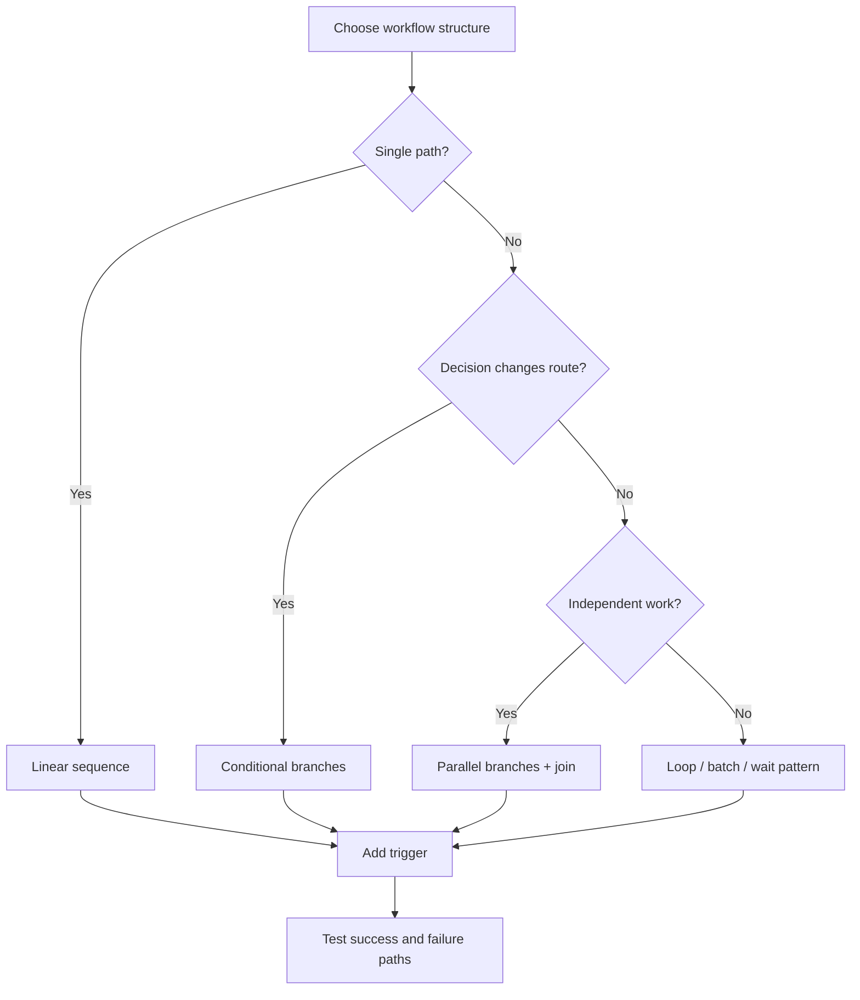

## Connection to AI engineering

AI workflows often use a hybrid pattern: trigger → retrieve context → ask an LLM to classify → validate schema → branch by category → request approval for risky cases → perform the action. Parallelism can reduce waiting time, but use it only when tasks are genuinely independent and provider rate limits allow it.

## Guided practice

Sketch three designs: (1) a daily weather-free reminder that runs at 8 AM, (2) an incoming GitHub issue routed to one of three teams, and (3) a weekly report that fetches records and calculates totals in batches. For each, name the trigger, pattern, branches, output, and failure response.

## Best practices

- Name nodes and workflows after their purpose, not after the order in which you created them.
- Test normal, empty, malformed, duplicate, and failure inputs—not only the happy path.
- Keep credentials out of code, screenshots, exported examples, and public repositories.
- Make data contracts explicit: document what each step expects and returns.
- Add observability and recovery before treating a workflow as production-ready.

## Quick revision

- Explain linear, conditional, parallel, looping, and combined workflow patterns.
- Distinguish manual, event-driven, scheduled, and webhook-triggered starts.
- Understand the difference between a conceptual workflow pattern and a specific n8n trigger/node.
- Choose a pattern using the process requirements, data volume, and error behavior.
- Design branches, joins, loops, and human approval points.

## Knowledge check

1. Explain the central idea of **Types of Workflows** in your own words.
2. Draw the workflow or architecture without looking at the notes.
3. Describe one failure case and how you would detect and recover from it.
4. Explain where Python, an API, a database, or an AI model would fit into this topic.

## Official and further reading

- [CampusX: Types of Workflows](https://github.com/campusx-official/n8n-notes/tree/main/Types%20of%20Workflows).
- [n8n Docs: Flow logic](https://docs.n8n.io/flow-logic/).
- [n8n Docs: Triggers](https://docs.n8n.io/integrations/builtin/core-nodes/n8n-nodes-base.scheduletrigger/).

---

[Back to the master index](../README.md)


---


# Topic 3: Data Flow in n8n

> **Stage:** Stage 1 – Foundations  
> **Learning level:** Beginner → practical → professional  
> **Purpose:** Understand the structure, movement, mapping, and transformation of data between nodes.

## Learning outcomes

By the end of this topic, you should be able to:

- Explain input and output data and how connections pass data.
- Read JSON objects, arrays, nested fields, and binary data metadata.
- Understand n8n items and item-by-item processing.
- Map data from earlier nodes into later node parameters.
- Transform, filter, merge, and split data safely.
- Inspect execution data to diagnose incorrect mappings.

## Visual reference


*Image source: [Exivity documentation – JSON structure](https://docs.exivity.com/advanced/data%20pipelines/extractors/parslets/).*

## Detailed notes

### 3.1 Data is the payload moving through the workflow

A node receives input, performs an operation, and produces output. The next connected node receives that output. A connection therefore carries both control-flow direction and data-flow context.

### 3.2 JSON refresher

JSON has objects (`{}`), arrays (`[]`), strings, numbers, booleans, and `null`. Object keys identify values. Arrays contain ordered values. Nested objects are accessed through a path such as `customer.email`.

```json
{
  "orderId": "ORD-1042",
  "customer": {"name": "Asha", "email": "asha@example.com"},
  "items": [{"sku": "P-10", "quantity": 2}],
  "paid": true
}
```

### 3.3 n8n item model

n8n passes data between nodes as an array of items. Each item commonly contains a `json` object for structured data and may include a `binary` section for files. A node can receive multiple items and, for many operations, process each item individually. This is why a node that receives 10 items may create or update 10 records.

Conceptually:

```json
[
  {"json": {"name": "Asha", "email": "asha@example.com"}},
  {"json": {"name": "Ravi", "email": "ravi@example.com"}}
]
```

Do not confuse one item with one workflow execution. A single execution can contain many items and many node operations.

### 3.4 Input, output, and mapping

- **Input data:** what the current node receives from upstream nodes.
- **Output data:** what the node produces after its operation.
- **Mapping:** selecting a value from input data and assigning it to a field in a later node.
- **Transformation:** changing shape, type, format, or content.
- **Filtering:** keeping only items that satisfy a condition.
- **Merging:** combining data from branches or related sources.

### 3.5 Expressions and node references

Expressions let a node parameter use dynamic values. A common expression is `{{ $json.email }}`, which reads the `email` property from the current item. A reference to another node can use the expression editor's node-reference syntax, for example `{{ $('Webhook').first().json.body.email }}` when the workflow and item structure match that assumption. Inspect the actual execution output before writing paths; never guess the nesting.

### 3.6 Binary data

Files such as PDFs and images are not ordinary JSON text. n8n can carry binary data with metadata such as a file name and MIME type. Know whether the next node expects a binary file, text extracted from a file, or a URL. Large files affect memory, storage, and execution performance.

### 3.7 Branches and merges

A branch can produce different items on different paths. A Merge node can combine or coordinate branch data, but its mode and matching behavior matter. Confirm whether you need to append lists, match records by key, or wait for both branches. Incorrect merging can pair unrelated records or multiply rows unexpectedly.

### 3.8 Execution inspection

During development, open each node's input and output panels. Check item count, key names, nested structure, data types, and empty values. Test with one item, multiple items, missing optional fields, and malformed values.

## How the pieces fit together

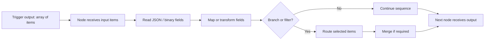

## Connection to AI engineering

AI APIs commonly return nested JSON, and document workflows may carry binary files. You must understand the exact payload before passing it to an LLM, parser, database, or downstream tool. Validate model responses as data—not as trusted instructions—and parse structured outputs before using them in business actions.

## Guided practice

Create a sample data contract for a registration item: `studentId`, `fullName`, `email`, `department`, and `submittedAt`. Write two example items as JSON. Draw where each field is used in a Google Sheets row and an email. Add cases where `department` is missing and `email` is `null`; state how the workflow should respond.

## Best practices

- Name nodes and workflows after their purpose, not after the order in which you created them.
- Test normal, empty, malformed, duplicate, and failure inputs—not only the happy path.
- Keep credentials out of code, screenshots, exported examples, and public repositories.
- Make data contracts explicit: document what each step expects and returns.
- Add observability and recovery before treating a workflow as production-ready.

## Quick revision

- Explain input and output data and how connections pass data.
- Read JSON objects, arrays, nested fields, and binary data metadata.
- Understand n8n items and item-by-item processing.
- Map data from earlier nodes into later node parameters.
- Transform, filter, merge, and split data safely.
- Inspect execution data to diagnose incorrect mappings.

## Knowledge check

1. Explain the central idea of **Data Flow in n8n** in your own words.
2. Draw the workflow or architecture without looking at the notes.
3. Describe one failure case and how you would detect and recover from it.
4. Explain where Python, an API, a database, or an AI model would fit into this topic.

## Official and further reading

- [CampusX: Data Flow in n8n](https://github.com/campusx-official/n8n-notes/tree/main/Data%20Flow%20in%20n8n).
- [n8n Docs: Data structure](https://docs.n8n.io/data/data-structure/).
- [n8n Docs: Expressions](https://docs.n8n.io/code/expressions/).

---

[Back to the master index](../README.md)


---


# Topic 4: Basics of n8n

> **Stage:** Stage 2 – Core Concepts  
> **Learning level:** Beginner → practical → professional  
> **Purpose:** Navigate the editor and understand the lifecycle of building, configuring, executing, and maintaining workflows.

## Learning outcomes

By the end of this topic, you should be able to:

- Navigate the editor and canvas.
- Add, configure, connect, rename, and organize nodes.
- Distinguish trigger, action, core, and integration nodes.
- Configure parameters, expressions, credentials, and connections.
- Execute manually, inspect runs, activate workflows, and understand publishing.
- Use templates and sub-workflows as starting points and reusable components.

## Visual reference


*Image source: [Nuvi – Comparing no-code AI agent builders](https://www.nuvi.dev/blog/ai-agent-platforms-compared). Interface details can change between n8n versions.*

## Detailed notes

### 4.1 The editor and canvas

The editor is the workspace for authoring a workflow. The canvas displays nodes and connections. The node panel lets you search for available nodes. A node's configuration panel contains the selected operation, parameters, and credential selection. The executions area is used to inspect previous runs. Exact interface labels can change with n8n releases.

### 4.2 Node categories

- **Trigger nodes:** begin a workflow through manual execution, a schedule, webhook, or an application event.
- **Action/integration nodes:** perform app-specific operations such as creating a row or sending a message.
- **Core nodes:** provide workflow logic and common operations such as IF, Switch, Merge, Wait, and Edit Fields.
- **Code nodes:** implement custom transformations when visual nodes and expressions are insufficient.

### 4.3 Configure a node systematically

1. Choose the correct node and operation.
2. Select or create the required credential.
3. Configure required parameters.
4. Map dynamic values from incoming data.
5. Run the node with representative input.
6. Inspect the input and output; confirm item count and field types.
7. Rename the node to describe its business purpose, such as `Create customer record`.

### 4.4 Connections and execution

Connections define which node can run after another. In a simple chain, the output of one node becomes the input to the next. Branching nodes create separate paths. Trigger settings determine how an active workflow starts; manual execution is useful for testing but does not replace configuring the production trigger.

### 4.5 Credentials

Credentials authorize n8n to access external systems. Depending on the service, authentication may use an API key, OAuth2, or another method. Use the least privilege needed. Never paste secrets into ordinary text fields, expressions, Code nodes, workflow names, or public screenshots.

### 4.6 Executions and activation

An **execution** is a run. While testing, inspect the run's node inputs and outputs and find the first point where actual data diverges from expected data. A workflow typically needs to be saved and activated/published according to its trigger and deployment mode to run automatically. Test and production webhook URLs can differ; use the URL appropriate to the workflow state.

### 4.7 Templates and sub-workflows

A template is a starting example, not a security-reviewed production solution. Inspect every node, credential, external destination, and data-handling step before using it. A sub-workflow lets a parent workflow call reusable logic. Define its inputs and outputs clearly and avoid hidden dependencies on unrelated parent state.

## How the pieces fit together

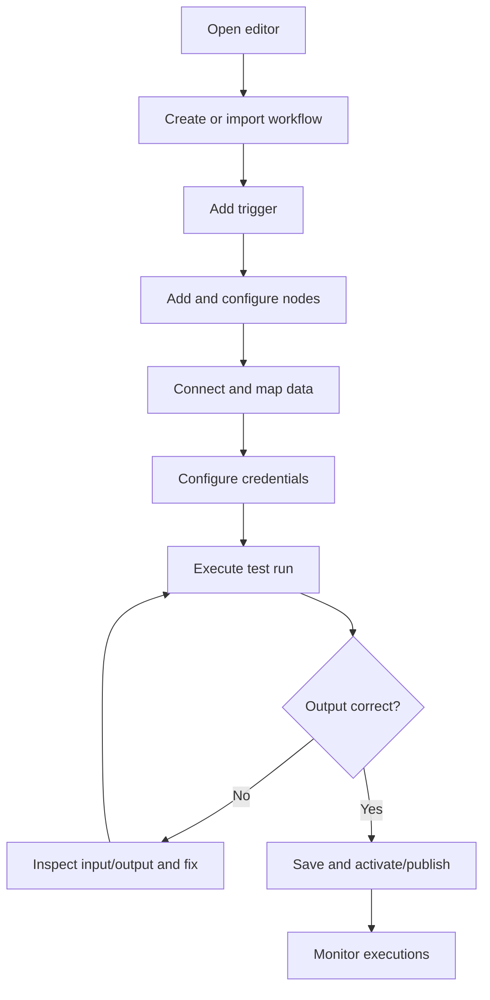

## Connection to AI engineering

The editor is where you compose application orchestration. As AI steps are added, treat their outputs as untrusted external data. Validate structured fields, put approval gates before costly or sensitive tool calls, and log model/provider identifiers and relevant run metadata without unnecessarily storing sensitive prompts or personal data.

## Guided practice

Build a small workflow design (or implement it if your environment is ready): Manual Trigger → Edit Fields (create `name` and `email`) → IF (email is present) → a success branch and a correction branch. Run it twice with different sample values. Rename every node and document what its output should contain.

## Best practices

- Name nodes and workflows after their purpose, not after the order in which you created them.
- Test normal, empty, malformed, duplicate, and failure inputs—not only the happy path.
- Keep credentials out of code, screenshots, exported examples, and public repositories.
- Make data contracts explicit: document what each step expects and returns.
- Add observability and recovery before treating a workflow as production-ready.

## Quick revision

- Navigate the editor and canvas.
- Add, configure, connect, rename, and organize nodes.
- Distinguish trigger, action, core, and integration nodes.
- Configure parameters, expressions, credentials, and connections.
- Execute manually, inspect runs, activate workflows, and understand publishing.
- Use templates and sub-workflows as starting points and reusable components.

## Knowledge check

1. Explain the central idea of **Basics of n8n** in your own words.
2. Draw the workflow or architecture without looking at the notes.
3. Describe one failure case and how you would detect and recover from it.
4. Explain where Python, an API, a database, or an AI model would fit into this topic.

## Official and further reading

- [CampusX: basics of n8n](https://github.com/campusx-official/n8n-notes/tree/main/basics%20of%20n8n).
- [n8n Docs: Nodes](https://docs.n8n.io/build/understand-workflows/workflow-components/work-with-nodes/).
- [n8n Docs: Credentials](https://docs.n8n.io/credentials/).
- [n8n Docs: Executions](https://docs.n8n.io/workflows/executions/).

---

[Back to the master index](../README.md)


---


# Topic 5: Installing n8n

> **Stage:** Stage 2 – Core Concepts  
> **Learning level:** Beginner → practical → professional  
> **Purpose:** Choose a suitable way to run n8n and understand the operational responsibilities of each option.

## Learning outcomes

By the end of this topic, you should be able to:

- Compare n8n Cloud and self-hosted deployments.
- Understand local npm and Docker/Docker Compose installation approaches.
- Recognize the roles of the editor, runtime, database, and environment variables.
- Use persistent storage and protect the encryption key.
- Understand why a laptop setup is different from a reliable production deployment.
- Know when to prefer a managed environment over self-hosting.

## Visual reference


*Image source: [WotAI – How to install n8n](https://wotai.co/blog/how-to-install-n8n). Verify architecture and configuration against the current official n8n hosting guide before deploying.*

## Detailed notes

### 5.1 Choose the environment first

- **n8n Cloud:** managed hosting. It is usually the quickest learning route because the provider manages server operations. Review plan limits, data residency, retention, and pricing before relying on it.
- **Self-hosted:** you operate n8n on your own computer, server, or cloud infrastructure. You gain control, but you become responsible for updates, uptime, TLS, backups, access control, monitoring, and incident response.
- **Local development:** useful for learning and testing. A laptop may sleep, lose connectivity, or change network address, so it is not a dependable production endpoint.

### 5.2 npm installation

The npm route runs n8n in a Node.js environment. It is useful for local development and learners familiar with command-line tools. Check the current n8n prerequisites and supported Node.js version in the official installation guide before installing. Use a dedicated project environment and avoid running a personal learning service with broad network access.

### 5.3 Docker and Docker Compose

Docker packages the application and its runtime into a container. Docker Compose describes a multi-service setup such as n8n plus PostgreSQL and Redis. For persistent work, mount volumes for state and database data. Pin an appropriate image version for controlled upgrades rather than blindly using a floating tag in production.

> Current n8n documentation recommends Docker-based self-hosting for many users and points learners toward Docker Compose for setup. Self-hosting requires server, networking, security, and backup knowledge.

### 5.4 Important configuration concepts

- **Port and URL:** how users and services reach the instance. The standard local interface has commonly used port `5678`, but verify the configured port.
- **Timezone:** set the timezone intentionally for schedules and date calculations.
- **Database:** local SQLite can be convenient for a small single-instance setup; a production design may use PostgreSQL depending on scale and requirements.
- **Encryption key:** protect the key used to encrypt stored credentials. Losing it can prevent access to previously stored secrets.
- **Persistent volume:** keep state outside a disposable container layer.
- **TLS/reverse proxy:** protect traffic when exposing the instance publicly.
- **Backups:** back up the database and necessary configuration/key material using a tested procedure.

### 5.5 Safe installation sequence

1. Decide Cloud versus self-hosted based on skill, privacy, cost, and operational ownership.
2. Read the current official installation instructions.
3. Configure a strong owner account and authentication.
4. Set timezone, persistent storage, and encryption key appropriately.
5. Keep the editor private unless there is a deliberate, secured public-access design.
6. Test credentials and one simple workflow.
7. Document the version, backup location, restore method, and update plan.

Do not copy old commands from tutorials without checking whether they match the current stable n8n release and current installation guidance.

## How the pieces fit together

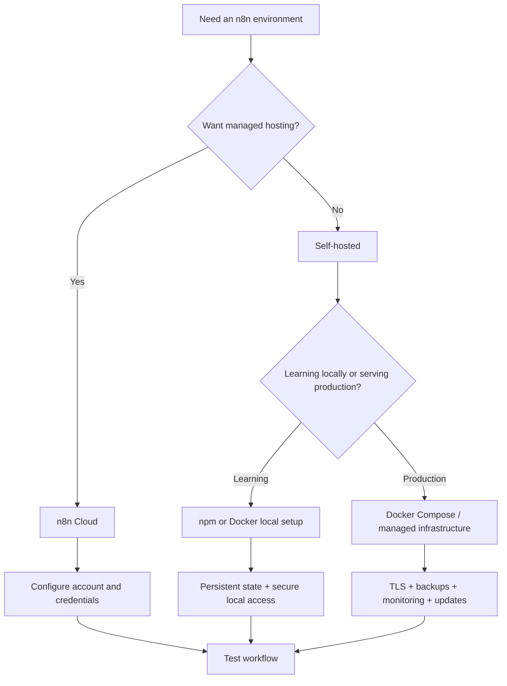

## Connection to AI engineering

AI workflows often store provider credentials, prompts, document content, and tool permissions. Choose hosting based on data sensitivity, where data is processed, and who is allowed to administer the instance. Self-hosting is not automatically more secure; poor patching, secrets handling, or public exposure can make it less secure.

## Guided practice

Before installing, make a decision sheet: expected number of workflows, whether external services need to call webhooks, sensitivity of data, budget, who will maintain the server, and backup needs. For a first learning instance, choose the lowest-complexity option that satisfies the course exercises. Then follow the current official guide rather than using unverified commands.

## Best practices

- Name nodes and workflows after their purpose, not after the order in which you created them.
- Test normal, empty, malformed, duplicate, and failure inputs—not only the happy path.
- Keep credentials out of code, screenshots, exported examples, and public repositories.
- Make data contracts explicit: document what each step expects and returns.
- Add observability and recovery before treating a workflow as production-ready.

## Quick revision

- Compare n8n Cloud and self-hosted deployments.
- Understand local npm and Docker/Docker Compose installation approaches.
- Recognize the roles of the editor, runtime, database, and environment variables.
- Use persistent storage and protect the encryption key.
- Understand why a laptop setup is different from a reliable production deployment.
- Know when to prefer a managed environment over self-hosting.

## Knowledge check

1. Explain the central idea of **Installing n8n** in your own words.
2. Draw the workflow or architecture without looking at the notes.
3. Describe one failure case and how you would detect and recover from it.
4. Explain where Python, an API, a database, or an AI model would fit into this topic.

## Official and further reading

- [CampusX: installing n8n](https://github.com/campusx-official/n8n-notes/tree/main/installing%20n8n).
- [n8n Docs: Hosting](https://docs.n8n.io/hosting/).
- [n8n Docs: Docker Compose installation](https://docs.n8n.io/deploy/host-n8n/install-options/).
- [n8n Hosting examples](https://github.com/n8n-io/n8n-hosting).

---

[Back to the master index](../README.md)


---


# Topic 6: Working with Core Nodes

> **Stage:** Stage 3 – Workflow Development  
> **Learning level:** Beginner → practical → professional  
> **Purpose:** Learn the most useful built-in building blocks and when to use each one.

## Learning outcomes

By the end of this topic, you should be able to:

- Choose the right trigger for manual, scheduled, webhook, or app-event starts.
- Use Edit Fields, IF, Switch, Merge, Loop Over Items, Wait, Code, and HTTP Request nodes.
- Understand Execute Sub-workflow and Error Trigger use cases.
- Design input/output contracts for node boundaries.
- Avoid unnecessary nodes and test each branch.

## Detailed notes

### 6.1 Triggers

- **Manual Trigger:** starts a run when the user executes the workflow; ideal for learning and testing.
- **Schedule Trigger:** starts at configured times or intervals; check timezone, daylight-saving behavior, and activation state.
- **Webhook:** exposes an endpoint for an external HTTP request; validate method, authentication, payload shape, and sender.
- **App triggers:** start when an integrated service reports or exposes an event; the integration may use polling or a provider webhook.

### 6.2 Data and transformation nodes

- **Edit Fields (Set):** create, rename, keep, or remove fields so later nodes receive a clean contract.
- **IF:** send items down a true or false path.
- **Switch:** route items among several named cases.
- **Merge:** combine or coordinate data from separate inputs. Select the correct merge mode and matching key.
- **Loop Over Items:** iterate or batch processing when explicit control is needed; many nodes already process multiple items automatically.
- **Wait:** pause execution until a time or event condition is satisfied; consider timeouts and resume behavior.
- **Code:** implement custom transformations when built-in nodes and expressions are not enough. Keep code small, deterministic, and tested.

### 6.3 Integration and orchestration nodes

- **HTTP Request:** call a REST endpoint or other HTTP service.
- **Execute Sub-workflow:** invoke reusable workflow logic with defined input and output expectations.
- **Error Trigger:** begins an error-handling workflow for configured workflow failures. Use it for alerting and centralized recovery; it does not replace local validation.

### 6.4 Choosing the smallest suitable tool

Use an expression for a small field mapping, Edit Fields for simple field shaping, a dedicated node for a common operation, and Code for complex logic. A workflow with 30 nodes is not automatically more professional than one with 8; clarity and reliability matter more than visual complexity.

### 6.5 Node design checklist

- What exact input does the node receive?
- What does it output when successful, empty, or failed?
- Does it act once per item or once per execution?
- Is the operation safe to retry?
- Does it have side effects such as sending a message or charging a card?
- What credentials and permissions are required?

## How the pieces fit together

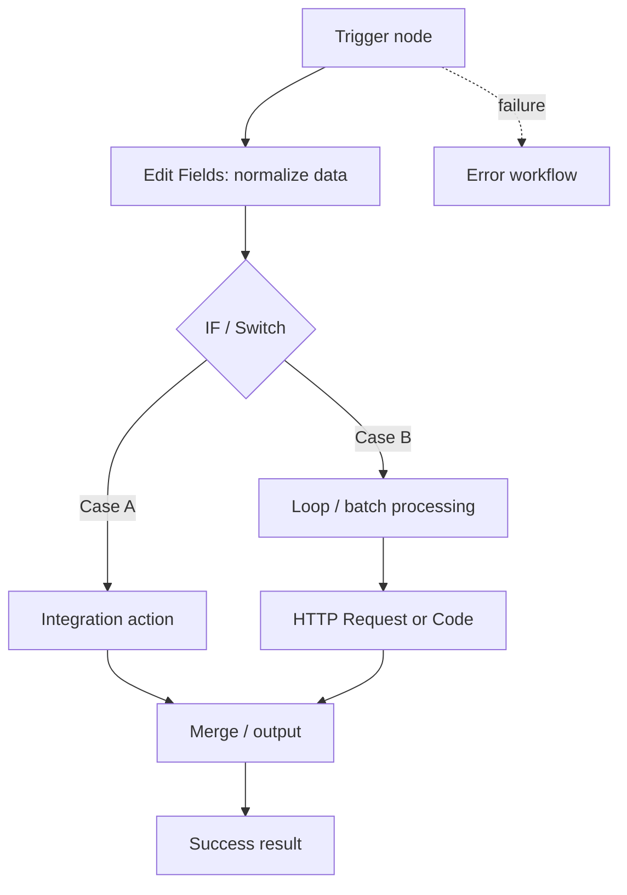

## Connection to AI engineering

Core nodes are the skeleton around an AI model. A robust workflow usually normalizes input before the LLM, constrains and parses the output after it, routes only validated data, and uses human approval before irreversible actions. Use Code for deterministic preparation, not to duplicate capabilities already provided by well-supported nodes.

## Guided practice

Build a support-ticket router design: Webhook → Edit Fields → IF (required fields present) → Switch (billing / technical / other) → route to the right queue. Add a failure path for invalid input and an Error Trigger workflow for execution-level errors. Document what each node should output.

## Best practices

- Name nodes and workflows after their purpose, not after the order in which you created them.
- Test normal, empty, malformed, duplicate, and failure inputs—not only the happy path.
- Keep credentials out of code, screenshots, exported examples, and public repositories.
- Make data contracts explicit: document what each step expects and returns.
- Add observability and recovery before treating a workflow as production-ready.

## Quick revision

- Choose the right trigger for manual, scheduled, webhook, or app-event starts.
- Use Edit Fields, IF, Switch, Merge, Loop Over Items, Wait, Code, and HTTP Request nodes.
- Understand Execute Sub-workflow and Error Trigger use cases.
- Design input/output contracts for node boundaries.
- Avoid unnecessary nodes and test each branch.

## Knowledge check

1. Explain the central idea of **Working with Core Nodes** in your own words.
2. Draw the workflow or architecture without looking at the notes.
3. Describe one failure case and how you would detect and recover from it.
4. Explain where Python, an API, a database, or an AI model would fit into this topic.

## Official and further reading

- [n8n Docs: Nodes](https://docs.n8n.io/build/understand-workflows/workflow-components/work-with-nodes/).
- [n8n Docs: Built-in core nodes](https://docs.n8n.io/integrations/builtin/core-nodes/).
- [n8n Docs: Flow logic](https://docs.n8n.io/flow-logic/).

---

[Back to the master index](../README.md)


---


# Topic 7: Expressions and Data Manipulation

> **Stage:** Stage 3 – Workflow Development  
> **Learning level:** Beginner → practical → professional  
> **Purpose:** Use dynamic expressions and transformation operations to shape data safely and clearly.

## Learning outcomes

By the end of this topic, you should be able to:

- Understand when to use expressions, transformation nodes, or Code.
- Use current-item data such as `$json` in expressions.
- Reference other node data using supported expression syntax.
- Handle arrays, objects, dates, strings, numbers, nulls, and missing fields.
- Choose a safe approach for complex transformations and test it.

## Detailed notes

### 7.1 Three ways to transform data

- **Expressions:** small dynamic calculations or values inside a node parameter. Example: `{{ $json.customer.email }}`.
- **Data transformation nodes:** visual operations such as editing fields, filtering, sorting, aggregating, splitting, or removing duplicates.
- **Code node:** custom logic for more complex restructuring, loops, or calculations. Use it when a visual node or expression becomes harder to understand than a short, well-tested code block.

### 7.2 Current-item data

`$json` is commonly used to access the current item's JSON data. If the input is `{ "customer": { "email": "asha@example.com" } }`, then `{{ $json.customer.email }}` maps the email. If the actual data came from a webhook body, the path may be `{{ $json.body.customer.email }}`. Always inspect the execution data to confirm the path.

### 7.3 Referencing another node

n8n expressions support referencing prior node output. For example, `{{ $('Webhook').first().json.body.name }}` can read the first item from a node named `Webhook`. Item linking and paired-item behavior matter in multi-item workflows; use the appropriate item accessor for the actual flow rather than applying `.first()` blindly.

### 7.4 Data types and defensive handling

- `null` is different from an empty string or a missing property.
- Convert numbers deliberately before arithmetic; strings such as `"12"` may not behave like numeric `12` in all operations.
- Normalize dates to a clear timezone and ISO representation before comparison.
- Check whether an array is empty before accessing its first element.
- Avoid string concatenation for numeric calculations.
- Preserve original identifiers when joining or updating records.

### 7.5 Example: normalize an order

Input fields may arrive as `first_name`, `last_name`, `qty`, and `unit_price`. A transformation can produce `customerName`, integer `quantity`, numeric `unitPrice`, and computed `lineTotal`. Verify that malformed values do not silently produce `NaN` or zero.

### 7.6 Code node discipline

Keep code deterministic where possible. Define expected input, validate it, transform, and return the expected output shape. Avoid hidden network calls and undeclared dependencies. Add comments for non-obvious logic and test with empty, large, malformed, and multiple-item inputs.

## How the pieces fit together

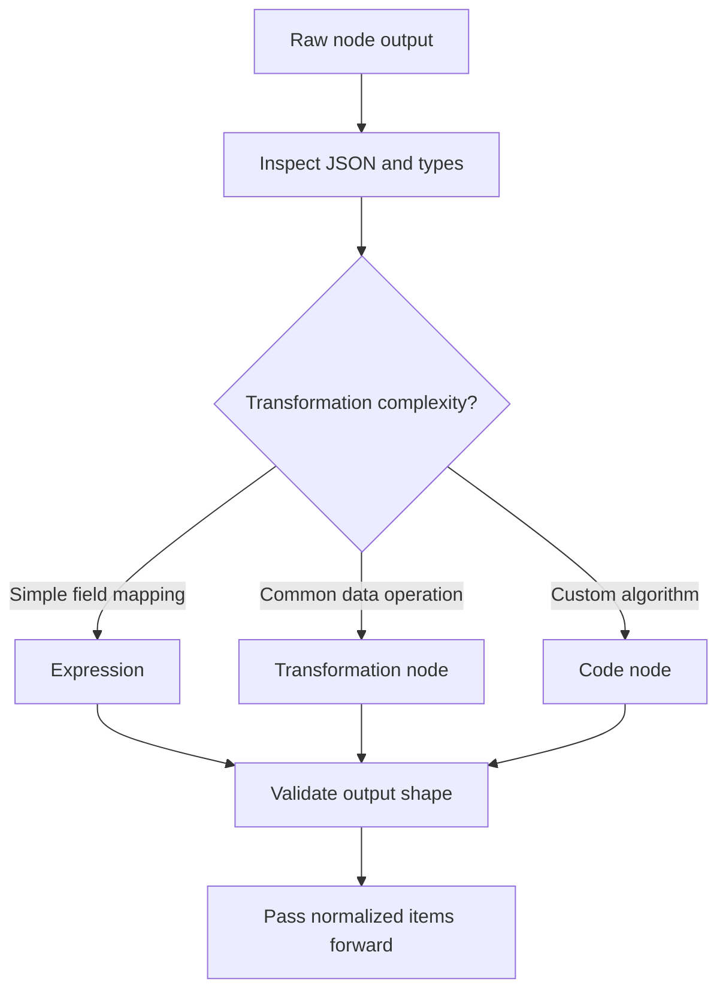

## Connection to AI engineering

Before sending text to an LLM, normalize fields, remove unnecessary personal information, and enforce a payload size limit. After an LLM responds, parse its structured output, validate field types and allowed values, then use deterministic expressions or code to route the result.

## Guided practice

Create a sample JSON order with two products. Design an output with `orderId`, `customerEmail`, `totalQuantity`, and `totalAmount`. Write the expression or pseudocode for each derived field. Test an item with a missing price and explain whether the workflow should stop, default, or send it for review.

## Best practices

- Name nodes and workflows after their purpose, not after the order in which you created them.
- Test normal, empty, malformed, duplicate, and failure inputs—not only the happy path.
- Keep credentials out of code, screenshots, exported examples, and public repositories.
- Make data contracts explicit: document what each step expects and returns.
- Add observability and recovery before treating a workflow as production-ready.

## Quick revision

- Understand when to use expressions, transformation nodes, or Code.
- Use current-item data such as `$json` in expressions.
- Reference other node data using supported expression syntax.
- Handle arrays, objects, dates, strings, numbers, nulls, and missing fields.
- Choose a safe approach for complex transformations and test it.

## Knowledge check

1. Explain the central idea of **Expressions and Data Manipulation** in your own words.
2. Draw the workflow or architecture without looking at the notes.
3. Describe one failure case and how you would detect and recover from it.
4. Explain where Python, an API, a database, or an AI model would fit into this topic.

## Official and further reading

- [n8n Docs: Expressions versus data nodes](https://docs.n8n.io/code/expressions/).
- [n8n Docs: Data structure](https://docs.n8n.io/data/data-structure/).
- [n8n Docs: Code node](https://docs.n8n.io/code/code-node/).

---

[Back to the master index](../README.md)


---


# Topic 8: APIs and HTTP Requests

> **Stage:** Stage 3 – Workflow Development  
> **Learning level:** Beginner → practical → professional  
> **Purpose:** Develop the API literacy needed to connect n8n to almost any modern software service.

## Learning outcomes

By the end of this topic, you should be able to:

- Explain API, REST, client/server, request, and response.
- Choose GET, POST, PUT, PATCH, or DELETE appropriately.
- Configure URLs, headers, query parameters, path parameters, and bodies.
- Understand JSON, status codes, and authentication.
- Handle pagination, rate limits, retries, and timeouts.
- Use the HTTP Request node to connect services that lack a dedicated integration.

## Visual reference


*Image source: [Swastik Sharma – REST APIs, Beginner Friendly Guide](https://medium.com/%40swastik7sharma/rest-apis-beginner-friendly-guide-e2a4a65239f2).*

## Detailed notes

### 8.1 What is an API?

An **Application Programming Interface** is a defined contract through which one software system requests a service or data from another. In a web API, a client sends an HTTP request to a server endpoint, and the server returns a response. The response may contain JSON, a file, or another representation.

### 8.2 REST concepts

REST is an architectural style commonly used by web APIs. APIs often model resources such as `/customers` or `/orders` and use HTTP methods to describe the operation.

| Method | Typical intent | Example |
|---|---|---|
| GET | Read a resource | `GET /customers/42` |
| POST | Create or submit | `POST /orders` |
| PUT | Replace/update a resource representation | `PUT /customers/42` |
| PATCH | Partially update | `PATCH /customers/42` |
| DELETE | Remove a resource | `DELETE /customers/42` |

The server's contract is authoritative. Not every API uses methods in exactly the same way. GET should not be used for actions that change state.

### 8.3 Anatomy of an HTTP request

- **Method:** what operation is requested.
- **URL / endpoint:** the target service and resource.
- **Path parameters:** identify a resource, such as `/users/123`.
- **Query parameters:** filter or paginate, such as `?status=active&page=2`.
- **Headers:** metadata such as `Accept`, `Content-Type`, or authorization.
- **Body:** data sent with methods such as POST or PATCH, often JSON.

### 8.4 Response and status codes

A response includes a status code, headers, and sometimes a body. Common groups: `2xx` success, `3xx` redirection, `4xx` client/request/authentication problems, and `5xx` server-side failures. Common examples include `200 OK`, `201 Created`, `400 Bad Request`, `401 Unauthorized`, `403 Forbidden`, `404 Not Found`, `429 Too Many Requests`, and `500 Internal Server Error`.

Do not assume every non-200 response means the same thing. Read the provider's error body and documentation.

### 8.5 Authentication

Common schemes include API keys, bearer tokens, Basic authentication, and OAuth 2.0. Store secrets in n8n credentials or an approved secret manager; do not hard-code them in URLs or code. OAuth scopes should be limited to the permissions the workflow needs.

### 8.6 HTTP Request node design

1. Choose method and endpoint.
2. Select the authentication/credential mechanism.
3. Add query parameters, headers, and request body as required.
4. Map dynamic values from the current item.
5. Configure response handling and timeout appropriately.
6. Execute a test request and inspect status, headers, and body.
7. Add pagination, retry, or error handling if the API requires it.

### 8.7 Pagination, limits, and retries

APIs commonly cap the number of records per response. Pagination may use page numbers, offsets, cursors, or continuation tokens. Follow the provider's contract; stop when no next page remains. Rate limits restrict request frequency. Respect `429` responses and any `Retry-After` header. Use exponential backoff with jitter for transient failures where appropriate. Avoid retrying non-idempotent operations blindly: a second POST could create a duplicate order or send a duplicate message.

### 8.8 Idempotency and safe retries

An operation is idempotent when repeating it has the same intended effect as performing it once. For non-idempotent creation operations, use provider-supported idempotency keys or check whether the record already exists before retrying. Log a stable correlation ID for each business transaction.

## How the pieces fit together

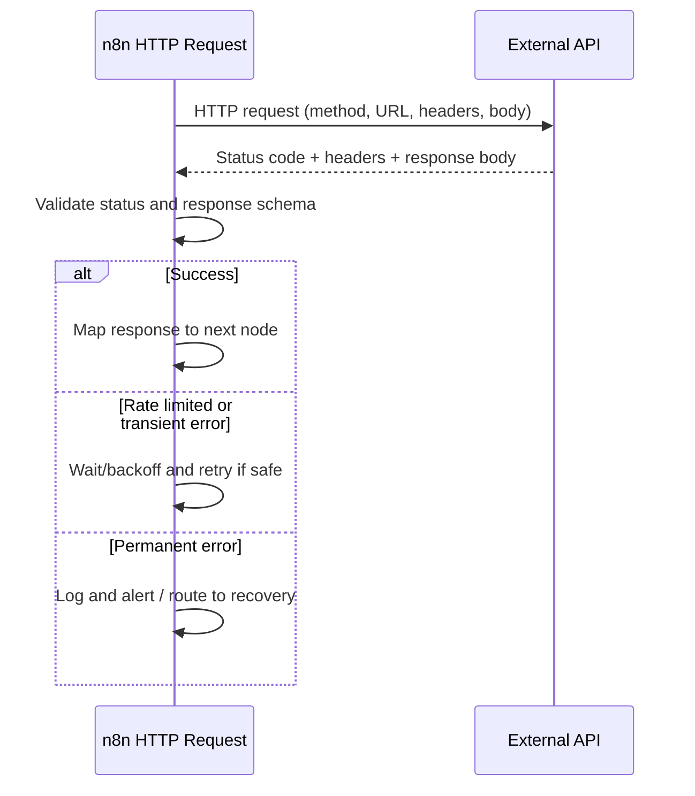

## Connection to AI engineering

Nearly every AI provider exposes an API. n8n can submit a prompt and receive a response, but a professional workflow also checks provider limits, response schema, model errors, data-processing terms, token usage, and retries. Do not log secret-bearing request headers or sensitive prompt content unnecessarily.

## Guided practice

Use a public practice API or a test endpoint. Make one GET request, inspect the JSON response, and map two fields into Edit Fields. Then test a 404 or invalid request. Document the status code, response body, and recovery behavior. Do not use a production API key for this exercise.

## Best practices

- Name nodes and workflows after their purpose, not after the order in which you created them.
- Test normal, empty, malformed, duplicate, and failure inputs—not only the happy path.
- Keep credentials out of code, screenshots, exported examples, and public repositories.
- Make data contracts explicit: document what each step expects and returns.
- Add observability and recovery before treating a workflow as production-ready.

## Quick revision

- Explain API, REST, client/server, request, and response.
- Choose GET, POST, PUT, PATCH, or DELETE appropriately.
- Configure URLs, headers, query parameters, path parameters, and bodies.
- Understand JSON, status codes, and authentication.
- Handle pagination, rate limits, retries, and timeouts.
- Use the HTTP Request node to connect services that lack a dedicated integration.

## Knowledge check

1. Explain the central idea of **APIs and HTTP Requests** in your own words.
2. Draw the workflow or architecture without looking at the notes.
3. Describe one failure case and how you would detect and recover from it.
4. Explain where Python, an API, a database, or an AI model would fit into this topic.

## Official and further reading

- [n8n Docs: HTTP Request node](https://docs.n8n.io/integrations/builtin/core-nodes/n8n-nodes-base.httprequest/).
- [n8n Docs: API authentication](https://docs.n8n.io/integrations/builtin/credentials/).
- [MDN: HTTP request methods](https://developer.mozilla.org/en-US/docs/Web/HTTP/Methods).
- [MDN: HTTP response status codes](https://developer.mozilla.org/en-US/docs/Web/HTTP/Status).

---

[Back to the master index](../README.md)


---


# Topic 9: Working with External Applications

> **Stage:** Stage 3 – Workflow Development  
> **Learning level:** Beginner → practical → professional  
> **Purpose:** Connect common business tools and design integrations that synchronize data across systems.

## Learning outcomes

By the end of this topic, you should be able to:

- Understand native app nodes versus generic API connections.
- Connect Google Sheets, Forms, Gmail, Telegram, Slack, Notion, GitHub, and databases conceptually.
- Choose between event triggers, polling, and webhooks.
- Configure credentials with least privilege.
- Map records and avoid duplicates.
- Design useful cross-application workflows.

## Detailed notes

### 9.1 Native integrations and generic APIs

A native n8n integration provides an interface for supported service operations and often simplifies authentication and field mapping. Not every app supports every trigger or action. When a suitable operation is missing, use HTTP Request with the provider's API documentation. A generic request requires you to understand the API contract, pagination, authentication, and errors.

### 9.2 Common application roles

- **Google Forms / form service:** captures input from people.
- **Google Sheets:** convenient lightweight record storage and reporting; not a substitute for a transactional database at all scales.
- **Gmail:** sends or processes email; handle attachments and personal data carefully.
- **Telegram / Slack:** notifications and conversational interfaces; protect bot tokens and restrict who can invoke privileged commands.
- **Notion:** stores pages and structured workspace content; respect workspace permissions.
- **GitHub:** issues, pull requests, commits, and repository events; use least-privilege tokens and avoid leaking source or secrets.
- **PostgreSQL or another database:** durable structured records; use constraints and transactions where needed.

### 9.3 Event, polling, and webhook integration

Some connectors listen for provider events through webhooks. Others periodically poll for new or changed records. Polling can add delay and consume API quota; webhooks need a publicly reachable endpoint and sender verification. Choose the method supported by the service and your deployment.

### 9.4 Data synchronization problems

A robust integration must consider:

- **Identity:** how do you know two records refer to the same customer or order? Use a stable ID, not just a display name.
- **Duplicates:** an event can arrive more than once. Make writes idempotent or deduplicate by event/resource ID.
- **Ordering:** events may arrive late or out of order. Use timestamps and version fields where available.
- **Partial failure:** Sheets may update while Gmail fails. Record the status so the workflow can resume safely.
- **Schema drift:** an upstream service may rename or add fields. Validate required fields and monitor changes.
- **Permissions:** grant only the required spreadsheet, mailbox, repository, or database permissions.

### 9.5 Example integration pattern

A new GitHub issue triggers a workflow. n8n normalizes title/body/repository/author, checks whether the issue ID already exists, sends a safe text-only summary to an LLM, validates category and priority, writes the issue to a database, and notifies the matching Slack channel. The original issue URL and identifier remain attached for traceability.

## How the pieces fit together

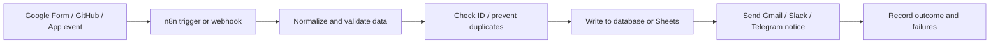

## Connection to AI engineering

AI can enrich records during integration—for example, classify a GitHub issue, extract invoice fields, or summarize a customer conversation. Keep raw source data and AI-enriched fields distinct. Preserve source IDs and links so a reviewer can verify the AI result.

## Guided practice

Design an issue-to-Slack workflow: choose the GitHub trigger, define the fields to preserve, create a deduplication key, choose an AI classification schema, map categories to Slack channels, and specify what happens if Slack is unavailable. Do not connect a bot to a real team workspace until its permissions and routing are reviewed.

## Best practices

- Name nodes and workflows after their purpose, not after the order in which you created them.
- Test normal, empty, malformed, duplicate, and failure inputs—not only the happy path.
- Keep credentials out of code, screenshots, exported examples, and public repositories.
- Make data contracts explicit: document what each step expects and returns.
- Add observability and recovery before treating a workflow as production-ready.

## Quick revision

- Understand native app nodes versus generic API connections.
- Connect Google Sheets, Forms, Gmail, Telegram, Slack, Notion, GitHub, and databases conceptually.
- Choose between event triggers, polling, and webhooks.
- Configure credentials with least privilege.
- Map records and avoid duplicates.
- Design useful cross-application workflows.

## Knowledge check

1. Explain the central idea of **Working with External Applications** in your own words.
2. Draw the workflow or architecture without looking at the notes.
3. Describe one failure case and how you would detect and recover from it.
4. Explain where Python, an API, a database, or an AI model would fit into this topic.

## Official and further reading

- [n8n Integrations library](https://n8n.io/integrations/).
- [n8n Docs: Webhook node](https://docs.n8n.io/integrations/builtin/core-nodes/n8n-nodes-base.webhook/).
- [n8n Docs: Credentials](https://docs.n8n.io/credentials/).

---

[Back to the master index](../README.md)


---


# Topic 10: Introduction to AI in n8n

> **Stage:** Stage 4 – AI Integration  
> **Learning level:** Beginner → practical → professional  
> **Purpose:** Understand where LLMs fit in workflows and how to connect them responsibly.

## Learning outcomes

By the end of this topic, you should be able to:

- Distinguish ordinary rule-based automation from AI-powered automation.
- Explain LLMs, tokens, prompts, context windows, and model providers.
- Connect a model to n8n using a supported node or API.
- Design system instructions and user prompts.
- Request and validate structured output.
- Account for hallucinations, privacy, latency, cost, and model limits.

## Detailed notes

### 10.1 What changes when AI is added?

Traditional automation is effective for deterministic operations: compare a value, format a date, or route an order by status. AI is useful when the input is unstructured or ambiguous: summarize a long email, classify free text, extract fields from a document, or draft a response. The best workflow combines deterministic logic with AI only where AI adds value.

### 10.2 Large Language Models

An **LLM** is a model trained to process and generate language. It receives tokenized input and produces a sequence of output tokens. It does not automatically know your private company data, guarantee factual accuracy, or understand your business rules unless those are provided through context and tools.

- **Token:** a unit of text processing; token counts influence context and cost.
- **Context window:** the amount of input/output context a model can handle in one request.
- **Provider/model:** the service and model family used to generate the response.
- **Temperature / sampling controls:** settings that can influence output variability. Lower variability does not guarantee correctness.
- **Prompt:** instructions and data provided to guide the model.

### 10.3 Prompt structure

A reliable prompt separates role/instructions, task, context, input data, output format, constraints, and examples if needed. Tell the model what to do when the information is missing. Do not put secrets or unnecessary personal data in prompts.

### 10.4 Structured output

When downstream nodes need predictable fields, request JSON or use a structured-output parser/schema where available. Then validate the output: required fields, data types, allowed category values, numeric ranges, and length constraints. A syntactically valid JSON response can still be factually wrong or semantically invalid.

### 10.5 Model connection in n8n

Use a supported provider integration or HTTP Request. Add credentials, select a model, map input text, configure relevant parameters, and inspect the result. Provider node names and options can evolve; use the current node documentation and provider API docs.

### 10.6 Risks and controls

- **Hallucination:** require source grounding, verification, or abstention when facts are uncertain.
- **Prompt injection:** treat user documents, webpages, and tool outputs as untrusted data; do not let them override system policies.
- **Privacy:** minimize data sent to the provider and review retention/processing policies.
- **Cost:** estimate token usage, limit context, and choose model capability proportional to the task.
- **Latency and availability:** add timeouts and failure paths.
- **Evaluation:** test against representative examples and edge cases before deployment.

## How the pieces fit together

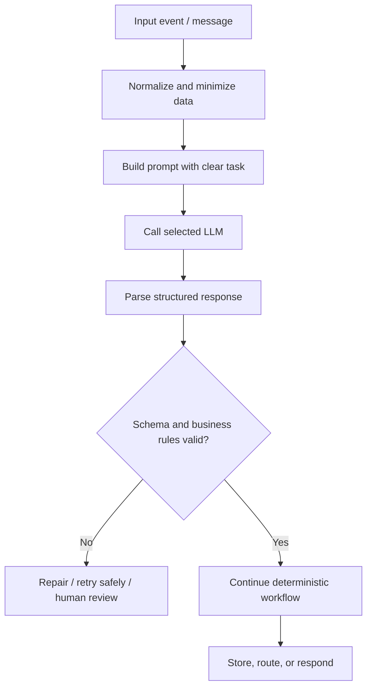

## Connection to AI engineering

A strong AI workflow treats the model as a probabilistic component inside a deterministic system. n8n manages the process; the LLM handles language tasks. The workflow should validate the response before it triggers a database change, email, purchase, or external action.

## Guided practice

Design a complaint classifier. Define three allowed labels (`billing`, `technical`, `other`), an `urgency` field (`low`, `medium`, `high`), and a short reason. Draft a prompt that says not to invent missing facts. List five test complaints, including one ambiguous and one malicious instruction embedded in the complaint.

## Best practices

- Name nodes and workflows after their purpose, not after the order in which you created them.
- Test normal, empty, malformed, duplicate, and failure inputs—not only the happy path.
- Keep credentials out of code, screenshots, exported examples, and public repositories.
- Make data contracts explicit: document what each step expects and returns.
- Add observability and recovery before treating a workflow as production-ready.

## Quick revision

- Distinguish ordinary rule-based automation from AI-powered automation.
- Explain LLMs, tokens, prompts, context windows, and model providers.
- Connect a model to n8n using a supported node or API.
- Design system instructions and user prompts.
- Request and validate structured output.
- Account for hallucinations, privacy, latency, cost, and model limits.

## Knowledge check

1. Explain the central idea of **Introduction to AI in n8n** in your own words.
2. Draw the workflow or architecture without looking at the notes.
3. Describe one failure case and how you would detect and recover from it.
4. Explain where Python, an API, a database, or an AI model would fit into this topic.

## Official and further reading

- [n8n Docs: Integrate AI](https://docs.n8n.io/advanced-ai/).
- [n8n Docs: Understand AI components](https://docs.n8n.io/advanced-ai/understand-ai/).
- [OWASP: Top 10 for LLM Applications](https://owasp.org/www-project-top-10-for-large-language-model-applications/).

---

[Back to the master index](../README.md)


---


# Topic 11: AI Nodes and AI Chains

> **Stage:** Stage 4 – AI Integration  
> **Learning level:** Beginner → practical → professional  
> **Purpose:** Understand model, chain, prompt, parser, and orchestration components used to build repeatable AI tasks.

## Learning outcomes

By the end of this topic, you should be able to:

- Explain the roles of LLM, prompt template, chain, and output parser.
- Distinguish a fixed chain from an agent that chooses tools dynamically.
- Combine AI nodes with ordinary n8n nodes.
- Request and validate structured outputs.
- Design sequential AI processing and handle intermediate failures.

## Visual reference


*Image source: [Nuvi – Comparing no-code AI agent builders](https://www.nuvi.dev/blog/ai-agent-platforms-compared). Interface details can change between n8n versions.*

## Detailed notes

### 11.1 What is an AI chain?

A **chain** is a connected sequence of defined AI-related steps. The workflow designer determines the sequence. For example: prepare input → build prompt → call LLM → parse JSON → validate fields → continue. A chain is often easier to test and control than an agent when the process is known in advance.

### 11.2 Main components

- **Chat model / language model:** generates or interprets text.
- **Prompt template:** inserts dynamic input into reusable instructions.
- **Output parser:** converts model text into a required structure or checks a schema.
- **Chain:** connects model and processing components into a repeatable task.
- **Retriever / vector store:** provides relevant context for a RAG-style chain.
- **Normal n8n nodes:** handle triggers, conditions, APIs, databases, and notifications around the AI chain.

### 11.3 A sequential pipeline

Example document summarization:

1. Receive a document and extract text.
2. Check file type and length.
3. Split long text into sections if needed.
4. Summarize each section using a consistent prompt.
5. Combine the section summaries.
6. Ask for a final summary in a defined format.
7. Validate output and store it.

This sequence is predictable; a dynamic agent is not needed unless it must choose tools or plans based on the content.

### 11.4 Structured output

Define a schema before sending the output into business logic. For example:

```json
{
  "category": "billing",
  "priority": "high",
  "summary": "Duplicate charge reported",
  "needs_human_review": true
}
```

Validate required keys, enum values, and data types after parsing. If parsing fails, route to a safe fallback rather than assuming the text is valid.

### 11.5 Chains versus agents

Use a chain when the steps are known. Use an agent when it must select among tools or determine intermediate steps. Agents offer flexibility but introduce additional uncertainty, latency, cost, and security considerations.

### 11.6 Model versioning and reproducibility

Record which provider/model and prompt version were used when evaluating important workflows. Provider output can change across model versions even if the prompt remains the same. Keep test cases and compare output quality before changing models.

## How the pieces fit together

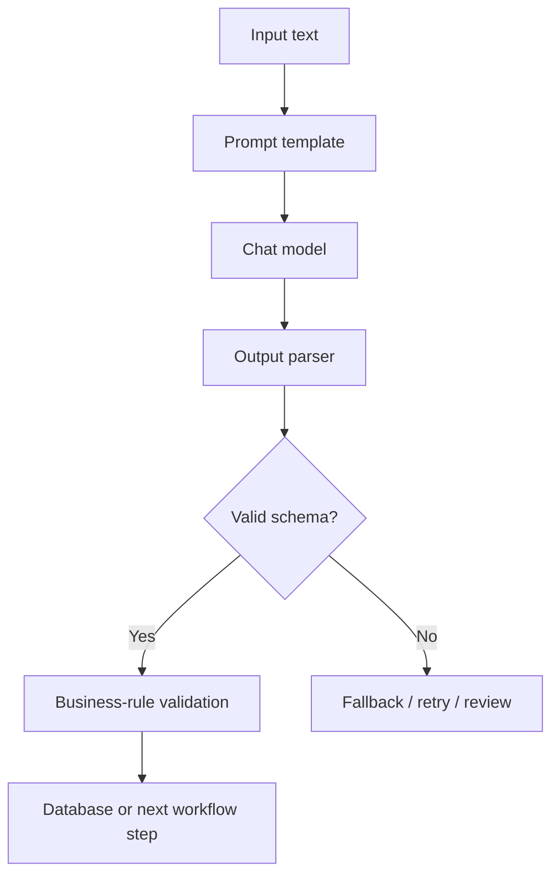

## Connection to AI engineering

Chains are ideal for repeatable AI tasks inside an n8n automation: extraction, summarization, classification, and rewriting. Put deterministic validation outside the model. For business-critical extraction, store the original source location or snippet so humans can verify each field.

## Guided practice

Create a chain design that extracts invoice number, invoice date, vendor, currency, and total. Define what should happen when the number is missing or the currency is ambiguous. Prepare at least ten sample invoices or synthetic examples and score exact field accuracy.

## Best practices

- Name nodes and workflows after their purpose, not after the order in which you created them.
- Test normal, empty, malformed, duplicate, and failure inputs—not only the happy path.
- Keep credentials out of code, screenshots, exported examples, and public repositories.
- Make data contracts explicit: document what each step expects and returns.
- Add observability and recovery before treating a workflow as production-ready.

## Quick revision

- Explain the roles of LLM, prompt template, chain, and output parser.
- Distinguish a fixed chain from an agent that chooses tools dynamically.
- Combine AI nodes with ordinary n8n nodes.
- Request and validate structured outputs.
- Design sequential AI processing and handle intermediate failures.

## Knowledge check

1. Explain the central idea of **AI Nodes and AI Chains** in your own words.
2. Draw the workflow or architecture without looking at the notes.
3. Describe one failure case and how you would detect and recover from it.
4. Explain where Python, an API, a database, or an AI model would fit into this topic.

## Official and further reading

- [n8n Docs: AI components](https://docs.n8n.io/advanced-ai/understand-ai/).
- [n8n Docs: AI examples](https://docs.n8n.io/advanced-ai/ai-examples/).
- [n8n Docs: Test and improve AI workflows](https://docs.n8n.io/advanced-ai/evaluations/).

---

[Back to the master index](../README.md)


---


# Topic 12: AI Agents

> **Stage:** Stage 4 – AI Integration  
> **Learning level:** Beginner → practical → professional  
> **Purpose:** Understand how agents use models and tools to pursue a goal over multiple steps, and how to constrain them safely.

## Learning outcomes

By the end of this topic, you should be able to:

- Define an AI agent and distinguish it from a fixed chain.
- Understand the model, instructions, tools, memory, and execution loop.
- Connect approved tools and configure tool descriptions.
- Control tool permissions and side effects.
- Add human approval and stopping conditions.
- Evaluate tool choice, completion, and failure behavior.

## Visual reference


*Image source: [Nuvi – Comparing no-code AI agent builders](https://www.nuvi.dev/blog/ai-agent-platforms-compared). Interface details can change between n8n versions.*

## Detailed notes

### 12.1 What is an AI agent?

An **AI agent** is a system in which a model can decide what step to take next, often by selecting from a set of tools, observing their results, and continuing until it reaches a stopping condition. An agent is not automatically autonomous in a safe or reliable way. Its capabilities are determined by its tools, instructions, permissions, guardrails, and execution environment.

### 12.2 Agent architecture

- **Model:** interprets the task and decides the next action.
- **System instructions:** define the role, goals, boundaries, and output expectations.
- **Tools:** controlled operations the agent may request, such as search, calculator, database lookup, or calling a sub-workflow.
- **Memory/context:** information retained or retrieved during a conversation or task.
- **Observation:** results returned by tools.
- **Stop condition:** the agent finishes, reaches a limit, or hands off to a person.

### 12.3 Agent loop

1. Receive the user's goal and relevant context.
2. Model reasons about what information/action is needed.
3. Model requests a tool with arguments.
4. n8n/tool layer checks and executes the operation according to configured permissions.
5. Result is returned to the agent.
6. Agent decides whether to continue, use another tool, or finish.
7. Workflow validates the final response and records the outcome.

### 12.4 Tool design

A tool should have one clear purpose, a narrow input schema, a limited permission scope, and a predictable result. A vague tool called `do_anything` is dangerous. Prefer `look_up_order(order_id)` or `create_draft_reply(ticket_id, text)` with clearly defined behavior.

### 12.5 Safety boundaries

- Separate read-only tools from tools that change state.
- Require approval before sending external messages, issuing refunds, deleting records, or making purchases.
- Validate tool arguments; the model can produce malformed or unsafe parameters.
- Limit the number of tool calls and total execution time.
- Restrict data access to the current user or tenant.
- Treat tool output and retrieved text as untrusted content.
- Log tool name, argument summary, result status, and approval decision without exposing secrets.

### 12.6 When not to use an agent

If a fixed sequence or a simple IF/Switch rule solves the task, use that. Agents are helpful when the next action depends on context and tool choice. They are a poor fit for exact arithmetic, strict deterministic policies, or unrestricted high-impact operations.

## How the pieces fit together

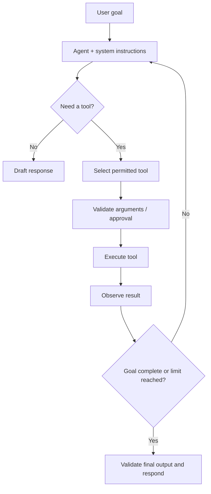

## Connection to AI engineering

n8n can connect an AI Agent node to a chat model, memory, and tools. The workflow should remain the policy enforcement layer: authenticate the user, constrain tools, apply approvals, validate outputs, and record actions. Never rely only on the model's promise to behave safely.

## Guided practice

Design a read-only research agent that can search a small approved knowledge base and calculate simple totals. Define three tools, the exact parameters each accepts, the data each can access, and a maximum tool-call count. Add a separate approval-required tool for sending an email, but do not let the agent execute it without approval.

## Best practices

- Name nodes and workflows after their purpose, not after the order in which you created them.
- Test normal, empty, malformed, duplicate, and failure inputs—not only the happy path.
- Keep credentials out of code, screenshots, exported examples, and public repositories.
- Make data contracts explicit: document what each step expects and returns.
- Add observability and recovery before treating a workflow as production-ready.

## Quick revision

- Define an AI agent and distinguish it from a fixed chain.
- Understand the model, instructions, tools, memory, and execution loop.
- Connect approved tools and configure tool descriptions.
- Control tool permissions and side effects.
- Add human approval and stopping conditions.
- Evaluate tool choice, completion, and failure behavior.

## Knowledge check

1. Explain the central idea of **AI Agents** in your own words.
2. Draw the workflow or architecture without looking at the notes.
3. Describe one failure case and how you would detect and recover from it.
4. Explain where Python, an API, a database, or an AI model would fit into this topic.

## Official and further reading

- [n8n Docs: Build and manage agents](https://docs.n8n.io/advanced-ai/ai-agent/).
- [n8n Docs: AI tools](https://docs.n8n.io/advanced-ai/ai-tools/).
- [OWASP: LLM application risks](https://owasp.org/www-project-top-10-for-large-language-model-applications/).

---

[Back to the master index](../README.md)


---


# Topic 13: Memory and Context Management

> **Stage:** Stage 4 – AI Integration  
> **Learning level:** Beginner → practical → professional  
> **Purpose:** Understand what an AI system remembers, how sessions are separated, and why memory must be controlled.

## Learning outcomes

By the end of this topic, you should be able to:

- Distinguish prompt context, conversation history, short-term memory, and long-term memory.
- Use session identifiers to isolate conversations.
- Understand persistence and retention.
- Avoid storing unnecessary or sensitive information.
- Manage context-window limits and stale or conflicting facts.
- Test memory retrieval and deletion behavior.

## Detailed notes

### 13.1 Context is not the same as memory

**Context** is information available to a model for the current request. It can include the current prompt, relevant conversation turns, retrieved documents, and tool results. **Memory** is information retained or retrieved across steps or sessions so it can influence a later interaction. A large prompt is not automatically good memory.

### 13.2 Types of memory

- **Short-term / conversational memory:** recent messages or task state used during a conversation.
- **Long-term memory:** selected facts or records persisted beyond one conversation.
- **External knowledge store:** documents and records retrieved when needed; this is often better for large knowledge bases than putting everything in the prompt.
- **Working state:** temporary workflow data such as the current order ID or approval status.

### 13.3 Session isolation

Use a stable session ID that uniquely identifies a conversation or user context. Do not use a shared constant for all users. If two students use the same memory key, one user's conversation may leak into the other's context. Derive session IDs from authenticated identities and enforce tenant boundaries in storage.

### 13.4 Context-window management

A model has a finite context window. Include only relevant information, summarize older turns when appropriate, retrieve facts on demand, and avoid sending large repeated documents with every call. Preserve dates and source references to distinguish old facts from current facts.

### 13.5 Memory quality and privacy

Memory can become stale, incorrect, or contradictory. Store a source, timestamp, confidence or verification status where appropriate. Let users correct or delete information where required by product policy and law. Avoid retaining secrets, credentials, or unnecessary sensitive personal information. Define retention and access controls before building long-term memory.

### 13.6 Practical memory design

For a student assistant, short-term memory may keep the current question and recent follow-up turns. Long-term storage could hold user-approved preferences such as preferred response format. Academic records should come from an authorized database with access checks—not from free-form model memory.

## How the pieces fit together

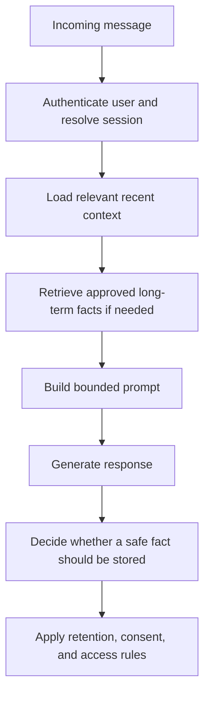

## Connection to AI engineering

In an n8n AI workflow, memory nodes or external stores can supply conversation context. Keep memory scoped per authenticated user/session and separate user statements from verified database facts. For RAG, retrieve documents rather than storing an entire private knowledge base as conversational memory.

## Guided practice

Design memory for a college helpdesk bot. List: (a) what stays only for the current chat, (b) what may be saved with user consent, (c) what must be fetched from an authoritative college system, and (d) what must never be stored. Describe how you would prevent session ID collision.

## Best practices

- Name nodes and workflows after their purpose, not after the order in which you created them.
- Test normal, empty, malformed, duplicate, and failure inputs—not only the happy path.
- Keep credentials out of code, screenshots, exported examples, and public repositories.
- Make data contracts explicit: document what each step expects and returns.
- Add observability and recovery before treating a workflow as production-ready.

## Quick revision

- Distinguish prompt context, conversation history, short-term memory, and long-term memory.
- Use session identifiers to isolate conversations.
- Understand persistence and retention.
- Avoid storing unnecessary or sensitive information.
- Manage context-window limits and stale or conflicting facts.
- Test memory retrieval and deletion behavior.

## Knowledge check

1. Explain the central idea of **Memory and Context Management** in your own words.
2. Draw the workflow or architecture without looking at the notes.
3. Describe one failure case and how you would detect and recover from it.
4. Explain where Python, an API, a database, or an AI model would fit into this topic.

## Official and further reading

- [n8n Docs: What is memory?](https://docs.n8n.io/advanced-ai/examples/understand-memory/).
- [n8n Docs: AI components](https://docs.n8n.io/advanced-ai/understand-ai/).
- [OWASP: LLM application risks](https://owasp.org/www-project-top-10-for-large-language-model-applications/).

---

[Back to the master index](../README.md)


---


# Topic 14: Embeddings and Vector Databases

> **Stage:** Stage 4 – AI Integration  
> **Learning level:** Beginner → practical → professional  
> **Purpose:** Understand how semantic search represents text numerically and retrieves related information.

## Learning outcomes

By the end of this topic, you should be able to:

- Explain embeddings and vector representations.
- Understand similarity search at a conceptual level.
- Describe vector database records, metadata, and indexes.
- Compare keyword search with semantic search.
- Prepare chunks and metadata for retrieval.
- Choose a vector store based on requirements rather than popularity.

## Visual reference


*Image source: [Shift Asia – Vector Databases Explained](https://shiftasia.com/community/vector-databases-explained/).*

## Detailed notes

### 14.1 What is an embedding?

An **embedding** is a numerical vector produced by a model to represent content such as a sentence, paragraph, image, or other input. The vector captures patterns useful for measuring similarity. Texts with related meanings may be near each other in the embedding space, but embeddings do not guarantee that two passages are factually equivalent.

### 14.2 Similarity search

A user query is embedded using a compatible embedding model. The vector database searches for stored vectors that are close under a chosen similarity metric, such as cosine similarity, dot product, or Euclidean distance. The selected metric and normalization must match the embedding model and vector-store configuration.

### 14.3 Vector database record

A typical record contains:

- A unique ID.
- The embedding vector.
- The text chunk or a reference to it.
- Metadata such as document ID, title, page, department, date, access group, and source URL.

Metadata is critical: it allows filtering by permission, document type, date, or tenant before returning context.

### 14.4 Keyword search versus semantic search

Keyword search is useful for exact terms, IDs, names, and precise phrases. Semantic search can retrieve conceptually related text even when wording differs. A hybrid approach can combine both. Neither approach removes the need to inspect relevance and access permissions.

### 14.5 Indexing pipeline

1. Collect approved documents.
2. Extract text and metadata.
3. Clean text and split it into chunks.
4. Generate embeddings using a specific model.
5. Store vectors and metadata in a vector database.
6. At query time, embed the question and retrieve relevant chunks.

Changing embedding model or dimensions can require re-embedding and rebuilding the index. Keep model names, dimensions, chunking policy, and source versions with the index metadata.

### 14.6 Choosing a store

Evaluate filtering, update/delete behavior, metadata support, scale, latency, hosting, backups, security, integration support, and cost. Examples include managed vector services and vector extensions for relational databases. Choose based on deployment and operational needs, not just a tutorial's default choice.

## How the pieces fit together

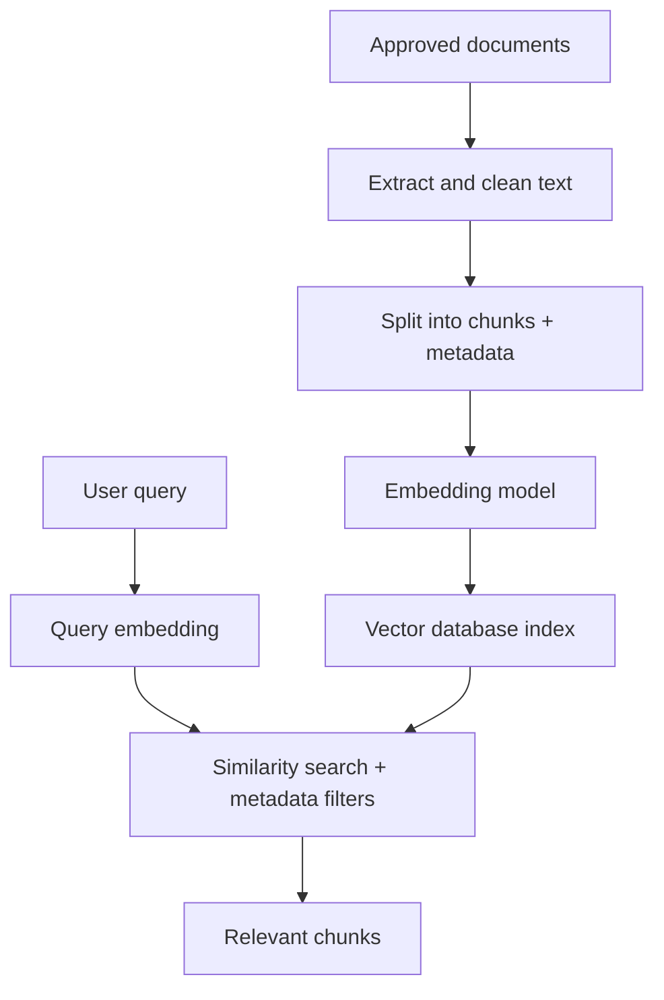

## Connection to AI engineering

n8n can orchestrate document ingestion and query-time retrieval using embedding and vector-store components. Keep ingestion and retrieval as separate workflows when that makes lifecycle and permissions clearer. Apply authorization filters before returning chunks; semantic similarity is not an access-control mechanism.

## Guided practice

Take five short synthetic policy paragraphs. Write one factual and one paraphrased query for each. Design metadata fields (`doc_id`, `page`, `department`, `effective_date`, `access_group`). Explain which query should be exact keyword search and which benefits from semantic search.

## Best practices

- Name nodes and workflows after their purpose, not after the order in which you created them.
- Test normal, empty, malformed, duplicate, and failure inputs—not only the happy path.
- Keep credentials out of code, screenshots, exported examples, and public repositories.
- Make data contracts explicit: document what each step expects and returns.
- Add observability and recovery before treating a workflow as production-ready.

## Quick revision

- Explain embeddings and vector representations.
- Understand similarity search at a conceptual level.
- Describe vector database records, metadata, and indexes.
- Compare keyword search with semantic search.
- Prepare chunks and metadata for retrieval.
- Choose a vector store based on requirements rather than popularity.

## Knowledge check

1. Explain the central idea of **Embeddings and Vector Databases** in your own words.
2. Draw the workflow or architecture without looking at the notes.
3. Describe one failure case and how you would detect and recover from it.
4. Explain where Python, an API, a database, or an AI model would fit into this topic.

## Official and further reading

- [n8n Docs: What is a vector database?](https://docs.n8n.io/advanced-ai/examples/understand-vector-databases/).
- [n8n Docs: Vector store nodes](https://docs.n8n.io/integrations/builtin/cluster-nodes/root-nodes/n8n-nodes-langchain.vectorstore/).
- [Pinecone: Vector database overview](https://www.pinecone.io/learn/vector-database/).

---

[Back to the master index](../README.md)


---


# Topic 15: Retrieval-Augmented Generation (RAG)

> **Stage:** Stage 4 – AI Integration  
> **Learning level:** Beginner → practical → professional  
> **Purpose:** Build grounded question-answering workflows that retrieve relevant external knowledge before generating a response.

## Learning outcomes

By the end of this topic, you should be able to:

- Explain why RAG is used and how it differs from model fine-tuning.
- Design ingestion and query pipelines.
- Understand loaders, text extraction, chunking, embeddings, vector stores, and retrievers.
- Use metadata filters and optional reranking.
- Construct grounded prompts and citations.
- Evaluate retrieval quality and answer faithfulness.

## Visual reference


*Image source: [Towards AI – RAG visual walkthrough](https://towardsai.net/p/artificial-intelligence/retrieval-augmented-generation-rag-a-comprehensive-visual-walkthrough). Used as a conceptual illustration; see the accompanying flowchart for the complete process.*

## Detailed notes

### 15.1 What is RAG?

**Retrieval-Augmented Generation** combines retrieval from an external knowledge source with a generative model. Instead of asking the LLM to answer only from its learned parameters, the system retrieves relevant passages and includes them as context for the answer. RAG can improve grounding and knowledge freshness, but it cannot guarantee truth or correct retrieval.

### 15.2 RAG has two pipelines

**A. Ingestion / indexing (usually run when documents change):**

1. Load approved files or content sources.
2. Extract text and preserve source metadata.
3. Clean and normalize the content.
4. Split into chunks using a tested chunking strategy.
5. Generate embeddings.
6. Store chunks, vectors, and metadata in the vector store.
7. Record source version and ingestion status.

**B. Query / retrieval (run for each question):**

1. Authenticate user and determine allowed knowledge scope.
2. Normalize the query and apply metadata/access filters.
3. Embed the query.
4. Retrieve top relevant chunks.
5. Optionally rerank or filter weak results.
6. Construct a prompt with the question, retrieved context, and citation metadata.
7. Generate an answer or abstain if evidence is insufficient.
8. Return citations and log evaluation metadata.

### 15.3 Chunking

Chunks must be large enough to preserve meaning but small enough for precise retrieval and context limits. Fixed-size chunking is simple; recursive/structure-aware splitting can preserve paragraphs, sections, or headings. Overlap can preserve boundary context but creates redundant vectors and storage. Tune chunk size and overlap using real queries, not arbitrary defaults.

### 15.4 Retrieval quality

A correct answer depends on retrieving the right passage. Consider top-k size, metadata filters, hybrid keyword/vector search, reranking, document freshness, and duplicate chunks. A retrieval result can be semantically similar but not answer the actual question.

### 15.5 Grounded generation and citations

Tell the model to answer only from supplied context, distinguish direct evidence from inference, state when the context does not answer the question, and cite source labels. The application must check that citations correspond to retrieved passages; the LLM should not invent page numbers or links.

### 15.6 RAG evaluation

Evaluate retrieval and generation separately:

- **Retrieval:** Did the correct source appear in top-k? Was the right page/section retrieved?
- **Answer:** Is the answer correct and supported by the context?
- **Faithfulness:** Does the answer avoid unsupported claims?
- **Coverage:** Does it answer all parts of the question?
- **Abstention:** Does it say “not found” when evidence is missing?
- **Security:** Can a user retrieve information outside their authorization scope?

### 15.7 RAG versus fine-tuning

RAG is suited to knowledge that changes or must be cited. Fine-tuning changes model behavior or style through training and is not a simple substitute for a searchable live knowledge base. They can be complementary, but solve different problems.

## How the pieces fit together

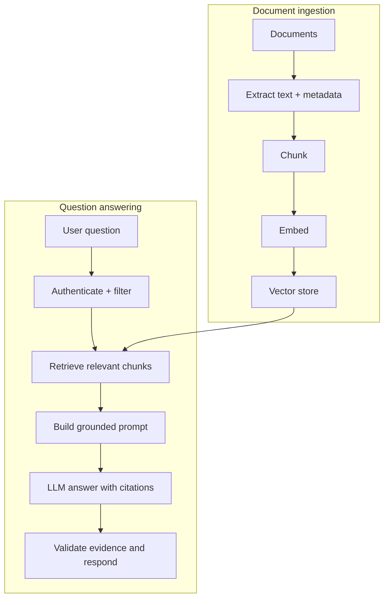

## Connection to AI engineering

A RAG system is a combination of data engineering, search, and generation. n8n can coordinate file ingestion, embeddings, vector-store operations, retrieval, LLM calls, and response delivery. The crucial engineering task is not merely connecting a vector database—it is measuring retrieval quality, enforcing document permissions, and grounding each answer.

## Guided practice

Use a small set of non-sensitive public policy documents. Create 10 questions where the answer exists and 5 where it does not. Track whether the correct source appears in the top 3 retrieved chunks, whether the answer is supported, and whether the system abstains when the answer is absent.

## Best practices

- Name nodes and workflows after their purpose, not after the order in which you created them.
- Test normal, empty, malformed, duplicate, and failure inputs—not only the happy path.
- Keep credentials out of code, screenshots, exported examples, and public repositories.
- Make data contracts explicit: document what each step expects and returns.
- Add observability and recovery before treating a workflow as production-ready.

## Quick revision

- Explain why RAG is used and how it differs from model fine-tuning.
- Design ingestion and query pipelines.
- Understand loaders, text extraction, chunking, embeddings, vector stores, and retrievers.
- Use metadata filters and optional reranking.
- Construct grounded prompts and citations.
- Evaluate retrieval quality and answer faithfulness.

## Knowledge check

1. Explain the central idea of **Retrieval-Augmented Generation (RAG)** in your own words.
2. Draw the workflow or architecture without looking at the notes.
3. Describe one failure case and how you would detect and recover from it.
4. Explain where Python, an API, a database, or an AI model would fit into this topic.

## Official and further reading

- [n8n Docs: Advanced AI](https://docs.n8n.io/advanced-ai/).
- [n8n Docs: Vector databases](https://docs.n8n.io/advanced-ai/examples/understand-vector-databases/).
- [Towards AI: RAG visual walkthrough](https://towardsai.net/p/artificial-intelligence/retrieval-augmented-generation-rag-a-comprehensive-visual-walkthrough).

---

[Back to the master index](../README.md)


---


# Topic 16: Advanced AI Agent Systems

> **Stage:** Stage 4 – AI Integration  
> **Learning level:** Beginner → practical → professional  
> **Purpose:** Move beyond one agent by designing tool ecosystems, multi-agent patterns, MCP connections, evaluation, and governance.

## Learning outcomes

By the end of this topic, you should be able to:

- Explain multi-agent orchestration patterns and their trade-offs.
- Design orchestrator-worker and specialist-agent architectures.
- Understand MCP at a conceptual level and how it connects clients to tools/resources.
- Limit tool access and prevent untrusted content from controlling agents.
- Evaluate agent success, tool correctness, cost, and safety.
- Choose chains or agents based on task uncertainty.

## Detailed notes

### 16.1 Multi-agent systems

A multi-agent design divides a complex task among several agent roles. Examples include a planner, researcher, analyst, and reviewer. More agents do not automatically improve quality. They can increase latency, cost, coordination failures, and the number of opportunities for error.

### 16.2 Common coordination patterns

- **Orchestrator–worker:** a coordinator decomposes the task and assigns bounded subtasks to specialist workers.
- **Sequential specialists:** each agent receives the output of the previous specialist, such as research → analysis → review.
- **Parallel specialists:** independent agents examine separate sources or aspects, then a deterministic step combines the results.
- **Critic/reviewer:** a second pass checks a draft against a rubric or evidence. It is not a guarantee of correctness; independent tests and source checks are still required.

### 16.3 Model Context Protocol (MCP)

MCP is a protocol for connecting AI applications to external context and tools through a standardized client/server pattern. Conceptually, an MCP server can expose tools, resources, or prompts to a compatible client. In n8n, use the current documentation for the specific MCP client/server features and security configuration available in your release. Do not assume every MCP server is trustworthy.

### 16.4 Tool ecosystem

Design tools with clear names, narrow functions, validated schemas, least-privilege credentials, and bounded outputs. Separate read operations from write operations. Use a human confirmation step for actions with material consequences. Never let untrusted retrieved text redefine system instructions or tool permissions.

### 16.5 Evaluating agent systems

Measure:

- Task completion rate.
- Tool-selection accuracy.
- Argument validity.
- Evidence quality.
- Response correctness and completeness.
- Latency, token usage, and cost.
- Unsafe-action rate and approval compliance.
- Recovery behavior when a tool fails.

Build a fixed evaluation set and rerun it when changing prompts, tools, models, or n8n versions. Inspect failures rather than relying only on a single aggregate score.

### 16.6 When to keep one agent

Use one agent with a small set of tools when it can handle the task. Use multi-agent delegation only when responsibilities are genuinely separable and the coordination overhead is justified. For deterministic policy workflows, prefer ordinary control-flow nodes.

## How the pieces fit together

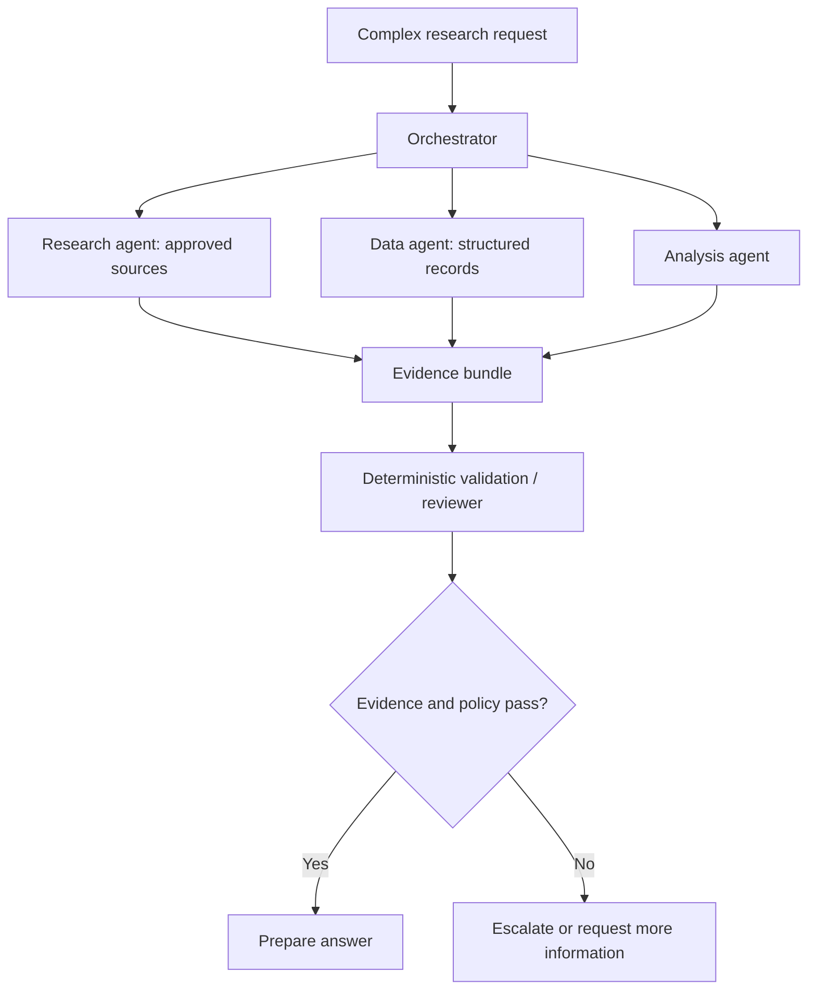

## Connection to AI engineering

n8n can connect agents to tools and other workflows, and current n8n documentation covers AI components and MCP-related capabilities. Treat each agent as an independent source of proposed actions—not as a trusted administrator. Enforce permission and approval rules outside the model.

## Guided practice

Design a research workflow with two specialists: one gathers evidence from an approved source list; the other compares evidence against a question. The orchestrator produces a summary only if every claim maps to a source. Define what happens when sources conflict or one agent fails. Include a maximum execution and cost budget.

## Best practices

- Name nodes and workflows after their purpose, not after the order in which you created them.
- Test normal, empty, malformed, duplicate, and failure inputs—not only the happy path.
- Keep credentials out of code, screenshots, exported examples, and public repositories.
- Make data contracts explicit: document what each step expects and returns.
- Add observability and recovery before treating a workflow as production-ready.

## Quick revision

- Explain multi-agent orchestration patterns and their trade-offs.
- Design orchestrator-worker and specialist-agent architectures.
- Understand MCP at a conceptual level and how it connects clients to tools/resources.
- Limit tool access and prevent untrusted content from controlling agents.
- Evaluate agent success, tool correctness, cost, and safety.
- Choose chains or agents based on task uncertainty.

## Knowledge check

1. Explain the central idea of **Advanced AI Agent Systems** in your own words.
2. Draw the workflow or architecture without looking at the notes.
3. Describe one failure case and how you would detect and recover from it.
4. Explain where Python, an API, a database, or an AI model would fit into this topic.

## Official and further reading

- [n8n Docs: Integrate AI and MCP](https://docs.n8n.io/advanced-ai/).
- [Model Context Protocol specification](https://modelcontextprotocol.io/specification).
- [OWASP: LLM Top 10](https://owasp.org/www-project-top-10-for-large-language-model-applications/).

---

[Back to the master index](../README.md)


---


# Topic 17: Error Handling and Debugging

> **Stage:** Stage 5 – Professional Development  
> **Learning level:** Beginner → practical → professional  
> **Purpose:** Build workflows that fail visibly, recover safely, and provide enough evidence to diagnose issues.

## Learning outcomes

By the end of this topic, you should be able to:

- Distinguish validation errors, node errors, external service failures, and logic errors.
- Inspect execution inputs, outputs, and error messages.
- Use error workflows and alerts appropriately.
- Design retries, timeouts, idempotency, and recovery.
- Avoid duplicate side effects and data loss.
- Create actionable logs and operational runbooks.

## Detailed notes

### 17.1 Failure categories

- **Input/validation error:** required data is missing or has the wrong type.
- **Configuration/authentication error:** invalid credential, expired token, or wrong permission.
- **External dependency error:** API unavailable, timeout, rate limit, or server error.
- **Logic/data error:** wrong expression, unexpected item count, or incorrect merge.
- **Business-rule rejection:** the data is technically valid but not allowed by policy.

The first step in debugging is to find the earliest node whose actual input/output differs from the expected data contract.

### 17.2 Inspect executions

Open the failed execution and inspect the failed node, upstream inputs, parameters, output, and error details. Reproduce the issue using a small representative test payload. Avoid changing multiple things at once; isolate the cause and rerun the failing case.

### 17.3 Retry carefully

Retries help with transient failures, not permanent errors such as invalid input or authorization. Use bounded retries with delay/backoff. Respect provider rate-limit instructions. Do not repeatedly retry a non-idempotent side effect such as sending a payment request or creating a record without a deduplication or idempotency strategy.

### 17.4 Idempotency and recovery

Give each business event a stable unique ID. Before performing a create action, check whether the event was already processed or use an API-supported idempotency key. Store processing status, attempt count, last error, and correlation ID. For complex systems, use a failed-job queue or a manual replay process.

### 17.5 Error workflows and alerts

An Error Trigger workflow can centralize notifications and incident records for execution failures. Include workflow name, execution ID, node, time, and a sanitized error summary. Do not send API keys, full personal records, or secrets to a public alert channel.

### 17.6 Operational runbook

Document: how to identify failure, which logs to inspect, who owns the service, what can safely be retried, how to replay an event, how to avoid duplicates, and when to escalate. Test the recovery process before an incident.

## How the pieces fit together

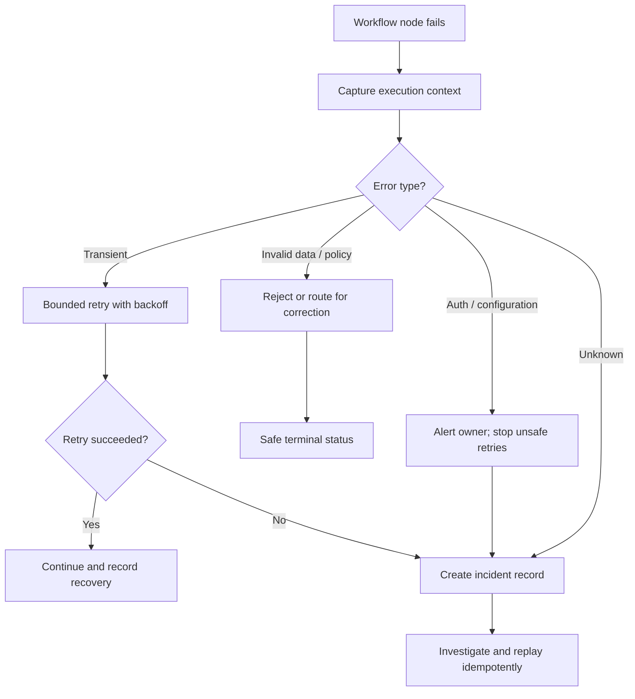

## Connection to AI engineering

AI calls add failure modes such as malformed JSON, refusal, rate limits, tool errors, and low-confidence answers. Treat an LLM output as untrusted until validated. Record model/provider and prompt version where useful, and preserve a safe fallback path when the AI service is unavailable.

## Guided practice

For a workflow that creates a database record and then sends an email, test: database timeout, email timeout, duplicate webhook event, invalid email, and provider 429. For each, decide whether to retry, stop, notify, or replay. Design a deduplication key so the email is not sent twice after an ambiguous timeout.

## Best practices

- Name nodes and workflows after their purpose, not after the order in which you created them.
- Test normal, empty, malformed, duplicate, and failure inputs—not only the happy path.
- Keep credentials out of code, screenshots, exported examples, and public repositories.
- Make data contracts explicit: document what each step expects and returns.
- Add observability and recovery before treating a workflow as production-ready.

## Quick revision

- Distinguish validation errors, node errors, external service failures, and logic errors.
- Inspect execution inputs, outputs, and error messages.
- Use error workflows and alerts appropriately.
- Design retries, timeouts, idempotency, and recovery.
- Avoid duplicate side effects and data loss.
- Create actionable logs and operational runbooks.

## Knowledge check

1. Explain the central idea of **Error Handling and Debugging** in your own words.
2. Draw the workflow or architecture without looking at the notes.
3. Describe one failure case and how you would detect and recover from it.
4. Explain where Python, an API, a database, or an AI model would fit into this topic.

## Official and further reading

- [n8n Docs: Error handling](https://docs.n8n.io/flow-logic/error-handling/).
- [n8n Docs: Executions](https://docs.n8n.io/workflows/executions/).
- [AWS: Retry with backoff guidance](https://docs.aws.amazon.com/prescriptive-guidance/latest/cloud-design-patterns/retry-backoff.html).

---

[Back to the master index](../README.md)


---


# Topic 18: Security and Credentials

> **Stage:** Stage 5 – Professional Development  
> **Learning level:** Beginner → practical → professional  
> **Purpose:** Protect connected accounts, user data, webhooks, AI prompts, and the n8n instance itself.

## Learning outcomes

By the end of this topic, you should be able to:

- Use least-privilege credentials and scoped API access.
- Store secrets in credentials or approved secret-management systems.
- Protect encryption keys, environment variables, and backups.
- Secure webhooks and editor access.
- Minimize and classify personal or confidential data.
- Apply prompt-injection and tool-abuse defenses to AI workflows.

## Detailed notes

### 18.1 Threat model first

List what the workflow can access, who can start it, which external services it can modify, what data it processes, and what would happen if a credential or webhook were abused. Security is a system property, not a single checkbox.

### 18.2 Credential hygiene

- Use a dedicated service account for automation rather than a personal administrator account where possible.
- Grant only the scopes and resources needed.
- Store API keys and OAuth credentials in n8n's credential system or an approved external secret manager.
- Rotate credentials and revoke unused tokens.
- Never commit secrets to Git, paste them into prompts, or include them in screenshots and logs.
- Protect the n8n encryption key and include it in a controlled backup/recovery plan.

### 18.3 Instance and network security

- Protect the editor with strong authentication and limit administrator accounts.
- Use HTTPS/TLS when traffic crosses an untrusted network.
- Put public webhooks behind the intended security controls; avoid exposing the editor unnecessarily.
- Keep n8n and the host patched.
- Restrict inbound/outbound network access where feasible.
- Review community nodes and imported workflow templates before installing or running them.

### 18.4 Webhook security

A webhook URL is not necessarily authentication. Use supported authentication, signature verification, shared secrets, IP allowlists where appropriate, and payload validation. Add replay protection or event-ID deduplication where the source supports it. Rate-limit public endpoints at the network or gateway layer where appropriate.

### 18.5 Data minimization and privacy

Only send the data required for the task. Mask or remove unnecessary personal identifiers before external AI processing. Set retention policies for execution data and logs. Apply access controls to databases, vector stores, and documents. Review provider data-processing terms and applicable legal/regulatory requirements for your use case.

### 18.6 AI-specific threats

Prompt injection can be embedded in a webpage, email, or PDF that an AI system reads. Treat retrieved text as untrusted content. Keep system instructions separate from retrieved material; do not let retrieved text change permissions. Validate tool arguments, restrict tools, require approval for risky writes, and test malicious inputs.

### 18.7 Secure workflow sharing

Exported workflows may expose internal URLs, node names, data samples, or accidentally hard-coded secrets. Remove sensitive execution data, review all expressions and credential references, and share only what is necessary.

## How the pieces fit together

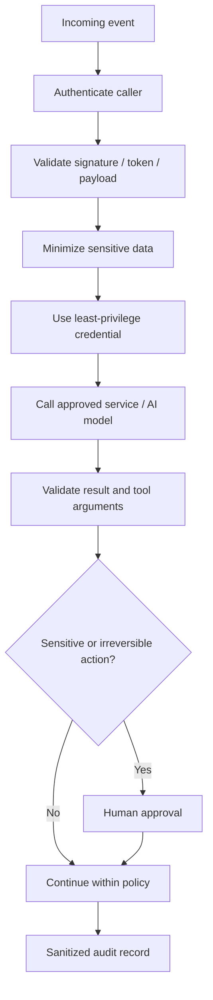

## Connection to AI engineering

AI workflows create a new security boundary because untrusted text can influence model decisions. Never treat an LLM as an access-control system. Enforce authorization in n8n and the target API, filter retrieval by user permissions, constrain tools, and make approvals explicit.

## Guided practice

Threat-model the AI email assistant. Identify assets (mailbox, tokens, customer messages), entry points (email trigger, webhook), trust boundaries (LLM provider, tools), and abuse cases (prompt injection, token leakage, sending to a wrong recipient). For each risk, propose a prevention and a detection control.

## Best practices

- Name nodes and workflows after their purpose, not after the order in which you created them.
- Test normal, empty, malformed, duplicate, and failure inputs—not only the happy path.
- Keep credentials out of code, screenshots, exported examples, and public repositories.
- Make data contracts explicit: document what each step expects and returns.
- Add observability and recovery before treating a workflow as production-ready.

## Quick revision

- Use least-privilege credentials and scoped API access.
- Store secrets in credentials or approved secret-management systems.
- Protect encryption keys, environment variables, and backups.
- Secure webhooks and editor access.
- Minimize and classify personal or confidential data.
- Apply prompt-injection and tool-abuse defenses to AI workflows.

## Knowledge check

1. Explain the central idea of **Security and Credentials** in your own words.
2. Draw the workflow or architecture without looking at the notes.
3. Describe one failure case and how you would detect and recover from it.
4. Explain where Python, an API, a database, or an AI model would fit into this topic.

## Official and further reading

- [n8n Docs: Security](https://docs.n8n.io/hosting/securing/).
- [n8n Docs: Credentials](https://docs.n8n.io/credentials/).
- [OWASP: Top 10 for LLM Applications](https://owasp.org/www-project-top-10-for-large-language-model-applications/).

---

[Back to the master index](../README.md)


---


# Topic 19: Deployment and Production

> **Stage:** Stage 5 – Professional Development  
> **Learning level:** Beginner → practical → professional  
> **Purpose:** Prepare n8n workflows for reliable operation, controlled updates, backups, observability, and growth.

## Learning outcomes

By the end of this topic, you should be able to:

- Compare Cloud, single-instance self-hosting, and scaled deployments.
- Understand Docker Compose, databases, reverse proxies, and TLS.
- Explain queue mode, Redis, workers, and execution distribution.
- Plan backups, recovery, upgrades, and version control.
- Monitor reliability, capacity, and API dependencies.
- Create a production-readiness checklist.

## Visual reference


*Image source: [n8n documentation – Queue mode](https://docs.n8n.io/deploy/host-n8n/configure-n8n/scaling/enable-queue-mode/).*

## Detailed notes

### 19.1 Development is not production

A local workflow can work for one test run but still fail in production due to sleeping laptops, missing public webhook access, expired credentials, higher volume, rate limits, lack of backups, or an untested error path. Production deployment includes operations, not merely starting the application.

### 19.2 Deployment choices

- **n8n Cloud:** managed environment; review plan, availability, limits, and data handling.
- **Single self-hosted instance:** appropriate for some small deployments when backed up and maintained.
- **Scaled self-hosted deployment:** may use a main instance, workers, Redis, a supported database, and webhook processors depending on architecture and version. This requires operational expertise.

### 19.3 Containers and reverse proxy

Docker Compose can define n8n, a database, Redis, volumes, and networks. A reverse proxy can terminate TLS and route traffic. Public webhook URLs must be configured correctly, and the editor should not be exposed more broadly than necessary. Pin versions and deploy through a repeatable process.

### 19.4 Queue mode and workers

In queue mode, the main n8n instance handles workflow triggers and places execution work into a queue. Redis coordinates queued jobs and workers perform workflow executions. Workers can be added to increase execution capacity. Queue mode is not a magic speed switch: database performance, CPU, memory, external APIs, concurrency, binary data, and workflow design remain bottlenecks.

### 19.5 Database and persistence

Use a supported database setup appropriate to scale and reliability requirements. Persistent storage is required for state. Plan backups for the database and necessary configuration/key material. Test restores; a backup that cannot be restored is not a recovery plan.

### 19.6 Monitoring and operations

Monitor success/failure rates, execution duration, queue depth, CPU/memory, database connections, API error rates, rate-limit responses, credential expirations, and storage. Create alerts that identify an owner and an action. Avoid logging sensitive payloads unnecessarily.

### 19.7 Updates and change management

- Pin a version in production and read release notes before upgrading.
- Back up before an upgrade and test in a staging environment.
- Export or version-control workflows without committing secrets or personal execution data.
- Keep prompts, model identifiers, and schemas versioned where possible.
- Maintain a rollback and recovery plan.
- Test critical workflows after upgrades with representative payloads.

### 19.8 Production-readiness checklist

A workflow is ready only when ownership, inputs, outputs, credentials, permissions, failure behavior, retry/idempotency, monitoring, backup/recovery, data retention, and support procedures are documented and tested.

## How the pieces fit together

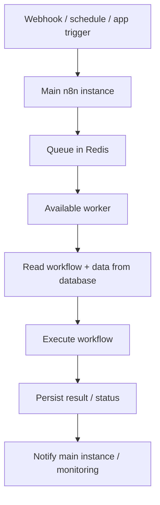

## Connection to AI engineering

Production AI automation needs capacity and cost controls in addition to ordinary workflow operations. Track model latency and token usage, apply per-user quotas, limit agent tool calls, cache stable retrieval where appropriate, and test quality after model or prompt updates. Keep a human fallback for high-impact failures.

## Guided practice

Write a deployment plan for a workflow that receives a public webhook and calls an LLM. Include hosting choice, URL/TLS, credential storage, request authentication, database and backup, rate limiting, retries, monitoring, retention, upgrade plan, and recovery owner. For a scaled deployment, explain the role of main instance, Redis, and workers.

## Best practices

- Name nodes and workflows after their purpose, not after the order in which you created them.
- Test normal, empty, malformed, duplicate, and failure inputs—not only the happy path.
- Keep credentials out of code, screenshots, exported examples, and public repositories.
- Make data contracts explicit: document what each step expects and returns.
- Add observability and recovery before treating a workflow as production-ready.

## Quick revision

- Compare Cloud, single-instance self-hosting, and scaled deployments.
- Understand Docker Compose, databases, reverse proxies, and TLS.
- Explain queue mode, Redis, workers, and execution distribution.
- Plan backups, recovery, upgrades, and version control.
- Monitor reliability, capacity, and API dependencies.
- Create a production-readiness checklist.

## Knowledge check

1. Explain the central idea of **Deployment and Production** in your own words.
2. Draw the workflow or architecture without looking at the notes.
3. Describe one failure case and how you would detect and recover from it.
4. Explain where Python, an API, a database, or an AI model would fit into this topic.

## Official and further reading

- [n8n Docs: Hosting](https://docs.n8n.io/hosting/).
- [n8n Docs: Queue mode](https://docs.n8n.io/hosting/scaling/queue-mode/).
- [n8n Docs: Docker Compose](https://docs.n8n.io/deploy/host-n8n/install-options/).
- [n8n Hosting examples](https://github.com/n8n-io/n8n-hosting).

---

[Back to the master index](../README.md)


---


# Project 1 – AI Email Assistant

**Level:** Beginner–intermediate  
**Outcome:** An email triage workflow that labels incoming messages, summarizes important content, drafts a reply, and asks for approval before sending.

## Problem and use case

A busy user receives more email than they can review immediately. The system should organize messages and prepare useful summaries while keeping a person in control of consequential replies.

## Architecture

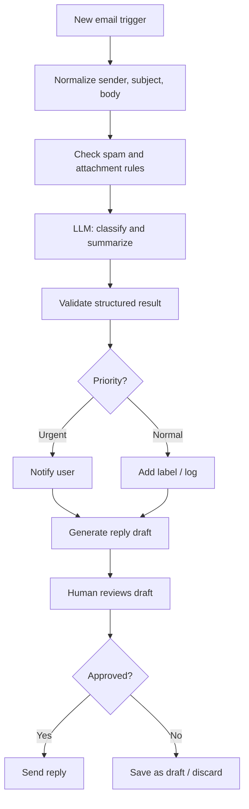

## Workflow components

- **Trigger:** Gmail Trigger or an equivalent email trigger.
- **Normalization:** map sender, subject, body, message ID, received time, and attachment metadata into a consistent object.
- **Deduplication:** use the provider message ID so retries do not create duplicate work.
- **AI classification:** return a strict JSON object such as `{"category":"billing","priority":"high","summary":"...","needs_reply":true}`.
- **Validation:** verify allowed category/priority values and impose a maximum summary length.
- **Routing:** urgent items create a notification; routine items receive a label or log entry.
- **Draft generation:** ask the model for a proposed reply, not an automatic send.
- **Approval:** use a human review step before sending.

## Example output contract

```json
{
  "category": "billing",
  "priority": "high",
  "summary": "The customer reports a duplicate charge.",
  "needs_reply": true,
  "suggested_action": "Investigate transaction"
}
```

Treat this as untrusted model output. Parse it, validate every field, and define a fallback for invalid JSON.

## Build sequence

1. Create a test mailbox or use non-sensitive sample messages.
2. Add the email trigger and inspect its raw output.
3. Normalize fields with Edit Fields.
4. Add deduplication using the stable message ID.
5. Connect an LLM and request structured classification.
6. Validate the response and add IF/Switch routing.
7. Save summaries to a table or spreadsheet.
8. Generate a reply draft and route it for approval.
9. Test empty bodies, forwarded threads, HTML email, attachments, duplicate events, and model failures.

## Safety, privacy, and reliability

- Do not send messages automatically until the draft quality and approval policy have been tested.
- Avoid sending full email content to a model unless necessary and permitted.
- Remove or mask secrets, payment details, and other sensitive data before model calls.
- Prevent prompt injection: email text is input data, not trusted instructions.
- Keep credentials in n8n credentials; never place API keys in prompts or exported workflow JSON.
- Log message IDs and outcomes, not unnecessary full message contents.
- Add retries for temporary provider errors and a dead-letter/error path for repeated failures.

## Success criteria

- Every processed email is traceable by provider message ID.
- Invalid model output never triggers an unsafe action.
- The correct category and urgency are assigned on a representative test set.
- No email is sent without the configured approval.
- Failures are visible and can be safely retried.

## Extension ideas

Add attachment text extraction, language detection, a knowledge-base lookup for suggested answers, or a daily digest. Measure classification accuracy and false-urgent rate before expanding automation.


---


# Project 2 – AI Telegram Chatbot

**Level:** Beginner–intermediate  
**Outcome:** A Telegram bot that receives a message, retrieves conversation context, calls an LLM, and replies safely.

## Architecture

```mermaid
flowchart TD
    A[Telegram message] --> B[Telegram Trigger]
    B --> C[Normalize chat ID and text]
    C --> D[Check sender / rate limit]
    D --> E[Load permitted conversation context]
    E --> F[LLM or AI Agent]
    F --> G[Validate and moderate response]
    G --> H{Safe and within limits?}
    H -->|Yes| I[Send Telegram reply]
    H -->|No| J[Fallback or human escalation]
    I --> K[Store conversation state]
```

## Main concepts

- **Telegram bot:** create a bot through BotFather and protect its token.
- **Trigger:** receive updates through the Telegram Trigger node or a webhook-based setup.
- **Identity:** use the chat/user identifier to associate a conversation; do not assume a username is stable.
- **Context:** store a bounded conversation history or use an explicit memory backend.
- **LLM:** provide a system instruction describing role, boundaries, and response style.
- **Output:** validate the response length and format before sending it.

## Suggested message contract

Normalize an inbound event to fields such as `chat_id`, `user_id`, `message_id`, `text`, and `received_at`. Keep the original provider payload only when needed for debugging and retention policies.

## Build sequence

1. Create a Telegram bot and store its token securely in n8n credentials.
2. Configure the trigger and send a test message.
3. Inspect the update payload; identify chat ID and text fields.
4. Add basic allow-listing or access control for a private test bot.
5. Connect the LLM and test with a fixed prompt.
6. Add conversation memory keyed by chat ID, with a retention limit.
7. Add a moderation/safety check and a fallback response.
8. Add rate limits and logging.
9. Test repeated messages, empty text, very long messages, unsupported media, and provider outages.

## Safety and operations

- Never publish the bot token or include it in screenshots.
- Restrict access while developing; a public bot needs abuse controls.
- Treat user messages as untrusted content and do not allow them to override system policy.
- Do not let the chatbot execute sensitive tools without authorization and confirmation.
- Keep per-user memory isolated; do not leak one user's context to another.
- Handle Telegram message-size and rate limits; split long responses when necessary.

## Extensions

Add voice transcription, image understanding, FAQ retrieval with RAG, language selection, or human handoff. Track response latency, cost per conversation, escalation rate, and user satisfaction.


---


# Project 3 – AI Document Processing System

**Level:** Intermediate  
**Outcome:** Accept a document, extract text, identify document type, extract structured fields, validate them, and store the result for review.

## Architecture

```mermaid
flowchart TD
    A[Document uploaded] --> B[Webhook / cloud storage trigger]
    B --> C[Check file type, size, and access]
    C --> D[Extract text or OCR]
    D --> E[Classify document]
    E --> F[LLM extracts fields as JSON]
    F --> G[Schema and business validation]
    G --> H{Validation passed?}
    H -->|Yes| I[Save structured record]
    H -->|No| J[Human review queue]
    I --> K[Notify requester]
    J --> K
```

## Possible document types

Invoices, resumes, purchase orders, application forms, and delivery receipts are useful examples. Each type should have its own extraction schema and validation rules.

## Example invoice schema

```json
{
  "vendor_name": "Example Supplies",
  "invoice_number": "INV-1042",
  "invoice_date": "2026-10-15",
  "currency": "INR",
  "total": 12500.00,
  "line_items": []
}
```

A model-generated schema example is not proof that the values are correct. Validate data types, date formats, currency, arithmetic totals, required fields, and duplicate invoice numbers.

## Build sequence

1. Create a private upload endpoint or storage-folder trigger.
2. Validate MIME type, file extension, file size, and access rights.
3. Extract text using an appropriate parser or OCR service.
4. Preserve page references where possible for traceability.
5. Classify the document and select the matching extraction schema.
6. Prompt the model to return only structured fields and use `null` when information is absent.
7. Parse and validate the result independently.
8. Store the record and document reference; send uncertain cases to human review.
9. Test poor scans, rotated pages, tables, handwriting, multi-page files, malformed files, and duplicate uploads.

## Important engineering controls

- Treat uploaded documents as untrusted; document text may contain prompt-injection instructions.
- Keep an original-file reference and access controls; avoid putting document contents into general logs.
- Do not infer missing values. Make the model distinguish absent, unclear, and extracted values.
- For important fields, store evidence such as page number or source text span.
- Keep a human review threshold based on confidence and business risk.
- Apply retention and deletion policies to both source documents and extracted data.

## Extensions

Add resume scoring with transparent criteria, invoice reconciliation, searchable document archives, or a RAG interface. Evaluate field-level precision/recall and review time saved, not just whether the workflow completed.


---


# Project 4 – RAG-Based Knowledge Assistant

**Level:** Intermediate–advanced  
**Outcome:** Build a question-answering assistant grounded in a selected document collection.

## RAG architecture

```mermaid
flowchart TD
    subgraph Ingestion
      A[Upload documents] --> B[Extract text]
      B --> C[Split into chunks]
      C --> D[Generate embeddings]
      D --> E[(Vector database)]
    end
    subgraph Query
      F[User question] --> G[Embed question]
      G --> H[Retrieve relevant chunks]
      E --> H
      H --> I[Build grounded prompt]
      I --> J[LLM generates answer]
      J --> K[Return answer with sources]
    end
```

## Core concepts

- **Chunking:** split long documents into searchable passages with suitable overlap.
- **Embeddings:** numerical representations used to compare semantic similarity.
- **Vector store:** stores embeddings and metadata for retrieval.
- **Retriever:** selects relevant chunks for a query.
- **Grounded generation:** the model is instructed to answer from retrieved evidence and say when evidence is insufficient.
- **Citations:** associate claims with document/page/chunk identifiers.

## Build sequence

1. Select a small, permission-cleared set of documents.
2. Extract text and preserve document/page metadata.
3. Choose a chunking strategy and record chunk IDs.
4. Generate embeddings with a selected model.
5. Store vectors and metadata in a vector database.
6. Build a query workflow that embeds the question and retrieves top relevant chunks.
7. Construct a prompt with retrieved text and clear instructions not to invent unsupported facts.
8. Return an answer with source references.
9. Test factual, ambiguous, out-of-scope, contradictory, and adversarial questions.

## Evaluation

Evaluate retrieval and generation separately:

- Retrieval relevance: are the right passages among the top results?
- Groundedness: are answer claims supported by retrieved passages?
- Citation correctness: do sources actually support the claims?
- Abstention: does the assistant say it does not know when evidence is missing?
- Latency and cost: measure ingestion and query paths independently.

## Failure modes and safeguards

- Bad parsing produces bad chunks; inspect extraction before tuning prompts.
- Chunks that are too small lose context; chunks that are too large reduce retrieval precision.
- Similarity alone is not truth. Use metadata filters and, where useful, reranking.
- Document content is untrusted input; do not treat instructions inside retrieved text as system instructions.
- Enforce per-user document permissions at retrieval time.
- Refresh or delete vectors when source documents change or are removed.

## Extensions

Add hybrid keyword/vector retrieval, reranking, query rewriting, multi-collection search, and an evaluation dataset with expected answers and source citations.


---


# Project 5 – AI Lead Management System

**Level:** Intermediate  
**Outcome:** Capture leads, validate and enrich their records, classify their interest, assign a follow-up path, and track results in a CRM.

## Architecture

```mermaid
flowchart TD
    A[Web form / webhook] --> B[Normalize lead]
    B --> C[Validate consent and required fields]
    C --> D[Deduplicate by email / CRM ID]
    D --> E[AI classifies inquiry]
    E --> F[Validate classification]
    F --> G[CRM create or update]
    G --> H{Priority segment?}
    H -->|High| I[Notify sales owner]
    H -->|Standard| J[Add to approved nurture sequence]
    I --> K[Record activity]
    J --> K
```

## Suggested lead fields

`lead_id`, `name`, `email`, `company`, `source`, `consent_status`, `inquiry_text`, `interest_category`, `priority`, `owner`, and `created_at`.

## Build sequence

1. Define what counts as a valid lead and which fields are mandatory.
2. Receive leads from a form or webhook.
3. Normalize and validate email, consent, and required data.
4. Deduplicate using a stable key; prefer CRM record IDs once available.
5. Use an LLM only for tasks such as categorizing free-text interest or summarizing an inquiry.
6. Validate the model output against an allowed category list.
7. Create/update the CRM record and assign an owner using deterministic business rules.
8. Notify sales and schedule follow-up only when consent and policy allow it.
9. Test duplicate submissions, missing consent, malformed email, and CRM API downtime.

## Responsible automation

- Do not infer sensitive personal traits or use protected characteristics for lead scoring.
- Make prioritization criteria explainable and review for unfair outcomes.
- Respect consent, opt-out, and applicable marketing rules.
- Keep AI-generated categories advisory unless validated for the business use case.
- Prevent duplicate follow-ups with idempotency keys and CRM checks.

## Metrics

Track valid-lead rate, duplicate rate, response time, routing accuracy, conversion by source, opt-out rate, and workflow failure rate. Avoid optimizing a single conversion metric at the expense of user consent or fairness.


---


# Project 6 – AI Research Assistant

**Level:** Advanced  
**Outcome:** Accept a research question, gather material from approved sources, organize evidence, and produce a cited draft report for human review.

## Architecture

```mermaid
flowchart TD
    A[Research request] --> B[Clarify scope and constraints]
    B --> C[Create search plan]
    C --> D[Search approved sources / APIs]
    D --> E[Fetch and extract source content]
    E --> F[Deduplicate and assess relevance]
    F --> G[Extract claims and source metadata]
    G --> H[Draft structured report]
    H --> I[Verify citations and claims]
    I --> J[Human review]
    J --> K[Export report]
```

## Recommended workflow design

- Collect topic, date range, geography, preferred domains, and output format.
- Use trusted search or data APIs rather than unrestricted scraping.
- Save each source's title, author/publisher, publication date, URL, retrieval date, and relevant excerpt.
- Deduplicate URL variants and distinguish publication date from event date.
- Ask the model to extract claims linked to source IDs; do not ask it to invent citations.
- Build report sections from verified claim records.
- Run a citation check and highlight unsupported statements.
- Require human review before publishing or sending the report.

## Evidence record example

```json
{
  "claim": "Example claim to verify",
  "source_id": "source_003",
  "url": "https://example.org/report",
  "published_at": "2026-01-10",
  "retrieved_at": "2026-11-14",
  "supporting_excerpt": "Short relevant passage"
}
```

## Risks and safeguards

- Search results can be outdated, incomplete, or misleading; verify primary sources.
- Retrieval is not evidence of truth. Inspect the underlying source.
- Keep source excerpts within copyright limits and link to the original material.
- Separate facts, interpretations, and recommendations in the final report.
- Treat webpage instructions as untrusted content, not as workflow instructions.
- Maintain an audit trail from each report claim to its source.

## Evaluation

Measure source quality, factual support rate, citation correctness, coverage of the question, freshness, and time saved. A good research assistant should clearly state uncertainty and missing evidence.


---


# Final Capstone – AI-Powered Personal Assistant and Automation Platform

**Level:** Advanced / portfolio capstone  
**Outcome:** A modular assistant that accepts requests, retrieves permitted knowledge, uses approved tools, and coordinates actions with strong confirmation and audit controls.

## Product scope

The assistant may help with approved tasks such as searching a personal knowledge base, summarizing documents, creating task drafts, preparing calendar suggestions, and notifying the user. It must not silently perform high-impact or irreversible actions.

## High-level architecture

```mermaid
flowchart TD
    A[Chat / Webhook interface] --> B[Authentication and request validation]
    B --> C[Intent classification]
    C --> D[Policy and permission check]
    D --> E[Assistant / agent orchestrator]
    E --> F[Knowledge retrieval RAG]
    E --> G[Approved tools and APIs]
    E --> H[Short-term / persistent memory]
    F --> I[Compose proposed response or action]
    G --> I
    H --> I
    I --> J[Validate output and action parameters]
    J --> K{Requires confirmation?}
    K -->|Yes| L[Human approval]
    K -->|No, low-risk| M[Execute permitted action]
    L -->|Approved| M
    L -->|Rejected| N[Cancel and explain]
    M --> O[Audit log and user response]
    N --> O
```

## Modules

1. **Interface:** Telegram, web form, or another authenticated entry point.
2. **Identity:** determine who is making the request and what data they may access.
3. **Orchestration:** route the request to deterministic workflows or an AI agent.
4. **Knowledge:** ingest approved documents, embed chunks, retrieve evidence, and cite sources.
5. **Tools:** expose a small allow-list of narrowly scoped actions.
6. **Memory:** keep bounded conversation context with explicit retention and deletion rules.
7. **Approval:** require confirmation for sending, deleting, purchasing, sharing, or modifying important records.
8. **Observability:** capture execution ID, tool name, outcome, latency, and sanitized errors.

## Implementation milestones

### Milestone 1 – Reliable foundation

Build a deterministic request/response workflow with authentication, input validation, error handling, and audit IDs. Do not add an agent yet.

### Milestone 2 – Knowledge assistant

Add document ingestion, chunking, embeddings, retrieval, grounded responses, and citations. Create an evaluation set of questions and expected source passages.

### Milestone 3 – Tool-enabled assistant

Add one read-only tool, such as searching a task list. Validate tool arguments and ensure the agent cannot access arbitrary resources.

### Milestone 4 – Controlled actions

Add draft creation and a human approval gate. Only after testing, enable narrowly scoped low-risk actions.

### Milestone 5 – Production readiness

Add rate limits, monitoring, backups, secret rotation, access reviews, retention rules, load tests, and recovery procedures.

## Non-negotiable safeguards

- Least-privilege credentials and per-user authorization.
- No secrets in prompts, logs, or exported workflows.
- Prompt-injection defenses for user messages and retrieved documents.
- Strict tool allow-list and argument validation.
- Human confirmation for high-impact or irreversible actions.
- Idempotency for actions that may be retried.
- Clear audit records and an emergency disable mechanism.
- Privacy-aware retention and data deletion process.

## Capstone evaluation rubric

| Area | Evidence of completion |
|---|---|
| Workflow design | Clear modular diagrams and documented node responsibilities |
| Data handling | Validated schemas, deduplication, and safe error paths |
| AI quality | Test dataset, grounded answers, and safe abstention |
| Tool safety | Narrow permissions, schema validation, approval gates |
| Reliability | Retries, idempotency, alerting, and recovery tests |
| Security | Credential hygiene, authentication, and access controls |
| Portfolio | README, architecture diagram, demo, limitations, and test results |

## Portfolio deliverables

Publish a sanitized README, architecture diagram, sample input/output, workflow screenshots with credentials hidden, test cases, known limitations, and a short demo. Never export real credentials, personal data, or sensitive execution history.


---
