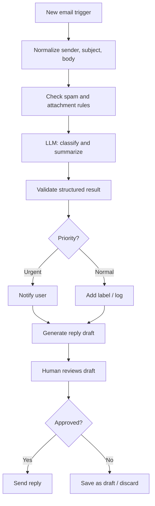

# Project 1 – AI Email Assistant

**Level:** Beginner–intermediate  
**Outcome:** An email triage workflow that labels incoming messages, summarizes important content, drafts a reply, and asks for approval before sending.

## Problem and use case

A busy user receives more email than they can review immediately. The system should organize messages and prepare useful summaries while keeping a person in control of consequential replies.

## Architecture



## Workflow components

- **Trigger:** Gmail Trigger or an equivalent email trigger.
- **Normalization:** map sender, subject, body, message ID, received time, and attachment metadata into a consistent object.
- **Deduplication:** use the provider message ID so retries do not create duplicate work.
- **AI classification:** return a strict JSON object such as `{"category":"billing","priority":"high","summary":"...","needs_reply":true}`.
- **Validation:** verify allowed category/priority values and impose a maximum summary length.
- **Routing:** urgent items create a notification; routine items receive a label or log entry.
- **Draft generation:** ask the model for a proposed reply, not an automatic send.
- **Approval:** use a human review step before sending.

## Example output contract

```json
{
  "category": "billing",
  "priority": "high",
  "summary": "The customer reports a duplicate charge.",
  "needs_reply": true,
  "suggested_action": "Investigate transaction"
}
```

Treat this as untrusted model output. Parse it, validate every field, and define a fallback for invalid JSON.

## Build sequence

1. Create a test mailbox or use non-sensitive sample messages.
2. Add the email trigger and inspect its raw output.
3. Normalize fields with Edit Fields.
4. Add deduplication using the stable message ID.
5. Connect an LLM and request structured classification.
6. Validate the response and add IF/Switch routing.
7. Save summaries to a table or spreadsheet.
8. Generate a reply draft and route it for approval.
9. Test empty bodies, forwarded threads, HTML email, attachments, duplicate events, and model failures.

## Safety, privacy, and reliability

- Do not send messages automatically until the draft quality and approval policy have been tested.
- Avoid sending full email content to a model unless necessary and permitted.
- Remove or mask secrets, payment details, and other sensitive data before model calls.
- Prevent prompt injection: email text is input data, not trusted instructions.
- Keep credentials in n8n credentials; never place API keys in prompts or exported workflow JSON.
- Log message IDs and outcomes, not unnecessary full message contents.
- Add retries for temporary provider errors and a dead-letter/error path for repeated failures.

## Success criteria

- Every processed email is traceable by provider message ID.
- Invalid model output never triggers an unsafe action.
- The correct category and urgency are assigned on a representative test set.
- No email is sent without the configured approval.
- Failures are visible and can be safely retried.

## Extension ideas

Add attachment text extraction, language detection, a knowledge-base lookup for suggested answers, or a daily digest. Measure classification accuracy and false-urgent rate before expanding automation.
