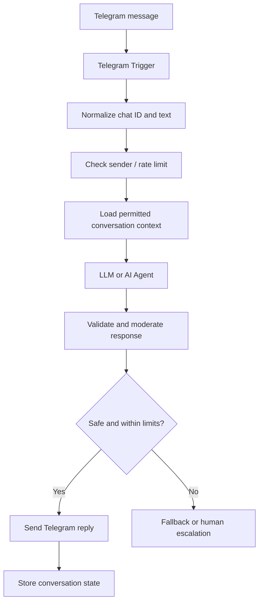

# Project 2 – AI Telegram Chatbot

**Level:** Beginner–intermediate  
**Outcome:** A Telegram bot that receives a message, retrieves conversation context, calls an LLM, and replies safely.

## Architecture

## Main concepts

- **Telegram bot:** create a bot through BotFather and protect its token.
- **Trigger:** receive updates through the Telegram Trigger node or a webhook-based setup.
- **Identity:** use the chat/user identifier to associate a conversation; do not assume a username is stable.
- **Context:** store a bounded conversation history or use an explicit memory backend.
- **LLM:** provide a system instruction describing role, boundaries, and response style.
- **Output:** validate the response length and format before sending it.

## Suggested message contract

Normalize an inbound event to fields such as `chat_id`, `user_id`, `message_id`, `text`, and `received_at`. Keep the original provider payload only when needed for debugging and retention policies.

## Build sequence

1. Create a Telegram bot and store its token securely in n8n credentials.
2. Configure the trigger and send a test message.
3. Inspect the update payload; identify chat ID and text fields.
4. Add basic allow-listing or access control for a private test bot.
5. Connect the LLM and test with a fixed prompt.
6. Add conversation memory keyed by chat ID, with a retention limit.
7. Add a moderation/safety check and a fallback response.
8. Add rate limits and logging.
9. Test repeated messages, empty text, very long messages, unsupported media, and provider outages.

## Safety and operations

- Never publish the bot token or include it in screenshots.
- Restrict access while developing; a public bot needs abuse controls.
- Treat user messages as untrusted content and do not allow them to override system policy.
- Do not let the chatbot execute sensitive tools without authorization and confirmation.
- Keep per-user memory isolated; do not leak one user's context to another.
- Handle Telegram message-size and rate limits; split long responses when necessary.

## Extensions

Add voice transcription, image understanding, FAQ retrieval with RAG, language selection, or human handoff. Track response latency, cost per conversation, escalation rate, and user satisfaction.
