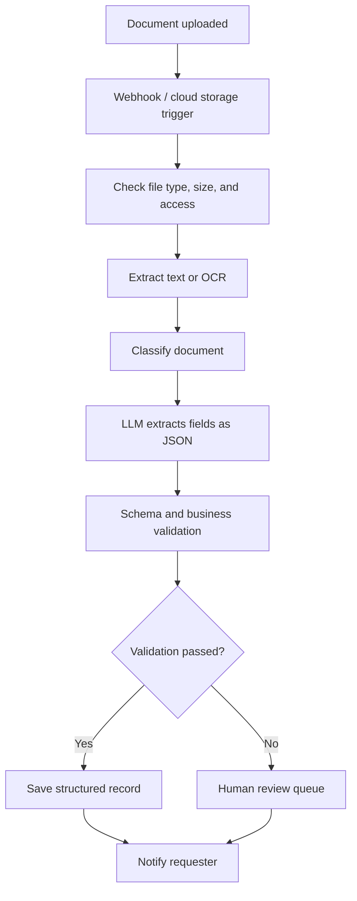

# Project 3 – AI Document Processing System

**Level:** Intermediate  
**Outcome:** Accept a document, extract text, identify document type, extract structured fields, validate them, and store the result for review.

## Architecture



## Possible document types

Invoices, resumes, purchase orders, application forms, and delivery receipts are useful examples. Each type should have its own extraction schema and validation rules.

## Example invoice schema

```json
{
  "vendor_name": "Example Supplies",
  "invoice_number": "INV-1042",
  "invoice_date": "2026-10-15",
  "currency": "INR",
  "total": 12500.00,
  "line_items": []
}
```

A model-generated schema example is not proof that the values are correct. Validate data types, date formats, currency, arithmetic totals, required fields, and duplicate invoice numbers.

## Build sequence

1. Create a private upload endpoint or storage-folder trigger.
2. Validate MIME type, file extension, file size, and access rights.
3. Extract text using an appropriate parser or OCR service.
4. Preserve page references where possible for traceability.
5. Classify the document and select the matching extraction schema.
6. Prompt the model to return only structured fields and use `null` when information is absent.
7. Parse and validate the result independently.
8. Store the record and document reference; send uncertain cases to human review.
9. Test poor scans, rotated pages, tables, handwriting, multi-page files, malformed files, and duplicate uploads.

## Important engineering controls

- Treat uploaded documents as untrusted; document text may contain prompt-injection instructions.
- Keep an original-file reference and access controls; avoid putting document contents into general logs.
- Do not infer missing values. Make the model distinguish absent, unclear, and extracted values.
- For important fields, store evidence such as page number or source text span.
- Keep a human review threshold based on confidence and business risk.
- Apply retention and deletion policies to both source documents and extracted data.

## Extensions

Add resume scoring with transparent criteria, invoice reconciliation, searchable document archives, or a RAG interface. Evaluate field-level precision/recall and review time saved, not just whether the workflow completed.
