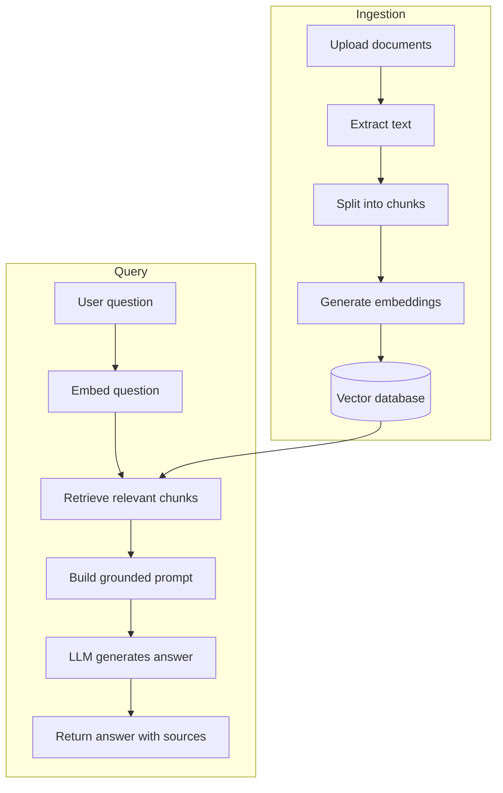

# Project 4 – RAG-Based Knowledge Assistant

**Level:** Intermediate–advanced  
**Outcome:** Build a question-answering assistant grounded in a selected document collection.

## RAG architecture

## Core concepts

- **Chunking:** split long documents into searchable passages with suitable overlap.
- **Embeddings:** numerical representations used to compare semantic similarity.
- **Vector store:** stores embeddings and metadata for retrieval.
- **Retriever:** selects relevant chunks for a query.
- **Grounded generation:** the model is instructed to answer from retrieved evidence and say when evidence is insufficient.
- **Citations:** associate claims with document/page/chunk identifiers.

## Build sequence

1. Select a small, permission-cleared set of documents.
2. Extract text and preserve document/page metadata.
3. Choose a chunking strategy and record chunk IDs.
4. Generate embeddings with a selected model.
5. Store vectors and metadata in a vector database.
6. Build a query workflow that embeds the question and retrieves top relevant chunks.
7. Construct a prompt with retrieved text and clear instructions not to invent unsupported facts.
8. Return an answer with source references.
9. Test factual, ambiguous, out-of-scope, contradictory, and adversarial questions.

## Evaluation

Evaluate retrieval and generation separately:

- Retrieval relevance: are the right passages among the top results?
- Groundedness: are answer claims supported by retrieved passages?
- Citation correctness: do sources actually support the claims?
- Abstention: does the assistant say it does not know when evidence is missing?
- Latency and cost: measure ingestion and query paths independently.

## Failure modes and safeguards

- Bad parsing produces bad chunks; inspect extraction before tuning prompts.
- Chunks that are too small lose context; chunks that are too large reduce retrieval precision.
- Similarity alone is not truth. Use metadata filters and, where useful, reranking.
- Document content is untrusted input; do not treat instructions inside retrieved text as system instructions.
- Enforce per-user document permissions at retrieval time.
- Refresh or delete vectors when source documents change or are removed.

## Extensions

Add hybrid keyword/vector retrieval, reranking, query rewriting, multi-collection search, and an evaluation dataset with expected answers and source citations.
