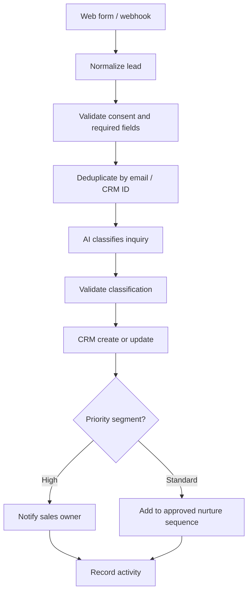

# Project 5 – AI Lead Management System

**Level:** Intermediate  
**Outcome:** Capture leads, validate and enrich their records, classify their interest, assign a follow-up path, and track results in a CRM.

## Architecture

## Suggested lead fields

`lead_id`, `name`, `email`, `company`, `source`, `consent_status`, `inquiry_text`, `interest_category`, `priority`, `owner`, and `created_at`.

## Build sequence

1. Define what counts as a valid lead and which fields are mandatory.
2. Receive leads from a form or webhook.
3. Normalize and validate email, consent, and required data.
4. Deduplicate using a stable key; prefer CRM record IDs once available.
5. Use an LLM only for tasks such as categorizing free-text interest or summarizing an inquiry.
6. Validate the model output against an allowed category list.
7. Create/update the CRM record and assign an owner using deterministic business rules.
8. Notify sales and schedule follow-up only when consent and policy allow it.
9. Test duplicate submissions, missing consent, malformed email, and CRM API downtime.

## Responsible automation

- Do not infer sensitive personal traits or use protected characteristics for lead scoring.
- Make prioritization criteria explainable and review for unfair outcomes.
- Respect consent, opt-out, and applicable marketing rules.
- Keep AI-generated categories advisory unless validated for the business use case.
- Prevent duplicate follow-ups with idempotency keys and CRM checks.

## Metrics

Track valid-lead rate, duplicate rate, response time, routing accuracy, conversion by source, opt-out rate, and workflow failure rate. Avoid optimizing a single conversion metric at the expense of user consent or fairness.
