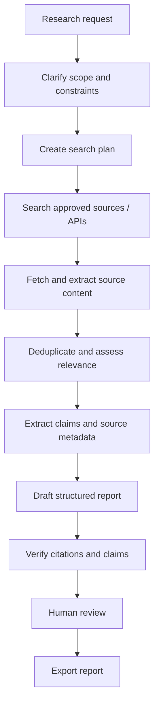

# Project 6 – AI Research Assistant

**Level:** Advanced  
**Outcome:** Accept a research question, gather material from approved sources, organize evidence, and produce a cited draft report for human review.

## Architecture



## Recommended workflow design

- Collect topic, date range, geography, preferred domains, and output format.
- Use trusted search or data APIs rather than unrestricted scraping.
- Save each source's title, author/publisher, publication date, URL, retrieval date, and relevant excerpt.
- Deduplicate URL variants and distinguish publication date from event date.
- Ask the model to extract claims linked to source IDs; do not ask it to invent citations.
- Build report sections from verified claim records.
- Run a citation check and highlight unsupported statements.
- Require human review before publishing or sending the report.

## Evidence record example

```json
{
  "claim": "Example claim to verify",
  "source_id": "source_003",
  "url": "https://example.org/report",
  "published_at": "2026-01-10",
  "retrieved_at": "2026-11-14",
  "supporting_excerpt": "Short relevant passage"
}
```

## Risks and safeguards

- Search results can be outdated, incomplete, or misleading; verify primary sources.
- Retrieval is not evidence of truth. Inspect the underlying source.
- Keep source excerpts within copyright limits and link to the original material.
- Separate facts, interpretations, and recommendations in the final report.
- Treat webpage instructions as untrusted content, not as workflow instructions.
- Maintain an audit trail from each report claim to its source.

## Evaluation

Measure source quality, factual support rate, citation correctness, coverage of the question, freshness, and time saved. A good research assistant should clearly state uncertainty and missing evidence.
