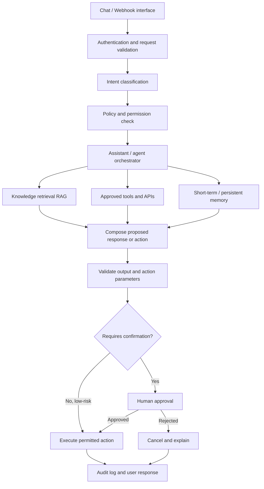

# Final Capstone – AI-Powered Personal Assistant and Automation Platform

**Level:** Advanced / portfolio capstone  
**Outcome:** A modular assistant that accepts requests, retrieves permitted knowledge, uses approved tools, and coordinates actions with strong confirmation and audit controls.

## Product scope

The assistant may help with approved tasks such as searching a personal knowledge base, summarizing documents, creating task drafts, preparing calendar suggestions, and notifying the user. It must not silently perform high-impact or irreversible actions.

## High-level architecture

## Modules

1. **Interface:** Telegram, web form, or another authenticated entry point.
2. **Identity:** determine who is making the request and what data they may access.
3. **Orchestration:** route the request to deterministic workflows or an AI agent.
4. **Knowledge:** ingest approved documents, embed chunks, retrieve evidence, and cite sources.
5. **Tools:** expose a small allow-list of narrowly scoped actions.
6. **Memory:** keep bounded conversation context with explicit retention and deletion rules.
7. **Approval:** require confirmation for sending, deleting, purchasing, sharing, or modifying important records.
8. **Observability:** capture execution ID, tool name, outcome, latency, and sanitized errors.

## Implementation milestones

### Milestone 1 – Reliable foundation

Build a deterministic request/response workflow with authentication, input validation, error handling, and audit IDs. Do not add an agent yet.

### Milestone 2 – Knowledge assistant

Add document ingestion, chunking, embeddings, retrieval, grounded responses, and citations. Create an evaluation set of questions and expected source passages.

### Milestone 3 – Tool-enabled assistant

Add one read-only tool, such as searching a task list. Validate tool arguments and ensure the agent cannot access arbitrary resources.

### Milestone 4 – Controlled actions

Add draft creation and a human approval gate. Only after testing, enable narrowly scoped low-risk actions.

### Milestone 5 – Production readiness

Add rate limits, monitoring, backups, secret rotation, access reviews, retention rules, load tests, and recovery procedures.

## Non-negotiable safeguards

- Least-privilege credentials and per-user authorization.
- No secrets in prompts, logs, or exported workflows.
- Prompt-injection defenses for user messages and retrieved documents.
- Strict tool allow-list and argument validation.
- Human confirmation for high-impact or irreversible actions.
- Idempotency for actions that may be retried.
- Clear audit records and an emergency disable mechanism.
- Privacy-aware retention and data deletion process.

## Capstone evaluation rubric

| Area | Evidence of completion |
|---|---|
| Workflow design | Clear modular diagrams and documented node responsibilities |
| Data handling | Validated schemas, deduplication, and safe error paths |
| AI quality | Test dataset, grounded answers, and safe abstention |
| Tool safety | Narrow permissions, schema validation, approval gates |
| Reliability | Retries, idempotency, alerting, and recovery tests |
| Security | Credential hygiene, authentication, and access controls |
| Portfolio | README, architecture diagram, demo, limitations, and test results |

## Portfolio deliverables

Publish a sanitized README, architecture diagram, sample input/output, workflow screenshots with credentials hidden, test cases, known limitations, and a short demo. Never export real credentials, personal data, or sensitive execution history.
