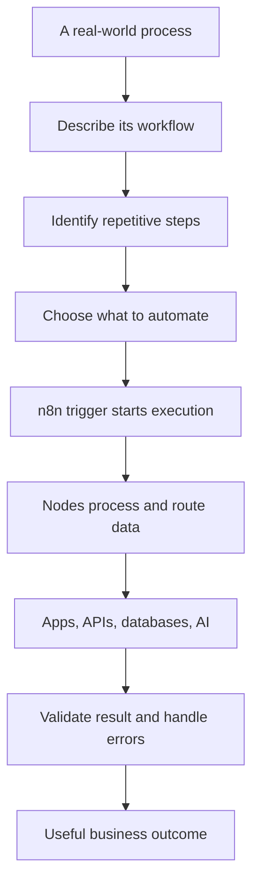

# Topic 1: Introduction to n8n

> **Stage:** Stage 1 – Foundations  
> **Learning level:** Beginner → practical → professional  
> **Purpose:** Build a correct mental model of workflows, automation, n8n, and its role in AI-enabled systems.

## Learning outcomes

By the end of this topic, you should be able to:

- Define a workflow and distinguish a workflow from automation.
- Explain why businesses automate repetitive and rule-based work.
- Describe n8n as a fair-code workflow automation and orchestration platform.
- Explain nodes, triggers, actions, connections, credentials, executions, and outputs.
- Recognize n8n capabilities: integrations, APIs, data transformation, custom code, AI, and deployment options.
- Separate the responsibility of an automation platform from the responsibility of an AI model.

## Visual reference

*Image source: [Nuvi – Comparing no-code AI agent builders](https://www.nuvi.dev/blog/ai-agent-platforms-compared). Interface details can change between n8n versions.*

## Detailed notes

### 1.1 Workflow: the process before the tool

A **workflow** is an ordered set of connected activities that takes an input or event and moves it toward an intended outcome. A workflow can be performed by a person, software, or a combination of both.

Example: a student submits a registration form. Someone checks the fields, records the student in a spreadsheet, assigns a department, and sends a confirmation. The sequence is the workflow even if every step is manual.

A useful way to describe any workflow is:

- **Trigger / starting condition:** What causes work to begin?
- **Input:** What information is available?
- **Processing:** What transformations or decisions are required?
- **Actions:** Which systems must be changed or contacted?
- **Output:** What result should exist when the process finishes?
- **Exceptions:** What happens when information is missing or a service fails?

### 1.2 Workflow versus automation

A workflow describes *how work is organized*. Automation describes *which steps technology executes with reduced manual intervention*. A workflow can be manual; an automated workflow executes some or all of its steps automatically.

For instance, manually checking an invoice and entering it into accounting software is a workflow. Automatically reading a mailbox, extracting invoice fields, validating them, and creating a draft accounting record is an automated version of that workflow.

### 1.3 Why automation is needed

- **Repetition:** the same steps are performed many times.
- **Time:** staff spend time copying, routing, and formatting information.
- **Consistency:** a well-tested process applies the same rules each time.
- **Scale:** higher volumes can be handled without a linear increase in manual effort, within infrastructure and provider limits.
- **Integration:** separate apps can exchange data without users repeatedly moving it by hand.
- **Traceability:** executions and logs can show what happened and where a failure occurred.

Automation does not guarantee correctness. A flawed rule can repeat a mistake very efficiently. High-impact decisions still need controls, review, and an escalation path.

### 1.4 What is n8n?

**n8n (pronounced “n-eight-n”)** is a fair-code workflow automation platform. It lets builders connect applications and APIs, move and transform data, and orchestrate operations using a visual editor with the option to add code. It can be used as a hosted cloud service or self-hosted by users who can operate the infrastructure.

It is not itself an LLM, a database, or a replacement for Python. It coordinates systems and steps. A connected AI model may classify a message; n8n can then route the classification, write a record, and notify a person.

### 1.5 Core building blocks

- **Workflow:** the complete automation definition.
- **Node:** one building block. A node may start a workflow, retrieve or send data, or process data.
- **Trigger node:** begins execution when its configured event or schedule occurs, or when a user starts it manually.
- **Action / processing node:** performs an operation after the workflow starts, such as filtering records or sending a message.
- **Connection:** defines the path from one node to another and passes output data forward.
- **Credentials:** authentication material used to connect to external services. Keep it private and grant only the permissions needed.
- **Execution:** one run of a workflow. Execution records help with inspection and debugging.
- **Canvas:** the visual workspace where a workflow is assembled and configured.

### 1.6 What n8n offers

- A visual workflow builder and a library of built-in integrations.
- HTTP requests and webhooks for services that expose APIs.
- Data mapping, expressions, transformation nodes, and custom code.
- Control flow such as conditions, branches, loops, waits, and sub-workflows.
- AI integrations with language models, agents, tools, memory, and retrieval components.
- Execution history, error workflows, and testing/debugging facilities.
- Cloud and self-hosted deployment options.

### 1.7 One connected example

A student submits a question. A form or webhook trigger starts the workflow. n8n validates the fields, sends the question to an AI model for a suggested category, checks the model output, routes it to the correct department, stores the record, and sends an acknowledgement. The **model** provides language understanding; **n8n** coordinates the process; the **database** persists records; and APIs connect the services.

### 1.8 Automation versus AI-powered automation

Traditional automation follows explicit rules: “if payment status is successful, create a receipt.” AI-powered automation uses a model for a task that involves ambiguous or unstructured information, such as classifying a complaint or extracting fields from a document. The workflow should still validate AI output and use human approval when the consequence of an incorrect action is significant.

## How the pieces fit together

## Connection to AI engineering

In AI engineering, n8n is an **orchestration layer**. The model interprets text, generates a draft, extracts information, or selects a tool; n8n controls the sequence, credentials, routing, persistence, notifications, and approvals. Do not give an AI agent unrestricted authority simply because it can be connected to a tool.

## Guided practice

Build a paper design before opening n8n: **New student registration → validate email and required fields → write to a sheet/database → send confirmation**. Add an invalid-data branch and a service-failure branch. Label every input and output. Then identify one step where an LLM might genuinely add value (for example, categorizing a free-text request) and explain why ordinary rules would be insufficient.

## Best practices

- Name nodes and workflows after their purpose, not after the order in which you created them.
- Test normal, empty, malformed, duplicate, and failure inputs—not only the happy path.
- Keep credentials out of code, screenshots, exported examples, and public repositories.
- Make data contracts explicit: document what each step expects and returns.
- Add observability and recovery before treating a workflow as production-ready.

## Quick revision

- Define a workflow and distinguish a workflow from automation.
- Explain why businesses automate repetitive and rule-based work.
- Describe n8n as a fair-code workflow automation and orchestration platform.
- Explain nodes, triggers, actions, connections, credentials, executions, and outputs.
- Recognize n8n capabilities: integrations, APIs, data transformation, custom code, AI, and deployment options.
- Separate the responsibility of an automation platform from the responsibility of an AI model.

## Knowledge check

1. Explain the central idea of **Introduction to n8n** in your own words.
2. Draw the workflow or architecture without looking at the notes.
3. Describe one failure case and how you would detect and recover from it.
4. Explain where Python, an API, a database, or an AI model would fit into this topic.

## Official and further reading

- [CampusX n8n notes repository](https://github.com/campusx-official/n8n-notes) – foundational chapter structure.
- [n8n Docs: Understand workflows](https://docs.n8n.io/workflows/).
- [n8n Docs: Work with nodes](https://docs.n8n.io/build/understand-workflows/workflow-components/work-with-nodes/).
- [n8n Academy](https://n8n.io/education/) – current hands-on learning paths.

---

[Back to the master index](../README.md)
