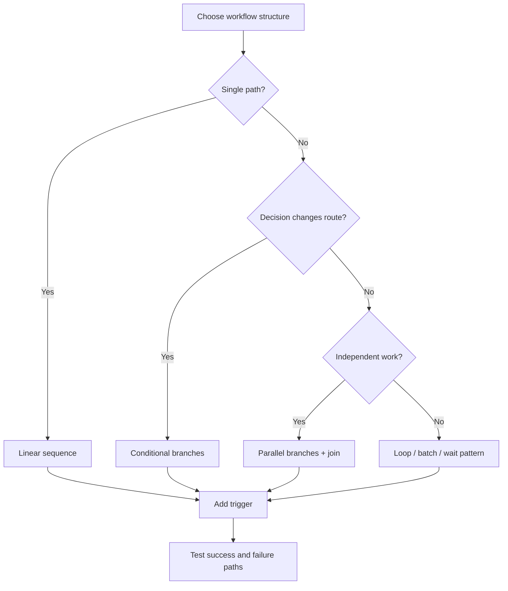

# Topic 2: Types of Workflows

> **Stage:** Stage 1 – Foundations  
> **Learning level:** Beginner → practical → professional  
> **Purpose:** Recognize common workflow patterns and choose a structure that matches the business process.

## Learning outcomes

By the end of this topic, you should be able to:

- Explain linear, conditional, parallel, looping, and combined workflow patterns.
- Distinguish manual, event-driven, scheduled, and webhook-triggered starts.
- Understand the difference between a conceptual workflow pattern and a specific n8n trigger/node.
- Choose a pattern using the process requirements, data volume, and error behavior.
- Design branches, joins, loops, and human approval points.

## Visual reference

*Image source: [Medium – The Complete n8n Social Media Pipeline](https://medium.com/write-a-catalyst/the-complete-n8n-social-media-pipeline-from-zero-to-autopilot-3cfd60ea308d). This is an example, not a required workflow pattern.*

## Detailed notes

### 2.1 A note about “types”

Workflow types can be classified in more than one way. **Linear, conditional, parallel, and looping** describe the structure of work. **Manual, scheduled, event-driven, and webhook-based** describe how a workflow starts. These are useful teaching categories, not a claim that n8n has one exclusive official list of workflow types.

### 2.2 Linear workflow

Steps execute in a straightforward sequence. Example: receive a form → format fields → add a row to a database → send an email. Use this pattern when each step depends on the previous result and no branching is required.

### 2.3 Conditional workflow

A decision selects a path. Example: if an invoice total is below an approval threshold, create a draft; otherwise, ask a manager to approve it. In n8n, an IF node is suitable for a two-way condition and a Switch node for several cases. Make the condition explicit and test both true and false paths.

### 2.4 Parallel workflow

Independent tasks can run on separate branches. Example: after a customer order is validated, update inventory and send an internal notification. Do not assume branches finish in a fixed order. Use a merge or later coordination step when downstream work needs both branch results.

### 2.5 Looping and batch workflows

A workflow may process many records or repeat an operation. Examples include processing each row in a dataset, handling pages of an API response, or retrying a transient service call. Distinguish item processing (many input items) from a deliberate loop that controls batch size or repetition. Avoid endless loops; define exit conditions and limits.

### 2.6 Combined workflows

Real processes usually combine patterns: a trigger starts a linear preparation phase, an IF node selects a branch, parallel actions run, and a merge coordinates the result. A human-approval pause can add another control point.

### 2.7 Start mechanisms

- **Manual:** a person starts an execution for testing or one-off work.
- **Scheduled:** a time-based trigger runs on a defined schedule. Check timezone and daylight-saving assumptions.
- **Event-driven:** an app event, such as a new record, starts the automation. Some integrations poll; others receive events.
- **Webhook:** an external service sends an HTTP request to a URL exposed by the workflow. Verify the sender and validate the payload.

### 2.8 Selecting a pattern

Ask: Is there one path or several? Can operations run independently? Is the input a single record or a collection? What starts the work? Must a person approve? What if one branch fails? The clearest workflow is usually the simplest structure that correctly represents the process.

## How the pieces fit together

## Connection to AI engineering

AI workflows often use a hybrid pattern: trigger → retrieve context → ask an LLM to classify → validate schema → branch by category → request approval for risky cases → perform the action. Parallelism can reduce waiting time, but use it only when tasks are genuinely independent and provider rate limits allow it.

## Guided practice

Sketch three designs: (1) a daily weather-free reminder that runs at 8 AM, (2) an incoming GitHub issue routed to one of three teams, and (3) a weekly report that fetches records and calculates totals in batches. For each, name the trigger, pattern, branches, output, and failure response.

## Best practices

- Name nodes and workflows after their purpose, not after the order in which you created them.
- Test normal, empty, malformed, duplicate, and failure inputs—not only the happy path.
- Keep credentials out of code, screenshots, exported examples, and public repositories.
- Make data contracts explicit: document what each step expects and returns.
- Add observability and recovery before treating a workflow as production-ready.

## Quick revision

- Explain linear, conditional, parallel, looping, and combined workflow patterns.
- Distinguish manual, event-driven, scheduled, and webhook-triggered starts.
- Understand the difference between a conceptual workflow pattern and a specific n8n trigger/node.
- Choose a pattern using the process requirements, data volume, and error behavior.
- Design branches, joins, loops, and human approval points.

## Knowledge check

1. Explain the central idea of **Types of Workflows** in your own words.
2. Draw the workflow or architecture without looking at the notes.
3. Describe one failure case and how you would detect and recover from it.
4. Explain where Python, an API, a database, or an AI model would fit into this topic.

## Official and further reading

- [CampusX: Types of Workflows](https://github.com/campusx-official/n8n-notes/tree/main/Types%20of%20Workflows).
- [n8n Docs: Flow logic](https://docs.n8n.io/flow-logic/).
- [n8n Docs: Triggers](https://docs.n8n.io/integrations/builtin/core-nodes/n8n-nodes-base.scheduletrigger/).

---

[Back to the master index](../README.md)
