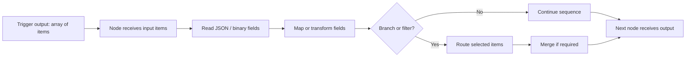

# Topic 3: Data Flow in n8n

> **Stage:** Stage 1 – Foundations  
> **Learning level:** Beginner → practical → professional  
> **Purpose:** Understand the structure, movement, mapping, and transformation of data between nodes.

## Learning outcomes

By the end of this topic, you should be able to:

- Explain input and output data and how connections pass data.
- Read JSON objects, arrays, nested fields, and binary data metadata.
- Understand n8n items and item-by-item processing.
- Map data from earlier nodes into later node parameters.
- Transform, filter, merge, and split data safely.
- Inspect execution data to diagnose incorrect mappings.

## Visual reference


*Image source: [Exivity documentation – JSON structure](https://docs.exivity.com/advanced/data%20pipelines/extractors/parslets/).*

## Detailed notes

### 3.1 Data is the payload moving through the workflow

A node receives input, performs an operation, and produces output. The next connected node receives that output. A connection therefore carries both control-flow direction and data-flow context.

### 3.2 JSON refresher

JSON has objects (`{}`), arrays (`[]`), strings, numbers, booleans, and `null`. Object keys identify values. Arrays contain ordered values. Nested objects are accessed through a path such as `customer.email`.

```json
{
  "orderId": "ORD-1042",
  "customer": {"name": "Asha", "email": "asha@example.com"},
  "items": [{"sku": "P-10", "quantity": 2}],
  "paid": true
}
```

### 3.3 n8n item model

n8n passes data between nodes as an array of items. Each item commonly contains a `json` object for structured data and may include a `binary` section for files. A node can receive multiple items and, for many operations, process each item individually. This is why a node that receives 10 items may create or update 10 records.

Conceptually:

```json
[
  {"json": {"name": "Asha", "email": "asha@example.com"}},
  {"json": {"name": "Ravi", "email": "ravi@example.com"}}
]
```

Do not confuse one item with one workflow execution. A single execution can contain many items and many node operations.

### 3.4 Input, output, and mapping

- **Input data:** what the current node receives from upstream nodes.
- **Output data:** what the node produces after its operation.
- **Mapping:** selecting a value from input data and assigning it to a field in a later node.
- **Transformation:** changing shape, type, format, or content.
- **Filtering:** keeping only items that satisfy a condition.
- **Merging:** combining data from branches or related sources.

### 3.5 Expressions and node references

Expressions let a node parameter use dynamic values. A common expression is `{{ $json.email }}`, which reads the `email` property from the current item. A reference to another node can use the expression editor's node-reference syntax, for example `{{ $('Webhook').first().json.body.email }}` when the workflow and item structure match that assumption. Inspect the actual execution output before writing paths; never guess the nesting.

### 3.6 Binary data

Files such as PDFs and images are not ordinary JSON text. n8n can carry binary data with metadata such as a file name and MIME type. Know whether the next node expects a binary file, text extracted from a file, or a URL. Large files affect memory, storage, and execution performance.

### 3.7 Branches and merges

A branch can produce different items on different paths. A Merge node can combine or coordinate branch data, but its mode and matching behavior matter. Confirm whether you need to append lists, match records by key, or wait for both branches. Incorrect merging can pair unrelated records or multiply rows unexpectedly.

### 3.8 Execution inspection

During development, open each node's input and output panels. Check item count, key names, nested structure, data types, and empty values. Test with one item, multiple items, missing optional fields, and malformed values.

## How the pieces fit together



## Connection to AI engineering

AI APIs commonly return nested JSON, and document workflows may carry binary files. You must understand the exact payload before passing it to an LLM, parser, database, or downstream tool. Validate model responses as data—not as trusted instructions—and parse structured outputs before using them in business actions.

## Guided practice

Create a sample data contract for a registration item: `studentId`, `fullName`, `email`, `department`, and `submittedAt`. Write two example items as JSON. Draw where each field is used in a Google Sheets row and an email. Add cases where `department` is missing and `email` is `null`; state how the workflow should respond.

## Best practices

- Name nodes and workflows after their purpose, not after the order in which you created them.
- Test normal, empty, malformed, duplicate, and failure inputs—not only the happy path.
- Keep credentials out of code, screenshots, exported examples, and public repositories.
- Make data contracts explicit: document what each step expects and returns.
- Add observability and recovery before treating a workflow as production-ready.

## Quick revision

- Explain input and output data and how connections pass data.
- Read JSON objects, arrays, nested fields, and binary data metadata.
- Understand n8n items and item-by-item processing.
- Map data from earlier nodes into later node parameters.
- Transform, filter, merge, and split data safely.
- Inspect execution data to diagnose incorrect mappings.

## Knowledge check

1. Explain the central idea of **Data Flow in n8n** in your own words.
2. Draw the workflow or architecture without looking at the notes.
3. Describe one failure case and how you would detect and recover from it.
4. Explain where Python, an API, a database, or an AI model would fit into this topic.

## Official and further reading

- [CampusX: Data Flow in n8n](https://github.com/campusx-official/n8n-notes/tree/main/Data%20Flow%20in%20n8n).
- [n8n Docs: Data structure](https://docs.n8n.io/data/data-structure/).
- [n8n Docs: Expressions](https://docs.n8n.io/code/expressions/).

---

[Back to the master index](../README.md)
