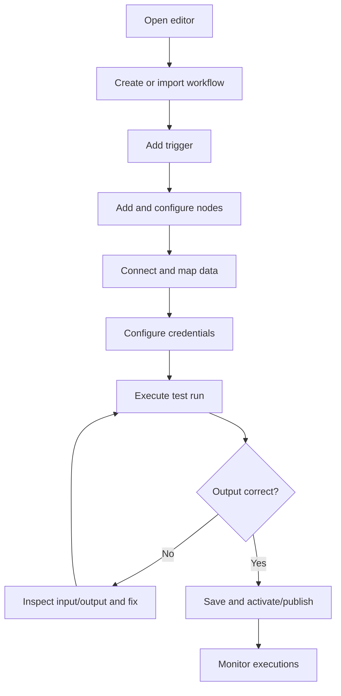

# Topic 4: Basics of n8n

> **Stage:** Stage 2 – Core Concepts  
> **Learning level:** Beginner → practical → professional  
> **Purpose:** Navigate the editor and understand the lifecycle of building, configuring, executing, and maintaining workflows.

## Learning outcomes

By the end of this topic, you should be able to:

- Navigate the editor and canvas.
- Add, configure, connect, rename, and organize nodes.
- Distinguish trigger, action, core, and integration nodes.
- Configure parameters, expressions, credentials, and connections.
- Execute manually, inspect runs, activate workflows, and understand publishing.
- Use templates and sub-workflows as starting points and reusable components.

## Visual reference

*Image source: [Nuvi – Comparing no-code AI agent builders](https://www.nuvi.dev/blog/ai-agent-platforms-compared). Interface details can change between n8n versions.*

## Detailed notes

### 4.1 The editor and canvas

The editor is the workspace for authoring a workflow. The canvas displays nodes and connections. The node panel lets you search for available nodes. A node's configuration panel contains the selected operation, parameters, and credential selection. The executions area is used to inspect previous runs. Exact interface labels can change with n8n releases.

### 4.2 Node categories

- **Trigger nodes:** begin a workflow through manual execution, a schedule, webhook, or an application event.
- **Action/integration nodes:** perform app-specific operations such as creating a row or sending a message.
- **Core nodes:** provide workflow logic and common operations such as IF, Switch, Merge, Wait, and Edit Fields.
- **Code nodes:** implement custom transformations when visual nodes and expressions are insufficient.

### 4.3 Configure a node systematically

1. Choose the correct node and operation.
2. Select or create the required credential.
3. Configure required parameters.
4. Map dynamic values from incoming data.
5. Run the node with representative input.
6. Inspect the input and output; confirm item count and field types.
7. Rename the node to describe its business purpose, such as `Create customer record`.

### 4.4 Connections and execution

Connections define which node can run after another. In a simple chain, the output of one node becomes the input to the next. Branching nodes create separate paths. Trigger settings determine how an active workflow starts; manual execution is useful for testing but does not replace configuring the production trigger.

### 4.5 Credentials

Credentials authorize n8n to access external systems. Depending on the service, authentication may use an API key, OAuth2, or another method. Use the least privilege needed. Never paste secrets into ordinary text fields, expressions, Code nodes, workflow names, or public screenshots.

### 4.6 Executions and activation

An **execution** is a run. While testing, inspect the run's node inputs and outputs and find the first point where actual data diverges from expected data. A workflow typically needs to be saved and activated/published according to its trigger and deployment mode to run automatically. Test and production webhook URLs can differ; use the URL appropriate to the workflow state.

### 4.7 Templates and sub-workflows

A template is a starting example, not a security-reviewed production solution. Inspect every node, credential, external destination, and data-handling step before using it. A sub-workflow lets a parent workflow call reusable logic. Define its inputs and outputs clearly and avoid hidden dependencies on unrelated parent state.

## How the pieces fit together

## Connection to AI engineering

The editor is where you compose application orchestration. As AI steps are added, treat their outputs as untrusted external data. Validate structured fields, put approval gates before costly or sensitive tool calls, and log model/provider identifiers and relevant run metadata without unnecessarily storing sensitive prompts or personal data.

## Guided practice

Build a small workflow design (or implement it if your environment is ready): Manual Trigger → Edit Fields (create `name` and `email`) → IF (email is present) → a success branch and a correction branch. Run it twice with different sample values. Rename every node and document what its output should contain.

## Best practices

- Name nodes and workflows after their purpose, not after the order in which you created them.
- Test normal, empty, malformed, duplicate, and failure inputs—not only the happy path.
- Keep credentials out of code, screenshots, exported examples, and public repositories.
- Make data contracts explicit: document what each step expects and returns.
- Add observability and recovery before treating a workflow as production-ready.

## Quick revision

- Navigate the editor and canvas.
- Add, configure, connect, rename, and organize nodes.
- Distinguish trigger, action, core, and integration nodes.
- Configure parameters, expressions, credentials, and connections.
- Execute manually, inspect runs, activate workflows, and understand publishing.
- Use templates and sub-workflows as starting points and reusable components.

## Knowledge check

1. Explain the central idea of **Basics of n8n** in your own words.
2. Draw the workflow or architecture without looking at the notes.
3. Describe one failure case and how you would detect and recover from it.
4. Explain where Python, an API, a database, or an AI model would fit into this topic.

## Official and further reading

- [CampusX: basics of n8n](https://github.com/campusx-official/n8n-notes/tree/main/basics%20of%20n8n).
- [n8n Docs: Nodes](https://docs.n8n.io/build/understand-workflows/workflow-components/work-with-nodes/).
- [n8n Docs: Credentials](https://docs.n8n.io/credentials/).
- [n8n Docs: Executions](https://docs.n8n.io/workflows/executions/).

---

[Back to the master index](../README.md)
