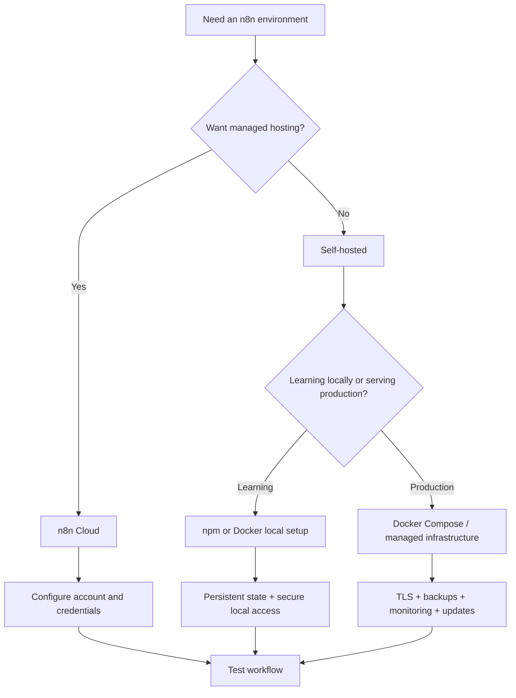

# Topic 5: Installing n8n

> **Stage:** Stage 2 – Core Concepts  
> **Learning level:** Beginner → practical → professional  
> **Purpose:** Choose a suitable way to run n8n and understand the operational responsibilities of each option.

## Learning outcomes

By the end of this topic, you should be able to:

- Compare n8n Cloud and self-hosted deployments.
- Understand local npm and Docker/Docker Compose installation approaches.
- Recognize the roles of the editor, runtime, database, and environment variables.
- Use persistent storage and protect the encryption key.
- Understand why a laptop setup is different from a reliable production deployment.
- Know when to prefer a managed environment over self-hosting.

## Visual reference

*Image source: [WotAI – How to install n8n](https://wotai.co/blog/how-to-install-n8n). Verify architecture and configuration against the current official n8n hosting guide before deploying.*

## Detailed notes

### 5.1 Choose the environment first

- **n8n Cloud:** managed hosting. It is usually the quickest learning route because the provider manages server operations. Review plan limits, data residency, retention, and pricing before relying on it.
- **Self-hosted:** you operate n8n on your own computer, server, or cloud infrastructure. You gain control, but you become responsible for updates, uptime, TLS, backups, access control, monitoring, and incident response.
- **Local development:** useful for learning and testing. A laptop may sleep, lose connectivity, or change network address, so it is not a dependable production endpoint.

### 5.2 npm installation

The npm route runs n8n in a Node.js environment. It is useful for local development and learners familiar with command-line tools. Check the current n8n prerequisites and supported Node.js version in the official installation guide before installing. Use a dedicated project environment and avoid running a personal learning service with broad network access.

### 5.3 Docker and Docker Compose

Docker packages the application and its runtime into a container. Docker Compose describes a multi-service setup such as n8n plus PostgreSQL and Redis. For persistent work, mount volumes for state and database data. Pin an appropriate image version for controlled upgrades rather than blindly using a floating tag in production.

> Current n8n documentation recommends Docker-based self-hosting for many users and points learners toward Docker Compose for setup. Self-hosting requires server, networking, security, and backup knowledge.

### 5.4 Important configuration concepts

- **Port and URL:** how users and services reach the instance. The standard local interface has commonly used port `5678`, but verify the configured port.
- **Timezone:** set the timezone intentionally for schedules and date calculations.
- **Database:** local SQLite can be convenient for a small single-instance setup; a production design may use PostgreSQL depending on scale and requirements.
- **Encryption key:** protect the key used to encrypt stored credentials. Losing it can prevent access to previously stored secrets.
- **Persistent volume:** keep state outside a disposable container layer.
- **TLS/reverse proxy:** protect traffic when exposing the instance publicly.
- **Backups:** back up the database and necessary configuration/key material using a tested procedure.

### 5.5 Safe installation sequence

1. Decide Cloud versus self-hosted based on skill, privacy, cost, and operational ownership.
2. Read the current official installation instructions.
3. Configure a strong owner account and authentication.
4. Set timezone, persistent storage, and encryption key appropriately.
5. Keep the editor private unless there is a deliberate, secured public-access design.
6. Test credentials and one simple workflow.
7. Document the version, backup location, restore method, and update plan.

Do not copy old commands from tutorials without checking whether they match the current stable n8n release and current installation guidance.

## How the pieces fit together

## Connection to AI engineering

AI workflows often store provider credentials, prompts, document content, and tool permissions. Choose hosting based on data sensitivity, where data is processed, and who is allowed to administer the instance. Self-hosting is not automatically more secure; poor patching, secrets handling, or public exposure can make it less secure.

## Guided practice

Before installing, make a decision sheet: expected number of workflows, whether external services need to call webhooks, sensitivity of data, budget, who will maintain the server, and backup needs. For a first learning instance, choose the lowest-complexity option that satisfies the course exercises. Then follow the current official guide rather than using unverified commands.

## Best practices

- Name nodes and workflows after their purpose, not after the order in which you created them.
- Test normal, empty, malformed, duplicate, and failure inputs—not only the happy path.
- Keep credentials out of code, screenshots, exported examples, and public repositories.
- Make data contracts explicit: document what each step expects and returns.
- Add observability and recovery before treating a workflow as production-ready.

## Quick revision

- Compare n8n Cloud and self-hosted deployments.
- Understand local npm and Docker/Docker Compose installation approaches.
- Recognize the roles of the editor, runtime, database, and environment variables.
- Use persistent storage and protect the encryption key.
- Understand why a laptop setup is different from a reliable production deployment.
- Know when to prefer a managed environment over self-hosting.

## Knowledge check

1. Explain the central idea of **Installing n8n** in your own words.
2. Draw the workflow or architecture without looking at the notes.
3. Describe one failure case and how you would detect and recover from it.
4. Explain where Python, an API, a database, or an AI model would fit into this topic.

## Official and further reading

- [CampusX: installing n8n](https://github.com/campusx-official/n8n-notes/tree/main/installing%20n8n).
- [n8n Docs: Hosting](https://docs.n8n.io/hosting/).
- [n8n Docs: Docker Compose installation](https://docs.n8n.io/deploy/host-n8n/install-options/).
- [n8n Hosting examples](https://github.com/n8n-io/n8n-hosting).

---

[Back to the master index](../README.md)
