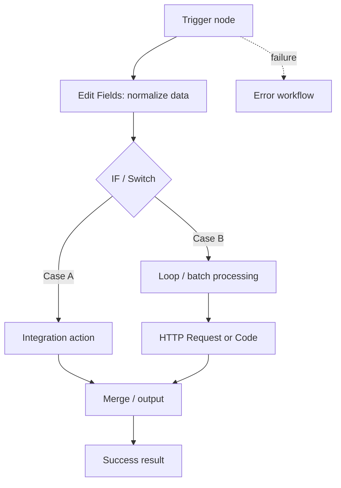

# Topic 6: Working with Core Nodes

> **Stage:** Stage 3 – Workflow Development  
> **Learning level:** Beginner → practical → professional  
> **Purpose:** Learn the most useful built-in building blocks and when to use each one.

## Learning outcomes

By the end of this topic, you should be able to:

- Choose the right trigger for manual, scheduled, webhook, or app-event starts.
- Use Edit Fields, IF, Switch, Merge, Loop Over Items, Wait, Code, and HTTP Request nodes.
- Understand Execute Sub-workflow and Error Trigger use cases.
- Design input/output contracts for node boundaries.
- Avoid unnecessary nodes and test each branch.

## Detailed notes

### 6.1 Triggers

- **Manual Trigger:** starts a run when the user executes the workflow; ideal for learning and testing.
- **Schedule Trigger:** starts at configured times or intervals; check timezone, daylight-saving behavior, and activation state.
- **Webhook:** exposes an endpoint for an external HTTP request; validate method, authentication, payload shape, and sender.
- **App triggers:** start when an integrated service reports or exposes an event; the integration may use polling or a provider webhook.

### 6.2 Data and transformation nodes

- **Edit Fields (Set):** create, rename, keep, or remove fields so later nodes receive a clean contract.
- **IF:** send items down a true or false path.
- **Switch:** route items among several named cases.
- **Merge:** combine or coordinate data from separate inputs. Select the correct merge mode and matching key.
- **Loop Over Items:** iterate or batch processing when explicit control is needed; many nodes already process multiple items automatically.
- **Wait:** pause execution until a time or event condition is satisfied; consider timeouts and resume behavior.
- **Code:** implement custom transformations when built-in nodes and expressions are not enough. Keep code small, deterministic, and tested.

### 6.3 Integration and orchestration nodes

- **HTTP Request:** call a REST endpoint or other HTTP service.
- **Execute Sub-workflow:** invoke reusable workflow logic with defined input and output expectations.
- **Error Trigger:** begins an error-handling workflow for configured workflow failures. Use it for alerting and centralized recovery; it does not replace local validation.

### 6.4 Choosing the smallest suitable tool

Use an expression for a small field mapping, Edit Fields for simple field shaping, a dedicated node for a common operation, and Code for complex logic. A workflow with 30 nodes is not automatically more professional than one with 8; clarity and reliability matter more than visual complexity.

### 6.5 Node design checklist

- What exact input does the node receive?
- What does it output when successful, empty, or failed?
- Does it act once per item or once per execution?
- Is the operation safe to retry?
- Does it have side effects such as sending a message or charging a card?
- What credentials and permissions are required?

## How the pieces fit together

## Connection to AI engineering

Core nodes are the skeleton around an AI model. A robust workflow usually normalizes input before the LLM, constrains and parses the output after it, routes only validated data, and uses human approval before irreversible actions. Use Code for deterministic preparation, not to duplicate capabilities already provided by well-supported nodes.

## Guided practice

Build a support-ticket router design: Webhook → Edit Fields → IF (required fields present) → Switch (billing / technical / other) → route to the right queue. Add a failure path for invalid input and an Error Trigger workflow for execution-level errors. Document what each node should output.

## Best practices

- Name nodes and workflows after their purpose, not after the order in which you created them.
- Test normal, empty, malformed, duplicate, and failure inputs—not only the happy path.
- Keep credentials out of code, screenshots, exported examples, and public repositories.
- Make data contracts explicit: document what each step expects and returns.
- Add observability and recovery before treating a workflow as production-ready.

## Quick revision

- Choose the right trigger for manual, scheduled, webhook, or app-event starts.
- Use Edit Fields, IF, Switch, Merge, Loop Over Items, Wait, Code, and HTTP Request nodes.
- Understand Execute Sub-workflow and Error Trigger use cases.
- Design input/output contracts for node boundaries.
- Avoid unnecessary nodes and test each branch.

## Knowledge check

1. Explain the central idea of **Working with Core Nodes** in your own words.
2. Draw the workflow or architecture without looking at the notes.
3. Describe one failure case and how you would detect and recover from it.
4. Explain where Python, an API, a database, or an AI model would fit into this topic.

## Official and further reading

- [n8n Docs: Nodes](https://docs.n8n.io/build/understand-workflows/workflow-components/work-with-nodes/).
- [n8n Docs: Built-in core nodes](https://docs.n8n.io/integrations/builtin/core-nodes/).
- [n8n Docs: Flow logic](https://docs.n8n.io/flow-logic/).

---

[Back to the master index](../README.md)
