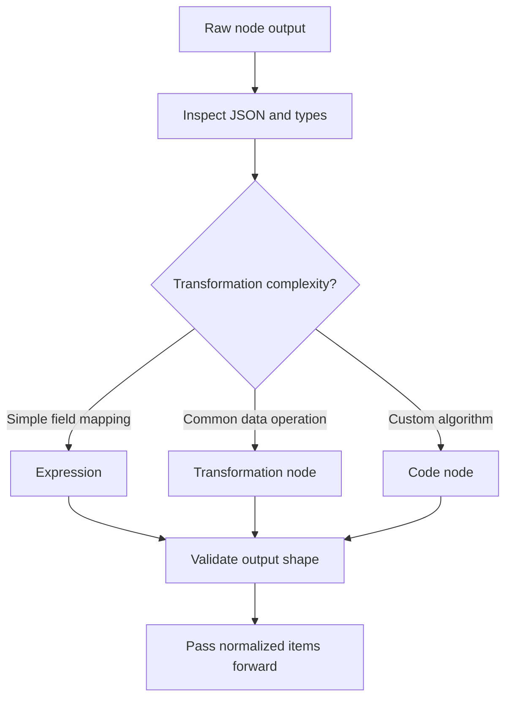

# Topic 7: Expressions and Data Manipulation

> **Stage:** Stage 3 – Workflow Development  
> **Learning level:** Beginner → practical → professional  
> **Purpose:** Use dynamic expressions and transformation operations to shape data safely and clearly.

## Learning outcomes

By the end of this topic, you should be able to:

- Understand when to use expressions, transformation nodes, or Code.
- Use current-item data such as `$json` in expressions.
- Reference other node data using supported expression syntax.
- Handle arrays, objects, dates, strings, numbers, nulls, and missing fields.
- Choose a safe approach for complex transformations and test it.

## Detailed notes

### 7.1 Three ways to transform data

- **Expressions:** small dynamic calculations or values inside a node parameter. Example: `{{ $json.customer.email }}`.
- **Data transformation nodes:** visual operations such as editing fields, filtering, sorting, aggregating, splitting, or removing duplicates.
- **Code node:** custom logic for more complex restructuring, loops, or calculations. Use it when a visual node or expression becomes harder to understand than a short, well-tested code block.

### 7.2 Current-item data

`$json` is commonly used to access the current item's JSON data. If the input is `{ "customer": { "email": "asha@example.com" } }`, then `{{ $json.customer.email }}` maps the email. If the actual data came from a webhook body, the path may be `{{ $json.body.customer.email }}`. Always inspect the execution data to confirm the path.

### 7.3 Referencing another node

n8n expressions support referencing prior node output. For example, `{{ $('Webhook').first().json.body.name }}` can read the first item from a node named `Webhook`. Item linking and paired-item behavior matter in multi-item workflows; use the appropriate item accessor for the actual flow rather than applying `.first()` blindly.

### 7.4 Data types and defensive handling

- `null` is different from an empty string or a missing property.
- Convert numbers deliberately before arithmetic; strings such as `"12"` may not behave like numeric `12` in all operations.
- Normalize dates to a clear timezone and ISO representation before comparison.
- Check whether an array is empty before accessing its first element.
- Avoid string concatenation for numeric calculations.
- Preserve original identifiers when joining or updating records.

### 7.5 Example: normalize an order

Input fields may arrive as `first_name`, `last_name`, `qty`, and `unit_price`. A transformation can produce `customerName`, integer `quantity`, numeric `unitPrice`, and computed `lineTotal`. Verify that malformed values do not silently produce `NaN` or zero.

### 7.6 Code node discipline

Keep code deterministic where possible. Define expected input, validate it, transform, and return the expected output shape. Avoid hidden network calls and undeclared dependencies. Add comments for non-obvious logic and test with empty, large, malformed, and multiple-item inputs.

## How the pieces fit together

## Connection to AI engineering

Before sending text to an LLM, normalize fields, remove unnecessary personal information, and enforce a payload size limit. After an LLM responds, parse its structured output, validate field types and allowed values, then use deterministic expressions or code to route the result.

## Guided practice

Create a sample JSON order with two products. Design an output with `orderId`, `customerEmail`, `totalQuantity`, and `totalAmount`. Write the expression or pseudocode for each derived field. Test an item with a missing price and explain whether the workflow should stop, default, or send it for review.

## Best practices

- Name nodes and workflows after their purpose, not after the order in which you created them.
- Test normal, empty, malformed, duplicate, and failure inputs—not only the happy path.
- Keep credentials out of code, screenshots, exported examples, and public repositories.
- Make data contracts explicit: document what each step expects and returns.
- Add observability and recovery before treating a workflow as production-ready.

## Quick revision

- Understand when to use expressions, transformation nodes, or Code.
- Use current-item data such as `$json` in expressions.
- Reference other node data using supported expression syntax.
- Handle arrays, objects, dates, strings, numbers, nulls, and missing fields.
- Choose a safe approach for complex transformations and test it.

## Knowledge check

1. Explain the central idea of **Expressions and Data Manipulation** in your own words.
2. Draw the workflow or architecture without looking at the notes.
3. Describe one failure case and how you would detect and recover from it.
4. Explain where Python, an API, a database, or an AI model would fit into this topic.

## Official and further reading

- [n8n Docs: Expressions versus data nodes](https://docs.n8n.io/code/expressions/).
- [n8n Docs: Data structure](https://docs.n8n.io/data/data-structure/).
- [n8n Docs: Code node](https://docs.n8n.io/code/code-node/).

---

[Back to the master index](../README.md)
