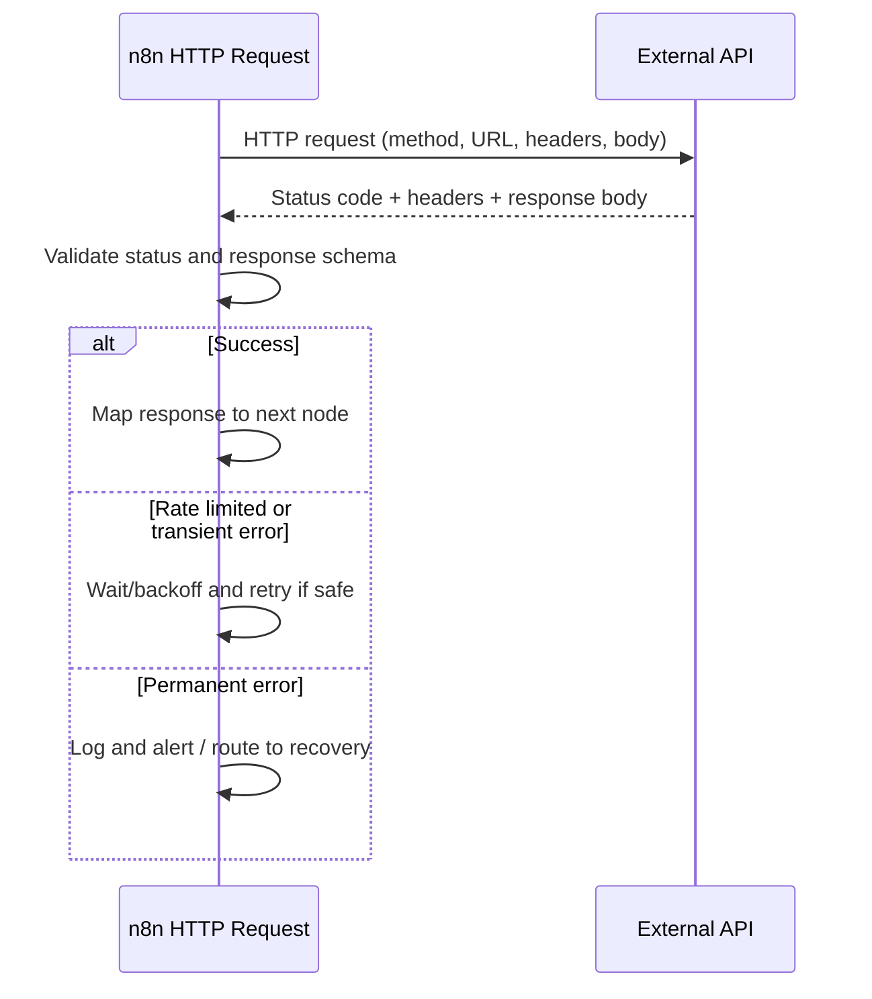

# Topic 8: APIs and HTTP Requests

> **Stage:** Stage 3 – Workflow Development  
> **Learning level:** Beginner → practical → professional  
> **Purpose:** Develop the API literacy needed to connect n8n to almost any modern software service.

## Learning outcomes

By the end of this topic, you should be able to:

- Explain API, REST, client/server, request, and response.
- Choose GET, POST, PUT, PATCH, or DELETE appropriately.
- Configure URLs, headers, query parameters, path parameters, and bodies.
- Understand JSON, status codes, and authentication.
- Handle pagination, rate limits, retries, and timeouts.
- Use the HTTP Request node to connect services that lack a dedicated integration.

## Visual reference

*Image source: [Swastik Sharma – REST APIs, Beginner Friendly Guide](https://medium.com/%40swastik7sharma/rest-apis-beginner-friendly-guide-e2a4a65239f2).*

## Detailed notes

### 8.1 What is an API?

An **Application Programming Interface** is a defined contract through which one software system requests a service or data from another. In a web API, a client sends an HTTP request to a server endpoint, and the server returns a response. The response may contain JSON, a file, or another representation.

### 8.2 REST concepts

REST is an architectural style commonly used by web APIs. APIs often model resources such as `/customers` or `/orders` and use HTTP methods to describe the operation.

| Method | Typical intent | Example |
|---|---|---|
| GET | Read a resource | `GET /customers/42` |
| POST | Create or submit | `POST /orders` |
| PUT | Replace/update a resource representation | `PUT /customers/42` |
| PATCH | Partially update | `PATCH /customers/42` |
| DELETE | Remove a resource | `DELETE /customers/42` |

The server's contract is authoritative. Not every API uses methods in exactly the same way. GET should not be used for actions that change state.

### 8.3 Anatomy of an HTTP request

- **Method:** what operation is requested.
- **URL / endpoint:** the target service and resource.
- **Path parameters:** identify a resource, such as `/users/123`.
- **Query parameters:** filter or paginate, such as `?status=active&page=2`.
- **Headers:** metadata such as `Accept`, `Content-Type`, or authorization.
- **Body:** data sent with methods such as POST or PATCH, often JSON.

### 8.4 Response and status codes

A response includes a status code, headers, and sometimes a body. Common groups: `2xx` success, `3xx` redirection, `4xx` client/request/authentication problems, and `5xx` server-side failures. Common examples include `200 OK`, `201 Created`, `400 Bad Request`, `401 Unauthorized`, `403 Forbidden`, `404 Not Found`, `429 Too Many Requests`, and `500 Internal Server Error`.

Do not assume every non-200 response means the same thing. Read the provider's error body and documentation.

### 8.5 Authentication

Common schemes include API keys, bearer tokens, Basic authentication, and OAuth 2.0. Store secrets in n8n credentials or an approved secret manager; do not hard-code them in URLs or code. OAuth scopes should be limited to the permissions the workflow needs.

### 8.6 HTTP Request node design

1. Choose method and endpoint.
2. Select the authentication/credential mechanism.
3. Add query parameters, headers, and request body as required.
4. Map dynamic values from the current item.
5. Configure response handling and timeout appropriately.
6. Execute a test request and inspect status, headers, and body.
7. Add pagination, retry, or error handling if the API requires it.

### 8.7 Pagination, limits, and retries

APIs commonly cap the number of records per response. Pagination may use page numbers, offsets, cursors, or continuation tokens. Follow the provider's contract; stop when no next page remains. Rate limits restrict request frequency. Respect `429` responses and any `Retry-After` header. Use exponential backoff with jitter for transient failures where appropriate. Avoid retrying non-idempotent operations blindly: a second POST could create a duplicate order or send a duplicate message.

### 8.8 Idempotency and safe retries

An operation is idempotent when repeating it has the same intended effect as performing it once. For non-idempotent creation operations, use provider-supported idempotency keys or check whether the record already exists before retrying. Log a stable correlation ID for each business transaction.

## How the pieces fit together

## Connection to AI engineering

Nearly every AI provider exposes an API. n8n can submit a prompt and receive a response, but a professional workflow also checks provider limits, response schema, model errors, data-processing terms, token usage, and retries. Do not log secret-bearing request headers or sensitive prompt content unnecessarily.

## Guided practice

Use a public practice API or a test endpoint. Make one GET request, inspect the JSON response, and map two fields into Edit Fields. Then test a 404 or invalid request. Document the status code, response body, and recovery behavior. Do not use a production API key for this exercise.

## Best practices

- Name nodes and workflows after their purpose, not after the order in which you created them.
- Test normal, empty, malformed, duplicate, and failure inputs—not only the happy path.
- Keep credentials out of code, screenshots, exported examples, and public repositories.
- Make data contracts explicit: document what each step expects and returns.
- Add observability and recovery before treating a workflow as production-ready.

## Quick revision

- Explain API, REST, client/server, request, and response.
- Choose GET, POST, PUT, PATCH, or DELETE appropriately.
- Configure URLs, headers, query parameters, path parameters, and bodies.
- Understand JSON, status codes, and authentication.
- Handle pagination, rate limits, retries, and timeouts.
- Use the HTTP Request node to connect services that lack a dedicated integration.

## Knowledge check

1. Explain the central idea of **APIs and HTTP Requests** in your own words.
2. Draw the workflow or architecture without looking at the notes.
3. Describe one failure case and how you would detect and recover from it.
4. Explain where Python, an API, a database, or an AI model would fit into this topic.

## Official and further reading

- [n8n Docs: HTTP Request node](https://docs.n8n.io/integrations/builtin/core-nodes/n8n-nodes-base.httprequest/).
- [n8n Docs: API authentication](https://docs.n8n.io/integrations/builtin/credentials/).
- [MDN: HTTP request methods](https://developer.mozilla.org/en-US/docs/Web/HTTP/Methods).
- [MDN: HTTP response status codes](https://developer.mozilla.org/en-US/docs/Web/HTTP/Status).

---

[Back to the master index](../README.md)
