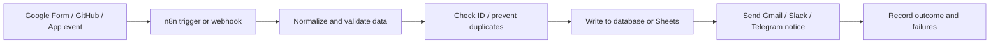

# Topic 9: Working with External Applications

> **Stage:** Stage 3 – Workflow Development  
> **Learning level:** Beginner → practical → professional  
> **Purpose:** Connect common business tools and design integrations that synchronize data across systems.

## Learning outcomes

By the end of this topic, you should be able to:

- Understand native app nodes versus generic API connections.
- Connect Google Sheets, Forms, Gmail, Telegram, Slack, Notion, GitHub, and databases conceptually.
- Choose between event triggers, polling, and webhooks.
- Configure credentials with least privilege.
- Map records and avoid duplicates.
- Design useful cross-application workflows.

## Detailed notes

### 9.1 Native integrations and generic APIs

A native n8n integration provides an interface for supported service operations and often simplifies authentication and field mapping. Not every app supports every trigger or action. When a suitable operation is missing, use HTTP Request with the provider's API documentation. A generic request requires you to understand the API contract, pagination, authentication, and errors.

### 9.2 Common application roles

- **Google Forms / form service:** captures input from people.
- **Google Sheets:** convenient lightweight record storage and reporting; not a substitute for a transactional database at all scales.
- **Gmail:** sends or processes email; handle attachments and personal data carefully.
- **Telegram / Slack:** notifications and conversational interfaces; protect bot tokens and restrict who can invoke privileged commands.
- **Notion:** stores pages and structured workspace content; respect workspace permissions.
- **GitHub:** issues, pull requests, commits, and repository events; use least-privilege tokens and avoid leaking source or secrets.
- **PostgreSQL or another database:** durable structured records; use constraints and transactions where needed.

### 9.3 Event, polling, and webhook integration

Some connectors listen for provider events through webhooks. Others periodically poll for new or changed records. Polling can add delay and consume API quota; webhooks need a publicly reachable endpoint and sender verification. Choose the method supported by the service and your deployment.

### 9.4 Data synchronization problems

A robust integration must consider:

- **Identity:** how do you know two records refer to the same customer or order? Use a stable ID, not just a display name.
- **Duplicates:** an event can arrive more than once. Make writes idempotent or deduplicate by event/resource ID.
- **Ordering:** events may arrive late or out of order. Use timestamps and version fields where available.
- **Partial failure:** Sheets may update while Gmail fails. Record the status so the workflow can resume safely.
- **Schema drift:** an upstream service may rename or add fields. Validate required fields and monitor changes.
- **Permissions:** grant only the required spreadsheet, mailbox, repository, or database permissions.

### 9.5 Example integration pattern

A new GitHub issue triggers a workflow. n8n normalizes title/body/repository/author, checks whether the issue ID already exists, sends a safe text-only summary to an LLM, validates category and priority, writes the issue to a database, and notifies the matching Slack channel. The original issue URL and identifier remain attached for traceability.

## How the pieces fit together

## Connection to AI engineering

AI can enrich records during integration—for example, classify a GitHub issue, extract invoice fields, or summarize a customer conversation. Keep raw source data and AI-enriched fields distinct. Preserve source IDs and links so a reviewer can verify the AI result.

## Guided practice

Design an issue-to-Slack workflow: choose the GitHub trigger, define the fields to preserve, create a deduplication key, choose an AI classification schema, map categories to Slack channels, and specify what happens if Slack is unavailable. Do not connect a bot to a real team workspace until its permissions and routing are reviewed.

## Best practices

- Name nodes and workflows after their purpose, not after the order in which you created them.
- Test normal, empty, malformed, duplicate, and failure inputs—not only the happy path.
- Keep credentials out of code, screenshots, exported examples, and public repositories.
- Make data contracts explicit: document what each step expects and returns.
- Add observability and recovery before treating a workflow as production-ready.

## Quick revision

- Understand native app nodes versus generic API connections.
- Connect Google Sheets, Forms, Gmail, Telegram, Slack, Notion, GitHub, and databases conceptually.
- Choose between event triggers, polling, and webhooks.
- Configure credentials with least privilege.
- Map records and avoid duplicates.
- Design useful cross-application workflows.

## Knowledge check

1. Explain the central idea of **Working with External Applications** in your own words.
2. Draw the workflow or architecture without looking at the notes.
3. Describe one failure case and how you would detect and recover from it.
4. Explain where Python, an API, a database, or an AI model would fit into this topic.

## Official and further reading

- [n8n Integrations library](https://n8n.io/integrations/).
- [n8n Docs: Webhook node](https://docs.n8n.io/integrations/builtin/core-nodes/n8n-nodes-base.webhook/).
- [n8n Docs: Credentials](https://docs.n8n.io/credentials/).

---

[Back to the master index](../README.md)
