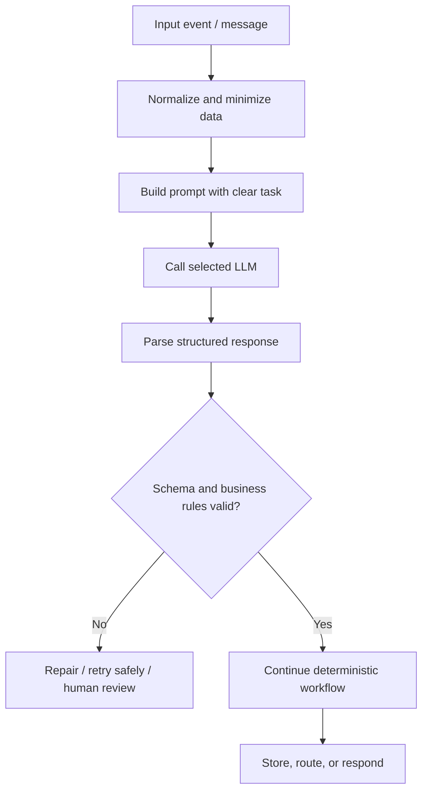

# Topic 10: Introduction to AI in n8n

> **Stage:** Stage 4 – AI Integration  
> **Learning level:** Beginner → practical → professional  
> **Purpose:** Understand where LLMs fit in workflows and how to connect them responsibly.

## Learning outcomes

By the end of this topic, you should be able to:

- Distinguish ordinary rule-based automation from AI-powered automation.
- Explain LLMs, tokens, prompts, context windows, and model providers.
- Connect a model to n8n using a supported node or API.
- Design system instructions and user prompts.
- Request and validate structured output.
- Account for hallucinations, privacy, latency, cost, and model limits.

## Detailed notes

### 10.1 What changes when AI is added?

Traditional automation is effective for deterministic operations: compare a value, format a date, or route an order by status. AI is useful when the input is unstructured or ambiguous: summarize a long email, classify free text, extract fields from a document, or draft a response. The best workflow combines deterministic logic with AI only where AI adds value.

### 10.2 Large Language Models

An **LLM** is a model trained to process and generate language. It receives tokenized input and produces a sequence of output tokens. It does not automatically know your private company data, guarantee factual accuracy, or understand your business rules unless those are provided through context and tools.

- **Token:** a unit of text processing; token counts influence context and cost.
- **Context window:** the amount of input/output context a model can handle in one request.
- **Provider/model:** the service and model family used to generate the response.
- **Temperature / sampling controls:** settings that can influence output variability. Lower variability does not guarantee correctness.
- **Prompt:** instructions and data provided to guide the model.

### 10.3 Prompt structure

A reliable prompt separates role/instructions, task, context, input data, output format, constraints, and examples if needed. Tell the model what to do when the information is missing. Do not put secrets or unnecessary personal data in prompts.

### 10.4 Structured output

When downstream nodes need predictable fields, request JSON or use a structured-output parser/schema where available. Then validate the output: required fields, data types, allowed category values, numeric ranges, and length constraints. A syntactically valid JSON response can still be factually wrong or semantically invalid.

### 10.5 Model connection in n8n

Use a supported provider integration or HTTP Request. Add credentials, select a model, map input text, configure relevant parameters, and inspect the result. Provider node names and options can evolve; use the current node documentation and provider API docs.

### 10.6 Risks and controls

- **Hallucination:** require source grounding, verification, or abstention when facts are uncertain.
- **Prompt injection:** treat user documents, webpages, and tool outputs as untrusted data; do not let them override system policies.
- **Privacy:** minimize data sent to the provider and review retention/processing policies.
- **Cost:** estimate token usage, limit context, and choose model capability proportional to the task.
- **Latency and availability:** add timeouts and failure paths.
- **Evaluation:** test against representative examples and edge cases before deployment.

## How the pieces fit together

## Connection to AI engineering

A strong AI workflow treats the model as a probabilistic component inside a deterministic system. n8n manages the process; the LLM handles language tasks. The workflow should validate the response before it triggers a database change, email, purchase, or external action.

## Guided practice

Design a complaint classifier. Define three allowed labels (`billing`, `technical`, `other`), an `urgency` field (`low`, `medium`, `high`), and a short reason. Draft a prompt that says not to invent missing facts. List five test complaints, including one ambiguous and one malicious instruction embedded in the complaint.

## Best practices

- Name nodes and workflows after their purpose, not after the order in which you created them.
- Test normal, empty, malformed, duplicate, and failure inputs—not only the happy path.
- Keep credentials out of code, screenshots, exported examples, and public repositories.
- Make data contracts explicit: document what each step expects and returns.
- Add observability and recovery before treating a workflow as production-ready.

## Quick revision

- Distinguish ordinary rule-based automation from AI-powered automation.
- Explain LLMs, tokens, prompts, context windows, and model providers.
- Connect a model to n8n using a supported node or API.
- Design system instructions and user prompts.
- Request and validate structured output.
- Account for hallucinations, privacy, latency, cost, and model limits.

## Knowledge check

1. Explain the central idea of **Introduction to AI in n8n** in your own words.
2. Draw the workflow or architecture without looking at the notes.
3. Describe one failure case and how you would detect and recover from it.
4. Explain where Python, an API, a database, or an AI model would fit into this topic.

## Official and further reading

- [n8n Docs: Integrate AI](https://docs.n8n.io/advanced-ai/).
- [n8n Docs: Understand AI components](https://docs.n8n.io/advanced-ai/understand-ai/).
- [OWASP: Top 10 for LLM Applications](https://owasp.org/www-project-top-10-for-large-language-model-applications/).

---

[Back to the master index](../README.md)
