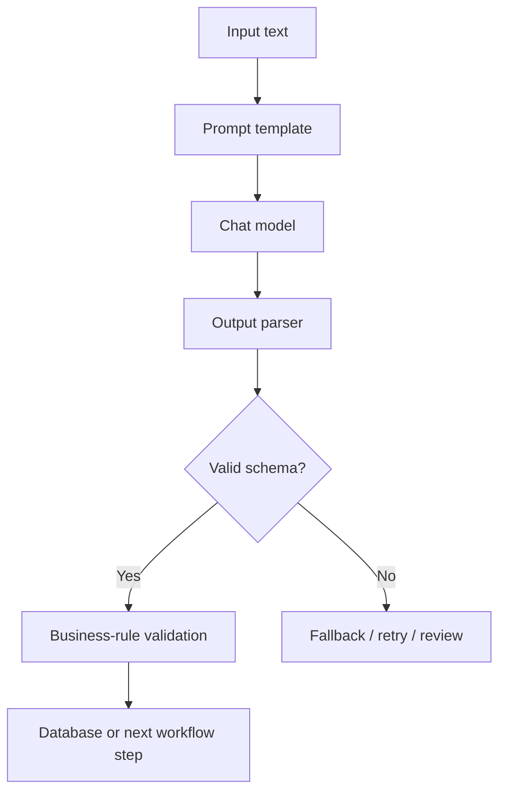

# Topic 11: AI Nodes and AI Chains

> **Stage:** Stage 4 – AI Integration  
> **Learning level:** Beginner → practical → professional  
> **Purpose:** Understand model, chain, prompt, parser, and orchestration components used to build repeatable AI tasks.

## Learning outcomes

By the end of this topic, you should be able to:

- Explain the roles of LLM, prompt template, chain, and output parser.
- Distinguish a fixed chain from an agent that chooses tools dynamically.
- Combine AI nodes with ordinary n8n nodes.
- Request and validate structured outputs.
- Design sequential AI processing and handle intermediate failures.

## Visual reference


*Image source: [Nuvi – Comparing no-code AI agent builders](https://www.nuvi.dev/blog/ai-agent-platforms-compared). Interface details can change between n8n versions.*

## Detailed notes

### 11.1 What is an AI chain?

A **chain** is a connected sequence of defined AI-related steps. The workflow designer determines the sequence. For example: prepare input → build prompt → call LLM → parse JSON → validate fields → continue. A chain is often easier to test and control than an agent when the process is known in advance.

### 11.2 Main components

- **Chat model / language model:** generates or interprets text.
- **Prompt template:** inserts dynamic input into reusable instructions.
- **Output parser:** converts model text into a required structure or checks a schema.
- **Chain:** connects model and processing components into a repeatable task.
- **Retriever / vector store:** provides relevant context for a RAG-style chain.
- **Normal n8n nodes:** handle triggers, conditions, APIs, databases, and notifications around the AI chain.

### 11.3 A sequential pipeline

Example document summarization:

1. Receive a document and extract text.
2. Check file type and length.
3. Split long text into sections if needed.
4. Summarize each section using a consistent prompt.
5. Combine the section summaries.
6. Ask for a final summary in a defined format.
7. Validate output and store it.

This sequence is predictable; a dynamic agent is not needed unless it must choose tools or plans based on the content.

### 11.4 Structured output

Define a schema before sending the output into business logic. For example:

```json
{
  "category": "billing",
  "priority": "high",
  "summary": "Duplicate charge reported",
  "needs_human_review": true
}
```

Validate required keys, enum values, and data types after parsing. If parsing fails, route to a safe fallback rather than assuming the text is valid.

### 11.5 Chains versus agents

Use a chain when the steps are known. Use an agent when it must select among tools or determine intermediate steps. Agents offer flexibility but introduce additional uncertainty, latency, cost, and security considerations.

### 11.6 Model versioning and reproducibility

Record which provider/model and prompt version were used when evaluating important workflows. Provider output can change across model versions even if the prompt remains the same. Keep test cases and compare output quality before changing models.

## How the pieces fit together



## Connection to AI engineering

Chains are ideal for repeatable AI tasks inside an n8n automation: extraction, summarization, classification, and rewriting. Put deterministic validation outside the model. For business-critical extraction, store the original source location or snippet so humans can verify each field.

## Guided practice

Create a chain design that extracts invoice number, invoice date, vendor, currency, and total. Define what should happen when the number is missing or the currency is ambiguous. Prepare at least ten sample invoices or synthetic examples and score exact field accuracy.

## Best practices

- Name nodes and workflows after their purpose, not after the order in which you created them.
- Test normal, empty, malformed, duplicate, and failure inputs—not only the happy path.
- Keep credentials out of code, screenshots, exported examples, and public repositories.
- Make data contracts explicit: document what each step expects and returns.
- Add observability and recovery before treating a workflow as production-ready.

## Quick revision

- Explain the roles of LLM, prompt template, chain, and output parser.
- Distinguish a fixed chain from an agent that chooses tools dynamically.
- Combine AI nodes with ordinary n8n nodes.
- Request and validate structured outputs.
- Design sequential AI processing and handle intermediate failures.

## Knowledge check

1. Explain the central idea of **AI Nodes and AI Chains** in your own words.
2. Draw the workflow or architecture without looking at the notes.
3. Describe one failure case and how you would detect and recover from it.
4. Explain where Python, an API, a database, or an AI model would fit into this topic.

## Official and further reading

- [n8n Docs: AI components](https://docs.n8n.io/advanced-ai/understand-ai/).
- [n8n Docs: AI examples](https://docs.n8n.io/advanced-ai/ai-examples/).
- [n8n Docs: Test and improve AI workflows](https://docs.n8n.io/advanced-ai/evaluations/).

---

[Back to the master index](../README.md)
