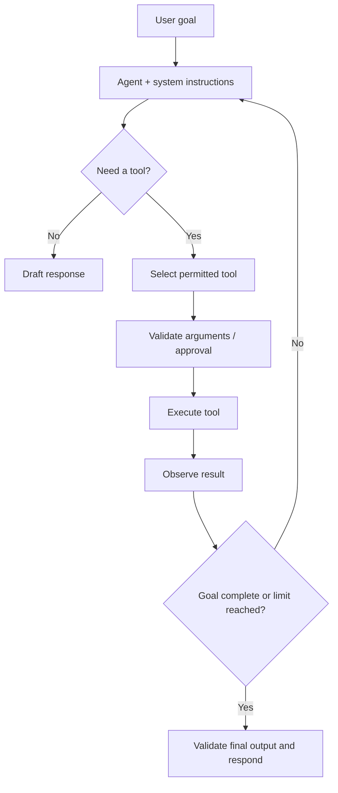

# Topic 12: AI Agents

> **Stage:** Stage 4 – AI Integration  
> **Learning level:** Beginner → practical → professional  
> **Purpose:** Understand how agents use models and tools to pursue a goal over multiple steps, and how to constrain them safely.

## Learning outcomes

By the end of this topic, you should be able to:

- Define an AI agent and distinguish it from a fixed chain.
- Understand the model, instructions, tools, memory, and execution loop.
- Connect approved tools and configure tool descriptions.
- Control tool permissions and side effects.
- Add human approval and stopping conditions.
- Evaluate tool choice, completion, and failure behavior.

## Visual reference

*Image source: [Nuvi – Comparing no-code AI agent builders](https://www.nuvi.dev/blog/ai-agent-platforms-compared). Interface details can change between n8n versions.*

## Detailed notes

### 12.1 What is an AI agent?

An **AI agent** is a system in which a model can decide what step to take next, often by selecting from a set of tools, observing their results, and continuing until it reaches a stopping condition. An agent is not automatically autonomous in a safe or reliable way. Its capabilities are determined by its tools, instructions, permissions, guardrails, and execution environment.

### 12.2 Agent architecture

- **Model:** interprets the task and decides the next action.
- **System instructions:** define the role, goals, boundaries, and output expectations.
- **Tools:** controlled operations the agent may request, such as search, calculator, database lookup, or calling a sub-workflow.
- **Memory/context:** information retained or retrieved during a conversation or task.
- **Observation:** results returned by tools.
- **Stop condition:** the agent finishes, reaches a limit, or hands off to a person.

### 12.3 Agent loop

1. Receive the user's goal and relevant context.
2. Model reasons about what information/action is needed.
3. Model requests a tool with arguments.
4. n8n/tool layer checks and executes the operation according to configured permissions.
5. Result is returned to the agent.
6. Agent decides whether to continue, use another tool, or finish.
7. Workflow validates the final response and records the outcome.

### 12.4 Tool design

A tool should have one clear purpose, a narrow input schema, a limited permission scope, and a predictable result. A vague tool called `do_anything` is dangerous. Prefer `look_up_order(order_id)` or `create_draft_reply(ticket_id, text)` with clearly defined behavior.

### 12.5 Safety boundaries

- Separate read-only tools from tools that change state.
- Require approval before sending external messages, issuing refunds, deleting records, or making purchases.
- Validate tool arguments; the model can produce malformed or unsafe parameters.
- Limit the number of tool calls and total execution time.
- Restrict data access to the current user or tenant.
- Treat tool output and retrieved text as untrusted content.
- Log tool name, argument summary, result status, and approval decision without exposing secrets.

### 12.6 When not to use an agent

If a fixed sequence or a simple IF/Switch rule solves the task, use that. Agents are helpful when the next action depends on context and tool choice. They are a poor fit for exact arithmetic, strict deterministic policies, or unrestricted high-impact operations.

## How the pieces fit together

## Connection to AI engineering

n8n can connect an AI Agent node to a chat model, memory, and tools. The workflow should remain the policy enforcement layer: authenticate the user, constrain tools, apply approvals, validate outputs, and record actions. Never rely only on the model's promise to behave safely.

## Guided practice

Design a read-only research agent that can search a small approved knowledge base and calculate simple totals. Define three tools, the exact parameters each accepts, the data each can access, and a maximum tool-call count. Add a separate approval-required tool for sending an email, but do not let the agent execute it without approval.

## Best practices

- Name nodes and workflows after their purpose, not after the order in which you created them.
- Test normal, empty, malformed, duplicate, and failure inputs—not only the happy path.
- Keep credentials out of code, screenshots, exported examples, and public repositories.
- Make data contracts explicit: document what each step expects and returns.
- Add observability and recovery before treating a workflow as production-ready.

## Quick revision

- Define an AI agent and distinguish it from a fixed chain.
- Understand the model, instructions, tools, memory, and execution loop.
- Connect approved tools and configure tool descriptions.
- Control tool permissions and side effects.
- Add human approval and stopping conditions.
- Evaluate tool choice, completion, and failure behavior.

## Knowledge check

1. Explain the central idea of **AI Agents** in your own words.
2. Draw the workflow or architecture without looking at the notes.
3. Describe one failure case and how you would detect and recover from it.
4. Explain where Python, an API, a database, or an AI model would fit into this topic.

## Official and further reading

- [n8n Docs: Build and manage agents](https://docs.n8n.io/advanced-ai/ai-agent/).
- [n8n Docs: AI tools](https://docs.n8n.io/advanced-ai/ai-tools/).
- [OWASP: LLM application risks](https://owasp.org/www-project-top-10-for-large-language-model-applications/).

---

[Back to the master index](../README.md)
