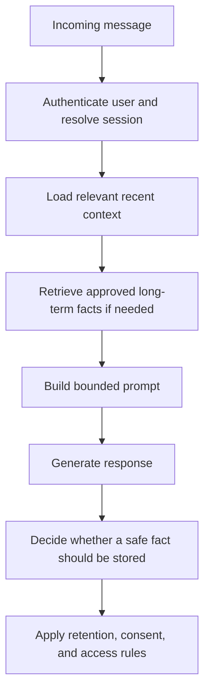

# Topic 13: Memory and Context Management

> **Stage:** Stage 4 – AI Integration  
> **Learning level:** Beginner → practical → professional  
> **Purpose:** Understand what an AI system remembers, how sessions are separated, and why memory must be controlled.

## Learning outcomes

By the end of this topic, you should be able to:

- Distinguish prompt context, conversation history, short-term memory, and long-term memory.
- Use session identifiers to isolate conversations.
- Understand persistence and retention.
- Avoid storing unnecessary or sensitive information.
- Manage context-window limits and stale or conflicting facts.
- Test memory retrieval and deletion behavior.

## Detailed notes

### 13.1 Context is not the same as memory

**Context** is information available to a model for the current request. It can include the current prompt, relevant conversation turns, retrieved documents, and tool results. **Memory** is information retained or retrieved across steps or sessions so it can influence a later interaction. A large prompt is not automatically good memory.

### 13.2 Types of memory

- **Short-term / conversational memory:** recent messages or task state used during a conversation.
- **Long-term memory:** selected facts or records persisted beyond one conversation.
- **External knowledge store:** documents and records retrieved when needed; this is often better for large knowledge bases than putting everything in the prompt.
- **Working state:** temporary workflow data such as the current order ID or approval status.

### 13.3 Session isolation

Use a stable session ID that uniquely identifies a conversation or user context. Do not use a shared constant for all users. If two students use the same memory key, one user's conversation may leak into the other's context. Derive session IDs from authenticated identities and enforce tenant boundaries in storage.

### 13.4 Context-window management

A model has a finite context window. Include only relevant information, summarize older turns when appropriate, retrieve facts on demand, and avoid sending large repeated documents with every call. Preserve dates and source references to distinguish old facts from current facts.

### 13.5 Memory quality and privacy

Memory can become stale, incorrect, or contradictory. Store a source, timestamp, confidence or verification status where appropriate. Let users correct or delete information where required by product policy and law. Avoid retaining secrets, credentials, or unnecessary sensitive personal information. Define retention and access controls before building long-term memory.

### 13.6 Practical memory design

For a student assistant, short-term memory may keep the current question and recent follow-up turns. Long-term storage could hold user-approved preferences such as preferred response format. Academic records should come from an authorized database with access checks—not from free-form model memory.

## How the pieces fit together

## Connection to AI engineering

In an n8n AI workflow, memory nodes or external stores can supply conversation context. Keep memory scoped per authenticated user/session and separate user statements from verified database facts. For RAG, retrieve documents rather than storing an entire private knowledge base as conversational memory.

## Guided practice

Design memory for a college helpdesk bot. List: (a) what stays only for the current chat, (b) what may be saved with user consent, (c) what must be fetched from an authoritative college system, and (d) what must never be stored. Describe how you would prevent session ID collision.

## Best practices

- Name nodes and workflows after their purpose, not after the order in which you created them.
- Test normal, empty, malformed, duplicate, and failure inputs—not only the happy path.
- Keep credentials out of code, screenshots, exported examples, and public repositories.
- Make data contracts explicit: document what each step expects and returns.
- Add observability and recovery before treating a workflow as production-ready.

## Quick revision

- Distinguish prompt context, conversation history, short-term memory, and long-term memory.
- Use session identifiers to isolate conversations.
- Understand persistence and retention.
- Avoid storing unnecessary or sensitive information.
- Manage context-window limits and stale or conflicting facts.
- Test memory retrieval and deletion behavior.

## Knowledge check

1. Explain the central idea of **Memory and Context Management** in your own words.
2. Draw the workflow or architecture without looking at the notes.
3. Describe one failure case and how you would detect and recover from it.
4. Explain where Python, an API, a database, or an AI model would fit into this topic.

## Official and further reading

- [n8n Docs: What is memory?](https://docs.n8n.io/advanced-ai/examples/understand-memory/).
- [n8n Docs: AI components](https://docs.n8n.io/advanced-ai/understand-ai/).
- [OWASP: LLM application risks](https://owasp.org/www-project-top-10-for-large-language-model-applications/).

---

[Back to the master index](../README.md)
