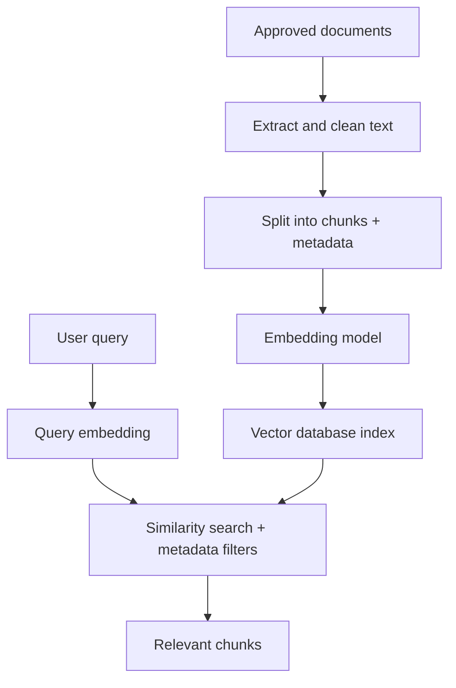

# Topic 14: Embeddings and Vector Databases

> **Stage:** Stage 4 – AI Integration  
> **Learning level:** Beginner → practical → professional  
> **Purpose:** Understand how semantic search represents text numerically and retrieves related information.

## Learning outcomes

By the end of this topic, you should be able to:

- Explain embeddings and vector representations.
- Understand similarity search at a conceptual level.
- Describe vector database records, metadata, and indexes.
- Compare keyword search with semantic search.
- Prepare chunks and metadata for retrieval.
- Choose a vector store based on requirements rather than popularity.

## Visual reference

*Image source: [Shift Asia – Vector Databases Explained](https://shiftasia.com/community/vector-databases-explained/).*

## Detailed notes

### 14.1 What is an embedding?

An **embedding** is a numerical vector produced by a model to represent content such as a sentence, paragraph, image, or other input. The vector captures patterns useful for measuring similarity. Texts with related meanings may be near each other in the embedding space, but embeddings do not guarantee that two passages are factually equivalent.

### 14.2 Similarity search

A user query is embedded using a compatible embedding model. The vector database searches for stored vectors that are close under a chosen similarity metric, such as cosine similarity, dot product, or Euclidean distance. The selected metric and normalization must match the embedding model and vector-store configuration.

### 14.3 Vector database record

A typical record contains:

- A unique ID.
- The embedding vector.
- The text chunk or a reference to it.
- Metadata such as document ID, title, page, department, date, access group, and source URL.

Metadata is critical: it allows filtering by permission, document type, date, or tenant before returning context.

### 14.4 Keyword search versus semantic search

Keyword search is useful for exact terms, IDs, names, and precise phrases. Semantic search can retrieve conceptually related text even when wording differs. A hybrid approach can combine both. Neither approach removes the need to inspect relevance and access permissions.

### 14.5 Indexing pipeline

1. Collect approved documents.
2. Extract text and metadata.
3. Clean text and split it into chunks.
4. Generate embeddings using a specific model.
5. Store vectors and metadata in a vector database.
6. At query time, embed the question and retrieve relevant chunks.

Changing embedding model or dimensions can require re-embedding and rebuilding the index. Keep model names, dimensions, chunking policy, and source versions with the index metadata.

### 14.6 Choosing a store

Evaluate filtering, update/delete behavior, metadata support, scale, latency, hosting, backups, security, integration support, and cost. Examples include managed vector services and vector extensions for relational databases. Choose based on deployment and operational needs, not just a tutorial's default choice.

## How the pieces fit together

## Connection to AI engineering

n8n can orchestrate document ingestion and query-time retrieval using embedding and vector-store components. Keep ingestion and retrieval as separate workflows when that makes lifecycle and permissions clearer. Apply authorization filters before returning chunks; semantic similarity is not an access-control mechanism.

## Guided practice

Take five short synthetic policy paragraphs. Write one factual and one paraphrased query for each. Design metadata fields (`doc_id`, `page`, `department`, `effective_date`, `access_group`). Explain which query should be exact keyword search and which benefits from semantic search.

## Best practices

- Name nodes and workflows after their purpose, not after the order in which you created them.
- Test normal, empty, malformed, duplicate, and failure inputs—not only the happy path.
- Keep credentials out of code, screenshots, exported examples, and public repositories.
- Make data contracts explicit: document what each step expects and returns.
- Add observability and recovery before treating a workflow as production-ready.

## Quick revision

- Explain embeddings and vector representations.
- Understand similarity search at a conceptual level.
- Describe vector database records, metadata, and indexes.
- Compare keyword search with semantic search.
- Prepare chunks and metadata for retrieval.
- Choose a vector store based on requirements rather than popularity.

## Knowledge check

1. Explain the central idea of **Embeddings and Vector Databases** in your own words.
2. Draw the workflow or architecture without looking at the notes.
3. Describe one failure case and how you would detect and recover from it.
4. Explain where Python, an API, a database, or an AI model would fit into this topic.

## Official and further reading

- [n8n Docs: What is a vector database?](https://docs.n8n.io/advanced-ai/examples/understand-vector-databases/).
- [n8n Docs: Vector store nodes](https://docs.n8n.io/integrations/builtin/cluster-nodes/root-nodes/n8n-nodes-langchain.vectorstore/).
- [Pinecone: Vector database overview](https://www.pinecone.io/learn/vector-database/).

---

[Back to the master index](../README.md)
