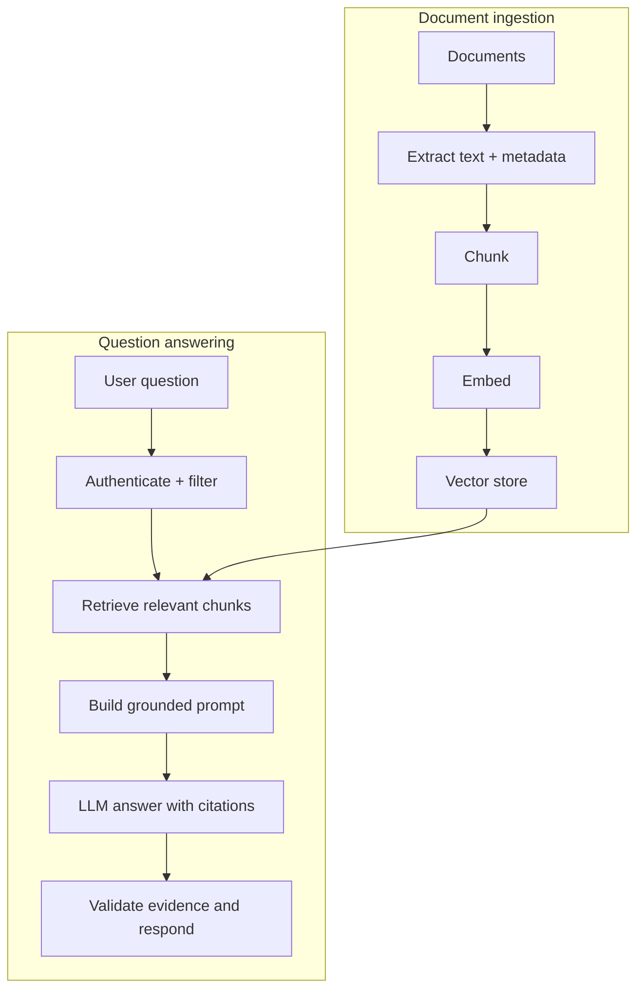

# Topic 15: Retrieval-Augmented Generation (RAG)

> **Stage:** Stage 4 – AI Integration  
> **Learning level:** Beginner → practical → professional  
> **Purpose:** Build grounded question-answering workflows that retrieve relevant external knowledge before generating a response.

## Learning outcomes

By the end of this topic, you should be able to:

- Explain why RAG is used and how it differs from model fine-tuning.
- Design ingestion and query pipelines.
- Understand loaders, text extraction, chunking, embeddings, vector stores, and retrievers.
- Use metadata filters and optional reranking.
- Construct grounded prompts and citations.
- Evaluate retrieval quality and answer faithfulness.

## Visual reference

*Image source: [Towards AI – RAG visual walkthrough](https://towardsai.net/p/artificial-intelligence/retrieval-augmented-generation-rag-a-comprehensive-visual-walkthrough). Used as a conceptual illustration; see the accompanying flowchart for the complete process.*

## Detailed notes

### 15.1 What is RAG?

**Retrieval-Augmented Generation** combines retrieval from an external knowledge source with a generative model. Instead of asking the LLM to answer only from its learned parameters, the system retrieves relevant passages and includes them as context for the answer. RAG can improve grounding and knowledge freshness, but it cannot guarantee truth or correct retrieval.

### 15.2 RAG has two pipelines

**A. Ingestion / indexing (usually run when documents change):**

1. Load approved files or content sources.
2. Extract text and preserve source metadata.
3. Clean and normalize the content.
4. Split into chunks using a tested chunking strategy.
5. Generate embeddings.
6. Store chunks, vectors, and metadata in the vector store.
7. Record source version and ingestion status.

**B. Query / retrieval (run for each question):**

1. Authenticate user and determine allowed knowledge scope.
2. Normalize the query and apply metadata/access filters.
3. Embed the query.
4. Retrieve top relevant chunks.
5. Optionally rerank or filter weak results.
6. Construct a prompt with the question, retrieved context, and citation metadata.
7. Generate an answer or abstain if evidence is insufficient.
8. Return citations and log evaluation metadata.

### 15.3 Chunking

Chunks must be large enough to preserve meaning but small enough for precise retrieval and context limits. Fixed-size chunking is simple; recursive/structure-aware splitting can preserve paragraphs, sections, or headings. Overlap can preserve boundary context but creates redundant vectors and storage. Tune chunk size and overlap using real queries, not arbitrary defaults.

### 15.4 Retrieval quality

A correct answer depends on retrieving the right passage. Consider top-k size, metadata filters, hybrid keyword/vector search, reranking, document freshness, and duplicate chunks. A retrieval result can be semantically similar but not answer the actual question.

### 15.5 Grounded generation and citations

Tell the model to answer only from supplied context, distinguish direct evidence from inference, state when the context does not answer the question, and cite source labels. The application must check that citations correspond to retrieved passages; the LLM should not invent page numbers or links.

### 15.6 RAG evaluation

Evaluate retrieval and generation separately:

- **Retrieval:** Did the correct source appear in top-k? Was the right page/section retrieved?
- **Answer:** Is the answer correct and supported by the context?
- **Faithfulness:** Does the answer avoid unsupported claims?
- **Coverage:** Does it answer all parts of the question?
- **Abstention:** Does it say “not found” when evidence is missing?
- **Security:** Can a user retrieve information outside their authorization scope?

### 15.7 RAG versus fine-tuning

RAG is suited to knowledge that changes or must be cited. Fine-tuning changes model behavior or style through training and is not a simple substitute for a searchable live knowledge base. They can be complementary, but solve different problems.

## How the pieces fit together

## Connection to AI engineering

A RAG system is a combination of data engineering, search, and generation. n8n can coordinate file ingestion, embeddings, vector-store operations, retrieval, LLM calls, and response delivery. The crucial engineering task is not merely connecting a vector database—it is measuring retrieval quality, enforcing document permissions, and grounding each answer.

## Guided practice

Use a small set of non-sensitive public policy documents. Create 10 questions where the answer exists and 5 where it does not. Track whether the correct source appears in the top 3 retrieved chunks, whether the answer is supported, and whether the system abstains when the answer is absent.

## Best practices

- Name nodes and workflows after their purpose, not after the order in which you created them.
- Test normal, empty, malformed, duplicate, and failure inputs—not only the happy path.
- Keep credentials out of code, screenshots, exported examples, and public repositories.
- Make data contracts explicit: document what each step expects and returns.
- Add observability and recovery before treating a workflow as production-ready.

## Quick revision

- Explain why RAG is used and how it differs from model fine-tuning.
- Design ingestion and query pipelines.
- Understand loaders, text extraction, chunking, embeddings, vector stores, and retrievers.
- Use metadata filters and optional reranking.
- Construct grounded prompts and citations.
- Evaluate retrieval quality and answer faithfulness.

## Knowledge check

1. Explain the central idea of **Retrieval-Augmented Generation (RAG)** in your own words.
2. Draw the workflow or architecture without looking at the notes.
3. Describe one failure case and how you would detect and recover from it.
4. Explain where Python, an API, a database, or an AI model would fit into this topic.

## Official and further reading

- [n8n Docs: Advanced AI](https://docs.n8n.io/advanced-ai/).
- [n8n Docs: Vector databases](https://docs.n8n.io/advanced-ai/examples/understand-vector-databases/).
- [Towards AI: RAG visual walkthrough](https://towardsai.net/p/artificial-intelligence/retrieval-augmented-generation-rag-a-comprehensive-visual-walkthrough).

---

[Back to the master index](../README.md)
