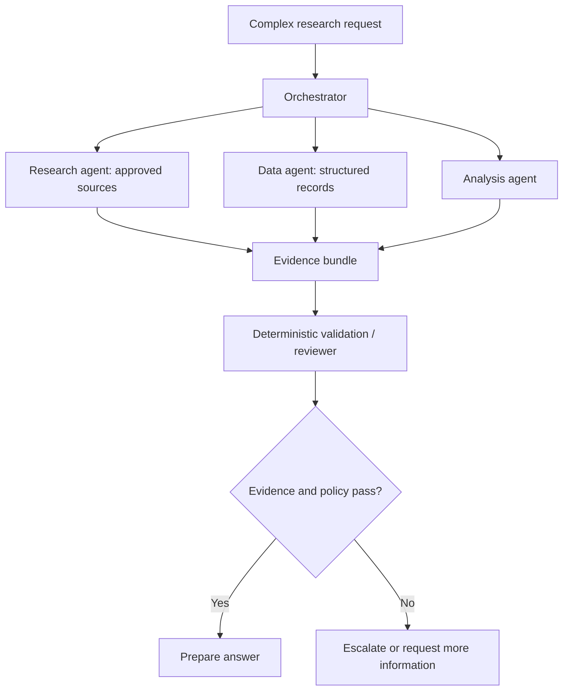

# Topic 16: Advanced AI Agent Systems

> **Stage:** Stage 4 – AI Integration  
> **Learning level:** Beginner → practical → professional  
> **Purpose:** Move beyond one agent by designing tool ecosystems, multi-agent patterns, MCP connections, evaluation, and governance.

## Learning outcomes

By the end of this topic, you should be able to:

- Explain multi-agent orchestration patterns and their trade-offs.
- Design orchestrator-worker and specialist-agent architectures.
- Understand MCP at a conceptual level and how it connects clients to tools/resources.
- Limit tool access and prevent untrusted content from controlling agents.
- Evaluate agent success, tool correctness, cost, and safety.
- Choose chains or agents based on task uncertainty.

## Detailed notes

### 16.1 Multi-agent systems

A multi-agent design divides a complex task among several agent roles. Examples include a planner, researcher, analyst, and reviewer. More agents do not automatically improve quality. They can increase latency, cost, coordination failures, and the number of opportunities for error.

### 16.2 Common coordination patterns

- **Orchestrator–worker:** a coordinator decomposes the task and assigns bounded subtasks to specialist workers.
- **Sequential specialists:** each agent receives the output of the previous specialist, such as research → analysis → review.
- **Parallel specialists:** independent agents examine separate sources or aspects, then a deterministic step combines the results.
- **Critic/reviewer:** a second pass checks a draft against a rubric or evidence. It is not a guarantee of correctness; independent tests and source checks are still required.

### 16.3 Model Context Protocol (MCP)

MCP is a protocol for connecting AI applications to external context and tools through a standardized client/server pattern. Conceptually, an MCP server can expose tools, resources, or prompts to a compatible client. In n8n, use the current documentation for the specific MCP client/server features and security configuration available in your release. Do not assume every MCP server is trustworthy.

### 16.4 Tool ecosystem

Design tools with clear names, narrow functions, validated schemas, least-privilege credentials, and bounded outputs. Separate read operations from write operations. Use a human confirmation step for actions with material consequences. Never let untrusted retrieved text redefine system instructions or tool permissions.

### 16.5 Evaluating agent systems

Measure:

- Task completion rate.
- Tool-selection accuracy.
- Argument validity.
- Evidence quality.
- Response correctness and completeness.
- Latency, token usage, and cost.
- Unsafe-action rate and approval compliance.
- Recovery behavior when a tool fails.

Build a fixed evaluation set and rerun it when changing prompts, tools, models, or n8n versions. Inspect failures rather than relying only on a single aggregate score.

### 16.6 When to keep one agent

Use one agent with a small set of tools when it can handle the task. Use multi-agent delegation only when responsibilities are genuinely separable and the coordination overhead is justified. For deterministic policy workflows, prefer ordinary control-flow nodes.

## How the pieces fit together

## Connection to AI engineering

n8n can connect agents to tools and other workflows, and current n8n documentation covers AI components and MCP-related capabilities. Treat each agent as an independent source of proposed actions—not as a trusted administrator. Enforce permission and approval rules outside the model.

## Guided practice

Design a research workflow with two specialists: one gathers evidence from an approved source list; the other compares evidence against a question. The orchestrator produces a summary only if every claim maps to a source. Define what happens when sources conflict or one agent fails. Include a maximum execution and cost budget.

## Best practices

- Name nodes and workflows after their purpose, not after the order in which you created them.
- Test normal, empty, malformed, duplicate, and failure inputs—not only the happy path.
- Keep credentials out of code, screenshots, exported examples, and public repositories.
- Make data contracts explicit: document what each step expects and returns.
- Add observability and recovery before treating a workflow as production-ready.

## Quick revision

- Explain multi-agent orchestration patterns and their trade-offs.
- Design orchestrator-worker and specialist-agent architectures.
- Understand MCP at a conceptual level and how it connects clients to tools/resources.
- Limit tool access and prevent untrusted content from controlling agents.
- Evaluate agent success, tool correctness, cost, and safety.
- Choose chains or agents based on task uncertainty.

## Knowledge check

1. Explain the central idea of **Advanced AI Agent Systems** in your own words.
2. Draw the workflow or architecture without looking at the notes.
3. Describe one failure case and how you would detect and recover from it.
4. Explain where Python, an API, a database, or an AI model would fit into this topic.

## Official and further reading

- [n8n Docs: Integrate AI and MCP](https://docs.n8n.io/advanced-ai/).
- [Model Context Protocol specification](https://modelcontextprotocol.io/specification).
- [OWASP: LLM Top 10](https://owasp.org/www-project-top-10-for-large-language-model-applications/).

---

[Back to the master index](../README.md)
