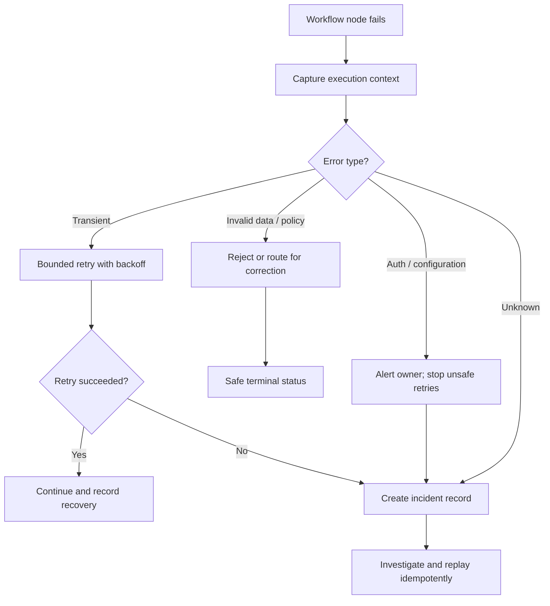

# Topic 17: Error Handling and Debugging

> **Stage:** Stage 5 – Professional Development  
> **Learning level:** Beginner → practical → professional  
> **Purpose:** Build workflows that fail visibly, recover safely, and provide enough evidence to diagnose issues.

## Learning outcomes

By the end of this topic, you should be able to:

- Distinguish validation errors, node errors, external service failures, and logic errors.
- Inspect execution inputs, outputs, and error messages.
- Use error workflows and alerts appropriately.
- Design retries, timeouts, idempotency, and recovery.
- Avoid duplicate side effects and data loss.
- Create actionable logs and operational runbooks.

## Detailed notes

### 17.1 Failure categories

- **Input/validation error:** required data is missing or has the wrong type.
- **Configuration/authentication error:** invalid credential, expired token, or wrong permission.
- **External dependency error:** API unavailable, timeout, rate limit, or server error.
- **Logic/data error:** wrong expression, unexpected item count, or incorrect merge.
- **Business-rule rejection:** the data is technically valid but not allowed by policy.

The first step in debugging is to find the earliest node whose actual input/output differs from the expected data contract.

### 17.2 Inspect executions

Open the failed execution and inspect the failed node, upstream inputs, parameters, output, and error details. Reproduce the issue using a small representative test payload. Avoid changing multiple things at once; isolate the cause and rerun the failing case.

### 17.3 Retry carefully

Retries help with transient failures, not permanent errors such as invalid input or authorization. Use bounded retries with delay/backoff. Respect provider rate-limit instructions. Do not repeatedly retry a non-idempotent side effect such as sending a payment request or creating a record without a deduplication or idempotency strategy.

### 17.4 Idempotency and recovery

Give each business event a stable unique ID. Before performing a create action, check whether the event was already processed or use an API-supported idempotency key. Store processing status, attempt count, last error, and correlation ID. For complex systems, use a failed-job queue or a manual replay process.

### 17.5 Error workflows and alerts

An Error Trigger workflow can centralize notifications and incident records for execution failures. Include workflow name, execution ID, node, time, and a sanitized error summary. Do not send API keys, full personal records, or secrets to a public alert channel.

### 17.6 Operational runbook

Document: how to identify failure, which logs to inspect, who owns the service, what can safely be retried, how to replay an event, how to avoid duplicates, and when to escalate. Test the recovery process before an incident.

## How the pieces fit together

## Connection to AI engineering

AI calls add failure modes such as malformed JSON, refusal, rate limits, tool errors, and low-confidence answers. Treat an LLM output as untrusted until validated. Record model/provider and prompt version where useful, and preserve a safe fallback path when the AI service is unavailable.

## Guided practice

For a workflow that creates a database record and then sends an email, test: database timeout, email timeout, duplicate webhook event, invalid email, and provider 429. For each, decide whether to retry, stop, notify, or replay. Design a deduplication key so the email is not sent twice after an ambiguous timeout.

## Best practices

- Name nodes and workflows after their purpose, not after the order in which you created them.
- Test normal, empty, malformed, duplicate, and failure inputs—not only the happy path.
- Keep credentials out of code, screenshots, exported examples, and public repositories.
- Make data contracts explicit: document what each step expects and returns.
- Add observability and recovery before treating a workflow as production-ready.

## Quick revision

- Distinguish validation errors, node errors, external service failures, and logic errors.
- Inspect execution inputs, outputs, and error messages.
- Use error workflows and alerts appropriately.
- Design retries, timeouts, idempotency, and recovery.
- Avoid duplicate side effects and data loss.
- Create actionable logs and operational runbooks.

## Knowledge check

1. Explain the central idea of **Error Handling and Debugging** in your own words.
2. Draw the workflow or architecture without looking at the notes.
3. Describe one failure case and how you would detect and recover from it.
4. Explain where Python, an API, a database, or an AI model would fit into this topic.

## Official and further reading

- [n8n Docs: Error handling](https://docs.n8n.io/flow-logic/error-handling/).
- [n8n Docs: Executions](https://docs.n8n.io/workflows/executions/).
- [AWS: Retry with backoff guidance](https://docs.aws.amazon.com/prescriptive-guidance/latest/cloud-design-patterns/retry-backoff.html).

---

[Back to the master index](../README.md)
