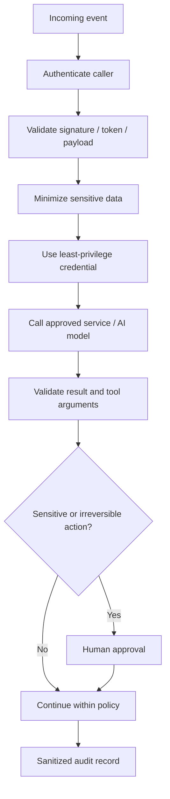

# Topic 18: Security and Credentials

> **Stage:** Stage 5 – Professional Development  
> **Learning level:** Beginner → practical → professional  
> **Purpose:** Protect connected accounts, user data, webhooks, AI prompts, and the n8n instance itself.

## Learning outcomes

By the end of this topic, you should be able to:

- Use least-privilege credentials and scoped API access.
- Store secrets in credentials or approved secret-management systems.
- Protect encryption keys, environment variables, and backups.
- Secure webhooks and editor access.
- Minimize and classify personal or confidential data.
- Apply prompt-injection and tool-abuse defenses to AI workflows.

## Detailed notes

### 18.1 Threat model first

List what the workflow can access, who can start it, which external services it can modify, what data it processes, and what would happen if a credential or webhook were abused. Security is a system property, not a single checkbox.

### 18.2 Credential hygiene

- Use a dedicated service account for automation rather than a personal administrator account where possible.
- Grant only the scopes and resources needed.
- Store API keys and OAuth credentials in n8n's credential system or an approved external secret manager.
- Rotate credentials and revoke unused tokens.
- Never commit secrets to Git, paste them into prompts, or include them in screenshots and logs.
- Protect the n8n encryption key and include it in a controlled backup/recovery plan.

### 18.3 Instance and network security

- Protect the editor with strong authentication and limit administrator accounts.
- Use HTTPS/TLS when traffic crosses an untrusted network.
- Put public webhooks behind the intended security controls; avoid exposing the editor unnecessarily.
- Keep n8n and the host patched.
- Restrict inbound/outbound network access where feasible.
- Review community nodes and imported workflow templates before installing or running them.

### 18.4 Webhook security

A webhook URL is not necessarily authentication. Use supported authentication, signature verification, shared secrets, IP allowlists where appropriate, and payload validation. Add replay protection or event-ID deduplication where the source supports it. Rate-limit public endpoints at the network or gateway layer where appropriate.

### 18.5 Data minimization and privacy

Only send the data required for the task. Mask or remove unnecessary personal identifiers before external AI processing. Set retention policies for execution data and logs. Apply access controls to databases, vector stores, and documents. Review provider data-processing terms and applicable legal/regulatory requirements for your use case.

### 18.6 AI-specific threats

Prompt injection can be embedded in a webpage, email, or PDF that an AI system reads. Treat retrieved text as untrusted content. Keep system instructions separate from retrieved material; do not let retrieved text change permissions. Validate tool arguments, restrict tools, require approval for risky writes, and test malicious inputs.

### 18.7 Secure workflow sharing

Exported workflows may expose internal URLs, node names, data samples, or accidentally hard-coded secrets. Remove sensitive execution data, review all expressions and credential references, and share only what is necessary.

## How the pieces fit together

## Connection to AI engineering

AI workflows create a new security boundary because untrusted text can influence model decisions. Never treat an LLM as an access-control system. Enforce authorization in n8n and the target API, filter retrieval by user permissions, constrain tools, and make approvals explicit.

## Guided practice

Threat-model the AI email assistant. Identify assets (mailbox, tokens, customer messages), entry points (email trigger, webhook), trust boundaries (LLM provider, tools), and abuse cases (prompt injection, token leakage, sending to a wrong recipient). For each risk, propose a prevention and a detection control.

## Best practices

- Name nodes and workflows after their purpose, not after the order in which you created them.
- Test normal, empty, malformed, duplicate, and failure inputs—not only the happy path.
- Keep credentials out of code, screenshots, exported examples, and public repositories.
- Make data contracts explicit: document what each step expects and returns.
- Add observability and recovery before treating a workflow as production-ready.

## Quick revision

- Use least-privilege credentials and scoped API access.
- Store secrets in credentials or approved secret-management systems.
- Protect encryption keys, environment variables, and backups.
- Secure webhooks and editor access.
- Minimize and classify personal or confidential data.
- Apply prompt-injection and tool-abuse defenses to AI workflows.

## Knowledge check

1. Explain the central idea of **Security and Credentials** in your own words.
2. Draw the workflow or architecture without looking at the notes.
3. Describe one failure case and how you would detect and recover from it.
4. Explain where Python, an API, a database, or an AI model would fit into this topic.

## Official and further reading

- [n8n Docs: Security](https://docs.n8n.io/hosting/securing/).
- [n8n Docs: Credentials](https://docs.n8n.io/credentials/).
- [OWASP: Top 10 for LLM Applications](https://owasp.org/www-project-top-10-for-large-language-model-applications/).

---

[Back to the master index](../README.md)
