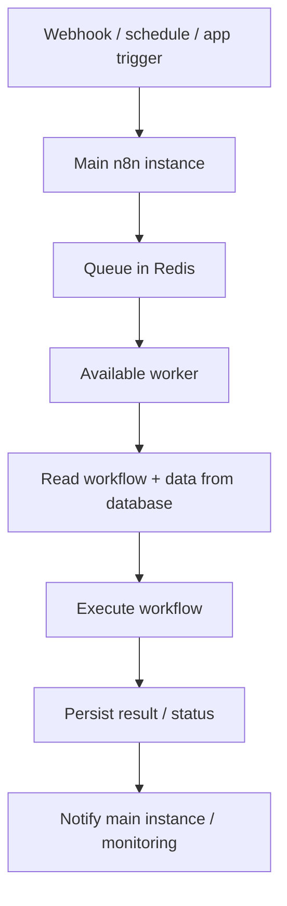

# Topic 19: Deployment and Production

> **Stage:** Stage 5 – Professional Development  
> **Learning level:** Beginner → practical → professional  
> **Purpose:** Prepare n8n workflows for reliable operation, controlled updates, backups, observability, and growth.

## Learning outcomes

By the end of this topic, you should be able to:

- Compare Cloud, single-instance self-hosting, and scaled deployments.
- Understand Docker Compose, databases, reverse proxies, and TLS.
- Explain queue mode, Redis, workers, and execution distribution.
- Plan backups, recovery, upgrades, and version control.
- Monitor reliability, capacity, and API dependencies.
- Create a production-readiness checklist.

## Visual reference

*Image source: [n8n documentation – Queue mode](https://docs.n8n.io/deploy/host-n8n/configure-n8n/scaling/enable-queue-mode/).*

## Detailed notes

### 19.1 Development is not production

A local workflow can work for one test run but still fail in production due to sleeping laptops, missing public webhook access, expired credentials, higher volume, rate limits, lack of backups, or an untested error path. Production deployment includes operations, not merely starting the application.

### 19.2 Deployment choices

- **n8n Cloud:** managed environment; review plan, availability, limits, and data handling.
- **Single self-hosted instance:** appropriate for some small deployments when backed up and maintained.
- **Scaled self-hosted deployment:** may use a main instance, workers, Redis, a supported database, and webhook processors depending on architecture and version. This requires operational expertise.

### 19.3 Containers and reverse proxy

Docker Compose can define n8n, a database, Redis, volumes, and networks. A reverse proxy can terminate TLS and route traffic. Public webhook URLs must be configured correctly, and the editor should not be exposed more broadly than necessary. Pin versions and deploy through a repeatable process.

### 19.4 Queue mode and workers

In queue mode, the main n8n instance handles workflow triggers and places execution work into a queue. Redis coordinates queued jobs and workers perform workflow executions. Workers can be added to increase execution capacity. Queue mode is not a magic speed switch: database performance, CPU, memory, external APIs, concurrency, binary data, and workflow design remain bottlenecks.

### 19.5 Database and persistence

Use a supported database setup appropriate to scale and reliability requirements. Persistent storage is required for state. Plan backups for the database and necessary configuration/key material. Test restores; a backup that cannot be restored is not a recovery plan.

### 19.6 Monitoring and operations

Monitor success/failure rates, execution duration, queue depth, CPU/memory, database connections, API error rates, rate-limit responses, credential expirations, and storage. Create alerts that identify an owner and an action. Avoid logging sensitive payloads unnecessarily.

### 19.7 Updates and change management

- Pin a version in production and read release notes before upgrading.
- Back up before an upgrade and test in a staging environment.
- Export or version-control workflows without committing secrets or personal execution data.
- Keep prompts, model identifiers, and schemas versioned where possible.
- Maintain a rollback and recovery plan.
- Test critical workflows after upgrades with representative payloads.

### 19.8 Production-readiness checklist

A workflow is ready only when ownership, inputs, outputs, credentials, permissions, failure behavior, retry/idempotency, monitoring, backup/recovery, data retention, and support procedures are documented and tested.

## How the pieces fit together

## Connection to AI engineering

Production AI automation needs capacity and cost controls in addition to ordinary workflow operations. Track model latency and token usage, apply per-user quotas, limit agent tool calls, cache stable retrieval where appropriate, and test quality after model or prompt updates. Keep a human fallback for high-impact failures.

## Guided practice

Write a deployment plan for a workflow that receives a public webhook and calls an LLM. Include hosting choice, URL/TLS, credential storage, request authentication, database and backup, rate limiting, retries, monitoring, retention, upgrade plan, and recovery owner. For a scaled deployment, explain the role of main instance, Redis, and workers.

## Best practices

- Name nodes and workflows after their purpose, not after the order in which you created them.
- Test normal, empty, malformed, duplicate, and failure inputs—not only the happy path.
- Keep credentials out of code, screenshots, exported examples, and public repositories.
- Make data contracts explicit: document what each step expects and returns.
- Add observability and recovery before treating a workflow as production-ready.

## Quick revision

- Compare Cloud, single-instance self-hosting, and scaled deployments.
- Understand Docker Compose, databases, reverse proxies, and TLS.
- Explain queue mode, Redis, workers, and execution distribution.
- Plan backups, recovery, upgrades, and version control.
- Monitor reliability, capacity, and API dependencies.
- Create a production-readiness checklist.

## Knowledge check

1. Explain the central idea of **Deployment and Production** in your own words.
2. Draw the workflow or architecture without looking at the notes.
3. Describe one failure case and how you would detect and recover from it.
4. Explain where Python, an API, a database, or an AI model would fit into this topic.

## Official and further reading

- [n8n Docs: Hosting](https://docs.n8n.io/hosting/).
- [n8n Docs: Queue mode](https://docs.n8n.io/hosting/scaling/queue-mode/).
- [n8n Docs: Docker Compose](https://docs.n8n.io/deploy/host-n8n/install-options/).
- [n8n Hosting examples](https://github.com/n8n-io/n8n-hosting).

---

[Back to the master index](../README.md)
